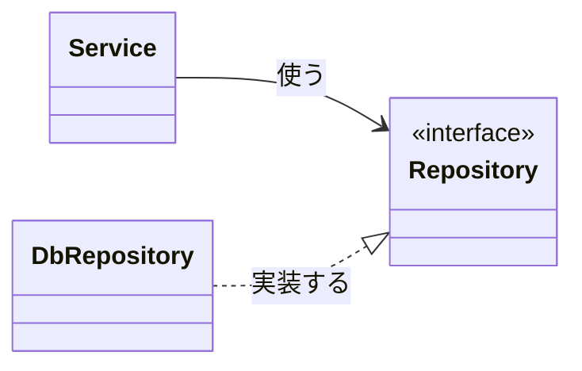
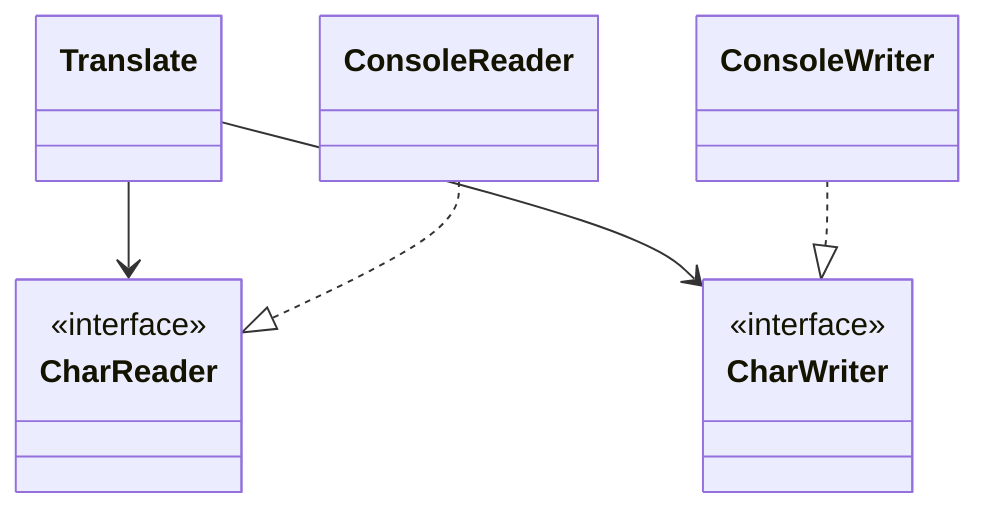
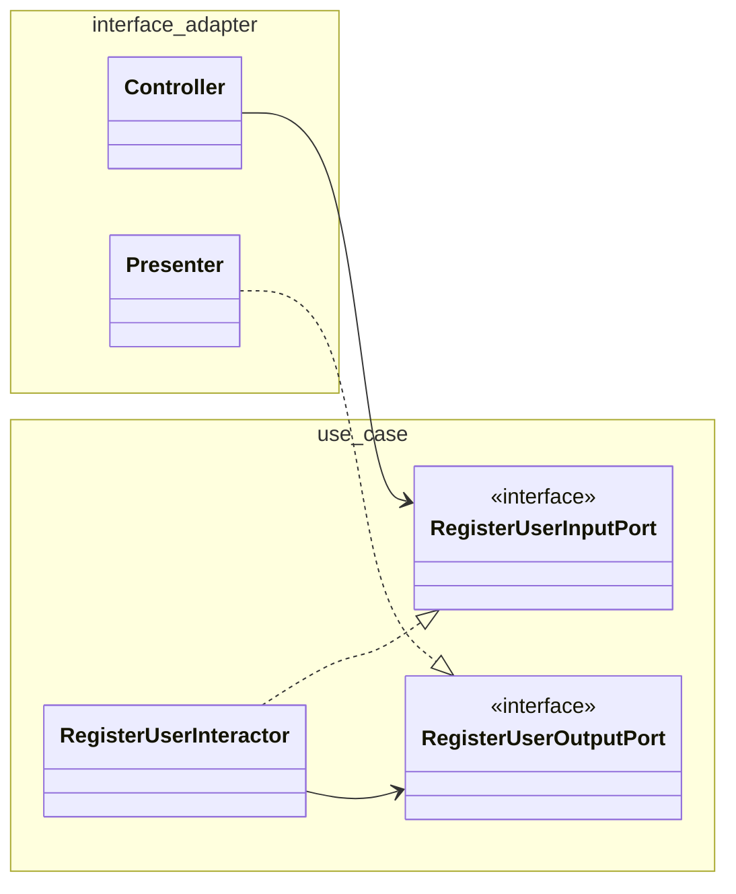

Clean Architectureの主張は1つに還元できる。
**ソースコードの依存関係は、方針 (policy) に向け、詳細 (detail) から遠ざける。**

方針とは業務ルール、詳細とはUI、DB、framework、通信方式のこと。
詳細は変わるが、業務ルールは変わりにくい。
変わりにくいものに依存を集めれば、変わるものを差し替えても業務ルールは影響を受けない。

本の大半は、この1文を実現するための道具の説明。
[Clean Code](/posts/clean-code/) が関数とクラスの単位を扱うのに対し、こちらはコンポーネントとその境界の単位を扱う。

以下、章立てに沿って要点を整理する。
例はJavaとKotlin。

## 設計とアーキテクチャ

### 違いはない

設計 (低レベルの決定) とアーキテクチャ (高レベルの構造) に境目はない。
両者は連続していて、一方だけでは意味をなさない。

アーキテクチャの目的は、**求められるシステムを構築し、保守するのに必要な人材を最小限に抑えること**。
品質の尺度は、変更に必要な労力。

### 2つの価値

ソフトウェアには2つの価値がある。

- 振る舞い: 要件通りに動くこと
- 構造: 変更しやすいこと

「ソフト」ウェアの名前の通り、本来の価値は後者。
動くが変更できないシステムは、要件が変わった瞬間に価値を失う。
変更できるシステムは、動かなくても直せる。

振る舞いは緊急だが、構造は重要。
緊急だが重要でないものを、緊急で重要なものと混同して優先するのが、アーキテクチャが崩れる典型的な経路 (Eisenhowerのマトリクス)。
構造を守るのは開発者の責務で、経営側と対等に交渉すべきもの。

## 3つのパラダイム

3つのパラダイムはいずれも、プログラマに**できることを増やすのではなく、何かを禁じる**ものとして整理される。

| パラダイム           | 禁じたもの                       | 得たもの                   |
| -------------------- | -------------------------------- | -------------------------- |
| 構造化プログラミング | `goto` (直接的な制御の移行)      | 分割統治、テスト可能な単位 |
| オブジェクト指向     | 関数pointer (間接的な制御の移行) | 多態による依存関係の逆転   |
| 関数型               | 代入                             | 不変性、競合状態の排除     |

### 構造化プログラミング

`goto` を禁じると、プログラムは順次、分岐、反復だけで書ける。
モジュールを再帰的に分割して、小さい証明可能な単位にできる。

ただし証明は実現せず、代わりに科学的方法、すなわちテストが残った。
テストはバグの存在は示せるが、不在は示せない。
テスト可能な単位にモジュールを分割することが、構造化プログラミングから今も残る価値。

### オブジェクト指向

カプセル化、継承はCでもできた。
OOがアーキテクチャに持ち込んだのは、**多態を安全に使えるようにしたこと**。

多態があると、呼び出し側のソースコードは呼ばれる側を知らずに済む。
制御の流れは `main` → `Service` → `Repository` でも、ソースコードの依存は `Repository` のインターフェースを `Service` 側が持てば `Repository` の実装 → `Service` に向く。
制御の流れと逆向きにソースコードの依存を向けられる (依存関係の逆転)。



制御は `Service` → `DbRepository` に流れるが、ソースコードの依存は `DbRepository` → `Repository` → `Service` 側に向く。
`Repository` のインターフェースを `Service` と同じ側に置くのがポイント。

これにより、業務ルールがDBやUIから独立してコンパイル、deployできる。
DBやUIは業務ルールのpluginになる。

### 関数型

変数が不変なら、競合状態、deadlock、並行更新の問題は起きない。
アーキテクチャとしての帰結は、**可変なコンポーネントと不変なコンポーネントを分け、可変な方をできるだけ小さくする**こと。

極端な形がevent sourcing。
状態を保存せず、状態を変えるeventだけを追記する。
現在の状態は、eventを全て適用して得る。
削除も更新もないので、CRUDのうちCRだけになる。

## SOLID原則

モジュール (クラス、あるいは関数とデータの集まり) の単位で、変更に強く、理解しやすく、再利用しやすい構造にするための原則。

### 単一責任の原則 (SRP)

「モジュールは1つのことをする」と誤解されるが、そちらは関数の話。
SRPは、**モジュールはたった1人のアクターに対して責務を負う**。
アクターとは、変更を要求してくる人や部門のこと。

```java
// 3人のアクターに対して責務を負っている
public class Employee {
    public Money calculatePay();   // 経理部門が変更を要求する
    public String reportHours();   // 人事部門が変更を要求する
    public void save();            // DBAが変更を要求する
}
```

`calculatePay` と `reportHours` が労働時間の計算を共有していると、経理の都合で変えたlogicが人事のレポートを狂わせる。
また、別々のアクターの変更が同じファイルで衝突し、mergeで壊れる。

対処は、アクターごとにクラスを分けること。
データだけを `EmployeeData` に残し、`PayCalculator`, `HourReporter`, `EmployeeSaver` に分ける。
クラスが増えて使いにくいなら、`EmployeeFacade` で束ねる。

### オープン・クローズドの原則 (OCP)

**ソフトウェアは、拡張に対して開き、修正に対して閉じている**べき。
機能を追加するときに、既存のコードを書き換えずに済む構造。

実現方法は、コンポーネントを階層に分け、**保護したい方に向けて依存を向ける**。
財務レポートをwebと紙の両方に出す例なら、金額を計算する `Interactor` が最上位で、`Controller`, `Presenter`, `View` はそれに依存する。
紙の出力形式が変わっても `Interactor` は影響を受けない。
逆に `Interactor` の変更は全てに波及するが、それは `Interactor` が最も重要で、最も変わりにくいから。

依存の向きを制御するのがDIP、不要な依存を断つのがISP。
OCPはこの2つを使って達成する。

### リスコフの置換原則 (LSP)

**派生型は、基底型と置き換えられなければならない。**

典型例は正方形と長方形。
`Square extends Rectangle` にすると、`setWidth` と `setHeight` を独立に呼ぶ利用者の期待を破る。

アーキテクチャの単位でも同じ。
複数のタクシー配車業者のREST APIを統一的に扱うとき、1社だけURLの形式が違えば、呼び出し側に業者ごとの `if` が散る。
置換できないものを同じ抽象で扱おうとすると、特殊扱いの分岐が至るところに漏れる。

### インターフェース分離の原則 (ISP)

**使っていないものに依存しない。**

`User1` が `op1` だけ使う `OPS` クラスの `op2` を変えると、`User1` も再コンパイル、再deployが要る。
`U1Ops` のような利用者ごとのインターフェースを切れば防げる。

アーキテクチャの単位では、使う機能が一部でも、frameworkに依存すればframeworkが依存するDBにも依存することになる。
不要なものを運んでいるモジュールに依存すると、予期しない変更に巻き込まれる。

### 依存関係逆転の原則 (DIP)

**抽象に依存し、具象に依存しない。**

`String` のような安定した具象クラスへの依存は無視してよい。
問題は、開発中で頻繁に変わる具象クラス。

- 変わりやすい具象クラスを参照しない。生成はabstract factoryに任せる
- 変わりやすい具象クラスから派生しない
- 具象関数をoverrideしない。具象関数は依存を持ち込むので、abstractにして実装側で分ける

```kotlin
// Application は ServiceFactory と Service (抽象) だけを知る
interface Service
interface ServiceFactory { fun makeService(): Service }

class Application(private val factory: ServiceFactory) {
    fun run() { val service = factory.makeService() }
}

// 具象は境界の反対側。依存は Impl → interface に向く
class ServiceImpl : Service
class ServiceFactoryImpl : ServiceFactory {
    override fun makeService(): Service = ServiceImpl()
}
```

制御の流れは `Application` → `ServiceFactoryImpl` → `ServiceImpl` だが、ソースコードの依存は全て抽象側に向いている。
抽象と具象の間に引いた線がアーキテクチャの境界で、依存はこの境界を常に抽象側へ越える。

## コンポーネントの原則

コンポーネントはdeployの単位。
jar, gem, DLL、あるいはサービス。
SOLIDがクラスの組み立て方なら、こちらはコンポーネントの組み立て方。

### 凝集性

どのクラスをどのコンポーネントにまとめるかの3原則。

- **再利用・リリース等価の原則 (REP)**: 再利用の単位とリリースの単位は等しい。versionを付けて追跡できるものだけが再利用できる
- **閉鎖性共通の原則 (CCP)**: 同じ理由、同じタイミングで変わるクラスは1つにまとめる。SRPのコンポーネント版。変更が1つのコンポーネントで閉じれば、再deployも1つで済む
- **全再利用の原則 (CRP)**: 利用者に、使わないクラスへの依存を強いない。ISPのコンポーネント版

3つは互いに引っ張り合う。

- REPとCCPを取ると、不要なリリースが増える (CRPを捨てた)
- REPとCRPを取ると、1つの変更が多くのコンポーネントに波及する (CCPを捨てた)
- CCPとCRPを取ると、再利用が難しい (REPを捨てた)


プロジェクト初期はCCP寄り (開発しやすさ優先)、成熟するとREPとCRP寄り (再利用優先) に動くのが普通。

### 結合

コンポーネント間の依存の3原則。

#### 非循環依存関係の原則 (ADP)

**コンポーネントの依存グラフに循環があってはならない。**

循環があると、誰かの変更で自分のビルドが通らなくなる「朝の症候群」が起きる。
循環に含まれるコンポーネントは事実上1つの巨大コンポーネントになり、独立してリリース、テストできない。

循環を断つ方法は2つ。

- DIPでインターフェースを導入し、依存の向きを逆にする
- 両方が依存する新しいコンポーネントを作り、共有部分をそこに移す

コンポーネント構造はトップダウンで設計できない。
クラスが増えて依存が見えてから、循環を断ち、変更の波及を絞るために整理していく。

#### 安定依存の原則 (SDP)

**安定している方向に依存する。**

安定とは、変更しにくいこと。
多くのコンポーネントから依存されているコンポーネントは、変えると波及が大きいので安定している (責任がある)。
何にも依存されていないコンポーネントは、気軽に変えられるので不安定。

安定度は数値にできる。

- Fan-in: このコンポーネントに依存するクラスの数
- Fan-out: このコンポーネントが依存するクラスの数
- 不安定度 I = Fan-out / (Fan-in + Fan-out)。0が最も安定、1が最も不安定

変わりやすいはずのコンポーネントに、安定したコンポーネントが依存していたら違反。
インターフェースを間に挟んで、依存の向きを変える。

#### 安定抽象の原則 (SAP)

**コンポーネントは、安定している度合いと同じだけ抽象的であるべき。**

安定したコンポーネントは変えにくい。
変えにくいのに具象だと拡張もできない。
抽象 (インターフェース、abstract class) なら、変えずに拡張できる。

抽象度も数値にできる。

- 抽象度 A = 抽象クラス数 / 全クラス数

AとIを軸にすると、望ましいのは A + I = 1 の直線上 (主系列)。
主系列から外れた2つの領域には名前がある。

- **苦痛ゾーン** (A=0, I=0): 具象で安定。変えにくいのに拡張もできない。DBschema、具象utilityがここに落ちる。`String` のように本当に変わらないなら問題ない
- **無駄ゾーン** (A=1, I=1): 抽象なのに誰も依存していない。使われないインターフェース

主系列からの距離 D = |A + I - 1| を計測すれば、設計の劣化を追跡できる。


## アーキテクチャ

### アーキテクチャとは

システムの形状。
コンポーネントへの分割、配置、通信の方法。

目的は動作ではなく、**開発、deploy、運用、保守を容易にすること**。
そのための戦略は、**選択肢をできるだけ長く残す**こと。

ソフトウェアは方針と詳細に分けられる。
方針は業務ルール。
詳細は、方針と通信する人間やシステムが使う手段で、I/O device、DB、web、serverー、framework、通信protocol。
**良いアーキテクトは、詳細についての決定を遅らせられる構造を作る。**

UNIXがI/O deviceをファイルとして抽象化したことで、プログラムをdevice非依存に書けるようになった。
punch cardから磁気テープに切り替えるときにプログラムを書き換えずに済んだのは、この分離の価値。

### 独立性

アーキテクチャが支えるべき4つ。

- **use case**: システムの意図が構造から見える
- **運用**: 要求されるthroughputに応じて、プロセス、thread、サービスに分割できる
- **開発**: チームが独立して作業できる (Conwayの法則)
- **deploy**: ビルド後すぐにdeployできる

分離の軸は2つ。

- **レイヤー**: UI、アプリケーション固有の業務ルール、アプリケーション非依存の業務ルール、DB
- **use case**: 注文を追加する、注文を削除する、は別の縦割り

両方で分離すれば、新しいuse caseの追加が既存に影響しない。

分離の方法には段階がある。

1. ソースレベル: モジュールの境界。同じプロセス、同じアドレス空間で関数呼び出し
1. deployレベル: jar、DLLの境界。同じプロセス内でも、deployは独立
1. サービスレベル: プロセス、ネットワークの境界

最初からサービスレベルにしないこと。
境界の引き方が間違っていれば、サービスにしたことで修正が高価になる。
**ソースレベルで境界を引き、必要になったらdeployレベル、サービスレベルに上げる**のが現実的な順序。

### 境界線を引く

境界とは、片側がもう片側の存在を知らずに済む線。
境界を引くのは、人的資源の消費を減らすため。
早すぎる決定 (framework、DB、web server) への結合が、後からの変更のコストを上げる。

DBは業務ルールの付属物で、業務ルールはDBを知らない。
GUIも同様。
どちらも業務ルールのplugin。

pluginアーキテクチャにすると、plugin側の変更は業務ルールに届かない。
境界を越える依存は、常にplugin → 業務ルールの向き。

<Hint level="info">
**FitNesseの例**

wiki pageの保存先をDBにすると決めてから、実装を後回しにしてin-memoryで進めた。
3か月後にflat fileで十分と分かり、DBは不要になった。
決定を遅らせたことで、DBの実装、設定、保守の労力を払わずに済んだ。

</Hint>

### 境界の解剖学

境界を越えるとは、片側の関数がもう片側の関数を呼ぶこと。
境界の形はいろいろあるが、どの形でも依存の向きを管理する点は同じ。

- **モノリス**: ソースレベルの境界。関数呼び出しで越える。最も安価で、最も見落とされやすい
- **deployコンポーネント**: jar、DLL。dynamic linkで越える
- **ローカルプロセス**: socket、shared memoryで越える。上位のプロセスが下位の名前を知らないように、依存は上位に向ける
- **サービス**: ネットワークで越える。最も高価。通信には時間がかかるので、頻繁な通信を避ける設計が要る

### 方針とレベル

レベルは、**入力と出力からの距離**。
入出力を扱う方針は最も低く、入出力から遠い方針は最も高い。

```
入力 → 文字を読む → 文字を変換 (暗号化) → 文字を書く → 出力
```

この中で最上位は変換。
読む、書くは詳細で、変換が読む、書くのインターフェースを持ち、具象がそれを実装する。



データは `ConsoleReader` → `Translate` → `ConsoleWriter` と流れるが、依存は全て `Translate` に向く。
高レベルの方針は低レベルの詳細から独立し、変更の頻度が低く、影響が大きい。

### 業務ルール

業務ルールは2段に分かれる。

- **最重要業務ルール** (critical business rule): コンピュータがなくても存在するルール。利息の計算、貸出期間
- **最重要業務データ**: ルールと共にあるデータ。利率、残高

この2つをまとめたオブジェクトが**entity**。
entityはDBも、UIも、frameworkも知らない。

```kotlin
class Loan(val principal: Money, val rate: Rate, val period: Period) {
    fun makePayment(amount: Money): Loan
    fun applyInterest(): Loan
    fun chargeLateFee(): Loan
}
```

その上にある、アプリケーション固有の業務ルールが**use case**。
「新規顧客を登録する」のように、入力、出力、entityをどう動かすかを記述する。
use caseはUIを知らない。webでもCLIでも同じuse case。

use caseは入出力を単純なデータ構造 (request / response model) で受け渡す。
entityを直接渡さない。
entityとrequest modelはよく似ていて同じにしたくなるが、変更理由が違う (entityは業務、request modelはアプリケーション)。
同じにすると、片方の変更が他方に漏れる。

### 叫ぶアーキテクチャ

建築の図面を見れば、住宅か図書館かが分かる。
ソフトウェアのディレクトリを見て、**「Railsのアプリ」ではなく「医療システム」「会計システム」が見える**べき。

frameworkは道具で、アーキテクチャではない。
webは配信の手段で、アーキテクチャではない。
use caseが最上位にあれば、frameworkやwebを決める前にuse caseをテストできる。

### クリーンアーキテクチャ

hexagonal、onion、DCI、BCEなど、既存のアーキテクチャはどれも同じ目標をもつ。
関心事の分離で、レイヤーに分けた上で、少なくとも業務ルールの層と、UIやシステムinterfaceの層を分ける。

結果として得られる性質。

- frameworkから独立
- テスト可能: UI、DB、web serverなしで業務ルールをテストできる
- UIから独立
- DBから独立
- 外部エージェントから独立

これを同心円で表したのがClean Architectureの図。
内側ほど高レベルの方針。

| 層                 | 内容                                                                 |
| ------------------ | -------------------------------------------------------------------- |
| entity             | 企業全体の業務ルール                                                 |
| use case           | アプリケーション固有の業務ルール                                     |
| interface adapter  | controller, presenter, gateway。use caseの形式と外部の形式を相互変換 |
| framework & driver | web framework, DB, device                                            |


#### 依存性のルール

**ソースコードの依存は、内側だけに向ける。**
内側の円は、外側の円のことを何も知らない。
外側で宣言された名前 (関数、クラス、変数、データ形式) は、内側に現れない。

層は4つでなくてもよい。
いくつにしても、このルールだけ守る。

#### 境界を越えるデータ

境界を越えるデータは、単純な構造体かDTO。
DBのrow、entity、frameworkのオブジェクトをそのまま渡さない。
そうしないと、内側が外側の形式を知ることになり、依存性のルールに反する。

#### 制御の流れとの食い違い

use caseがpresenterを呼ぶとき、制御の流れは use case → presenter (外向き)。
だがソースコードの依存は外向きにできない。

```kotlin
// use case 層にある
interface RegisterUserOutputPort { fun present(response: RegisterUserResponse) }

class RegisterUserInteractor(
    private val users: UserGateway,            // use case 層のインターフェース
    private val output: RegisterUserOutputPort, // use case 層のインターフェース
) {
    fun handle(request: RegisterUserRequest) {
        val user = User.register(request.name, request.email)
        users.save(user)
        output.present(RegisterUserResponse(user.id))
    }
}

// interface adapter 層にある。依存は presenter → use case (内向き)
class RegisterUserPresenter(private val viewModel: RegisterUserViewModel) : RegisterUserOutputPort {
    override fun present(response: RegisterUserResponse) {
        viewModel.userId = response.userId.toString()
    }
}
```

use case層にoutput portのインターフェースを置き、presenterがそれを実装する (DIP)。



制御は `Controller` → `Interactor` → `Presenter` と外から内、内から外に流れる。
依存の矢印は全て use case 層に向いていて、1本も外に出ていない。
制御の流れが外に向くところでは、必ずこの逆転を使う。

### presenterとhumble object

**テストしにくい振る舞いと、テストしやすい振る舞いを2つのクラスに分ける** pattern。
テストしにくい方がhumble object。

- **view**: 画面に描くだけ。humble object。テストしない
- **presenter**: 画面に出すデータを全て、文字列やフラグに加工して**view model**に詰める。日付のformat、金額の通貨記号、ボタンの有効無効まで決める。テストする

viewは受け取った文字列を置くだけなので、間違えようがない。

同じ構造が他の境界にもある。

- **DB gateway**: use caseが使うインターフェース。実装はSQLを発行するhumble object
- **data mapper (ORM)**: entityではなくgateway実装の都合。ORMはDB層に属する
- **service listener**: 外部サービスからのデータをuse caseの形式に変換する

### 部分的な境界

完全な境界 (インターフェースと入出力データ構造の往復、独立コンポーネント) は高価。
YAGNIと衝突する。

途中まで引いておく方法。

- **最後の一歩を省く**: インターフェースと実装を全て書くが、同じコンポーネントに置く。後で分離できる
- **一方向の境界**: 片方向のインターフェースだけ用意する (strategy)。逆向きの依存は防げない
- **facade**: facadeクラスで依存を隠す。利用者はfacadeの具象に依存するが、裏側は見えない

### レイヤーと境界

境界はUI、業務ルール、DBの3つとは限らない。
テキストアドベンチャーゲームでも、UIと言語の境界、ゲームルールとデータ保存の境界、ゲームルール内の高レベル方針 (移動、戦闘) と低レベルの機構 (地図) の境界が考えられる。

全ての境界を引くと高価すぎる。
**境界が必要になりそうな場所を見守り、必要になった時点で引く。**
最初から引きすぎるのも、引かずに放置して後から引くのも、どちらもコスト。
見守って判断するのがアーキテクトの仕事。

### main component

`main` は最も低レベルの詳細で、**究極のplugin**。
全ての具象を生成し、依存を注入して、高レベルの方針に制御を渡す。

`main` はdev、test、productionで別にしてよい。
国や顧客ごとに別にしてもよい。
`main` をpluginとして扱えば、設定の切り替えは `main` の差し替えで済む。

### サービス

サービス指向、microserviceはアーキテクチャではない。
**サービスは関数呼び出しより高価な分離に過ぎず、それだけでは依存関係を管理しない。**

- **分離の誤信**: サービスは互いのデータ形式で結合している。共有するデータの変更は、関係する全サービスの変更になる
- **独立開発の誤信**: 横断的な機能追加は全サービスに及ぶ

タクシー配車システムに「子猫の配達」機能を足す例では、配車、経路、課金の全サービスを変更する羽目になる。
対処は、サービスの中もSOLIDで組み立て、新機能をpluginとして足せる構造にすること。
境界はサービスの中にも、サービスをまたいでも引ける。
サービスの切れ目がアーキテクチャの境界とは限らない。

### テスト境界

テストもシステムの一部。
依存性のルールに従う最も外側のコンポーネントで、何にも依存されず、常に内側に依存する。

UIを操作するテストは、UIの変更で壊れる (fragile test)。
変わりやすいものにテストを結合しない。
業務ルールを検証するためのtesting APIを用意し、テストはUIやDBを経由せずそれを使う。
testing APIは、セキュリティ制約の無効化、transactionの制御なども担う。

### クリーン組み込みアーキテクチャ

組み込みでも原則は同じ。
hardwareとOSは詳細。

- firmware (hardwareに密着したコード) を減らし、software (hardware非依存のコード) を増やす
- hardware abstraction layer (HAL)、OS abstraction layer (OSAL) で境界を引く
- target hardwareなしでテストできる構造にする

## 詳細

### DBは詳細

重要なのはデータであり、DBではない。
DBはディスクの性質 (遅い、sequential access) に合わせてデータを整理するための仕組み。
RAMが十分にあれば、データ構造をメモリに置くだけでよい。

アーキテクチャの視点では、DBはデータの出し入れの機構で、業務ルールはそれを知らない。
RDBの行やtableの形式が業務ルールに漏れるのは、DBの都合の侵食。

### webは詳細

GUIはI/O deviceの1つ。
webが特別なのではなく、中央集権と分散の振り子が何度も往復してきた1つの位相。
業務ルールをwebから分離しておけば、振り子が戻っても影響を受けない。

### frameworkは詳細

frameworkの作者は、frameworkの問題を解決するために書いている。
利用者の問題のためではない。
利用者が受ける恩恵と、frameworkが要求する結合は非対称。

**frameworkと結婚しない。**
使ってよいが、業務ルールには入れない。
Springの `@Autowired` をentityやuse caseに書けば、業務ルールがSpringに依存する。
frameworkは `main` やinterface adapterに留め、業務ルールからはpluginとして見えるようにする。

<Hint level="info">
**実際のJava / Kotlinで**

Spring Boot、Micronaut、Ktorを使うとき、依存性のルールを守る最小限の形は次の通り。

- entityとuse caseを別moduleに置き、frameworkへの依存をbuild設定で禁止する (`build.gradle.kts` でframeworkのartifactを依存に含めない)
- use caseはinput port / output portのインターフェースを公開し、controller、presenterがそれを実装、利用する
- `@Service`, `@Repository`, `@Transactional` はadapter層のクラスにだけ付ける。use caseをbeanにするなら、`@Configuration` で `@Bean` として生成する
- gatewayの実装はSpring Data、Exposedなどに任せてよい。ORMのentityとドメインのentityは分ける

moduleの分割がなければ、Javaの `public` はアーキテクチャを守らない (後述)。

</Hint>

### 事例: 動画販売サイト

use case分析から入る。

1. アクターを見つける: 作者、管理者、視聴者、購入者
1. アクターごとにuse caseを書く
1. use caseをコンポーネントに分ける。view、presenter、interactor、controllerをアクターごと、use caseごとに縦割りにする
1. 依存は全てinteractorに向ける

縦割りのコンポーネントは、最初は1つのjarにして、必要になったら分ければよい。
分離の単位の決定も遅らせられる。

### 失われた章: package構成

同じ設計でも、コードの置き方で守られ方が変わる。

- **package by layer**: `web`, `service`, `repository`。最初はこれで十分。だが層が増えると、何のアプリかが見えなくなる
- **package by feature**: `orders`, `users`。機能ごとに縦割り。叫ぶアーキテクチャ
- **ports and adapters**: `domain` と、それに依存する `infrastructure`。内側と外側の分離
- **package by component**: use caseと、そのために必要なものを1つのpackageに閉じ込め、外にはインターフェースだけ公開する

Javaの `public` は、どのpackageからでも参照できる。
`public` を多用すれば、どの構成でもcompilerは境界を守ってくれない。
package-privateを最大限使うか、module (Gradle moduleやJPMS) で分ける。
あるいはArchUnitのようなツールで依存の向きをテストする。

## 批判

Clean Architectureへの主な批判。

- **間接参照の過剰**: request / response model、input / output port、presenter、view modelを全てのuse caseに作ると、1機能に5〜6個のクラスが要る。CRUDが大半の小さなアプリでは、boilerplateが業務ルールより多くなる。本の中の例自体が、1つの画面遷移にcontroller、interactor、presenter、viewを別々に持つ
- **「DBは詳細」の行き過ぎ**: RDBのtransaction、制約、queryの最適化はデータの整合性を守る重要な機能。DBを「ディスクの都合」と言い切ると、これらを業務ルール側で再実装する方向に誘導される
- **ORMの切り離しのコスト**: ドメインのentityとORMのentityを分けると、mapping codeが膨らむ。Spring DataやJPAのlazy loadingなど、frameworkの中核機能を捨てることになる
- **例が少なく抽象的**: 原則の説明が主で、実装のcodeは本の中にほとんどない。読者が同心円の図を4層のディレクトリ構造として機械的に写す誤解を招いた
- **既存のアーキテクチャとの差が小さい**: hexagonal、onionと主張は同じ。独自性はSOLIDとコンポーネント原則からの導出の整理にある
- **業務ルールの2段分類の曖昧さ**: 「企業全体のルール」と「アプリケーション固有のルール」の区別は、実務ではしばしば決められない。1つのアプリしかない企業では、区別自体に意味がない

**依存を方針に向け、詳細から遠ざけるという原則は妥当**で、間接参照をどこまで入れるかは、その原則に照らしてuse caseごとに決めるのが現実的。
変わりやすい詳細 (UI、外部API) との境界には投資し、変わらない詳細 (この先10年同じRDB) との境界は部分的に留める、という判断になる。

## 参考文献

- R. C. Martin, Clean Architecture: A Craftsman's Guide to Software Structure and Design, Prentice Hall, 2017 (邦訳: 『Clean Architecture 達人に学ぶソフトウェアの構造と設計』KADOKAWA, 2018)
- R. C. Martin, Agile Software Development, Principles, Patterns, and Practices, Prentice Hall, 2002 (SOLIDとコンポーネント原則の初出)
- A. Cockburn, [Hexagonal architecture](https://alistair.cockburn.us/hexagonal-architecture/), 2005
- J. Palermo, [The Onion Architecture](https://jeffreypalermo.com/2008/07/the-onion-architecture-part-1/), 2008
- S. Brown, Software Architecture for Developers, Leanpub, 2015 (失われた章の原型)
- E. Evans, Domain-Driven Design: Tackling Complexity in the Heart of Software, Addison-Wesley, 2003 ([ドメイン駆動設計](/posts/domain-driven-design/) とentityの扱いの対比)
