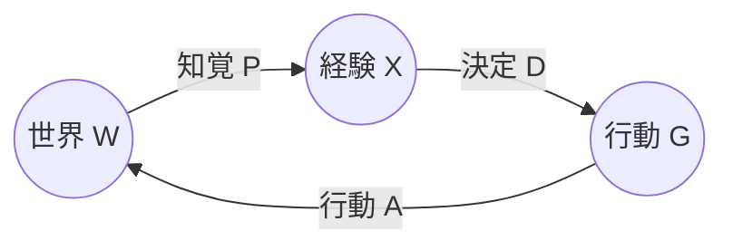

意識エージェント理論 (conscious agent theory) は、**意識を世界の基本要素に置き、物理世界をそこから導こうとする理論**。
脳が意識を作るという通常の向きを逆にして、時空と物体のほうを意識の側の産物と読む。

- 知覚は世界の真の姿を映すものではなく、生存に役立つように進化したインターフェース (知覚のインターフェース理論)
- 実在するのは意識をもつエージェントとその経験だけで、物理世界はエージェントどうしの相互作用の現れ (意識的実在論)
- エージェントはマルコフ核の組として数学的に定義でき、エージェントの組み合わせもまたエージェントになる

売りは、意識を物質から説明しようとして行き詰まるハードプロブレムを、問いの向きごと逆にして避けられること。
代わりに「では時空と物理法則をエージェントから実際に導けるのか」を示す責任を負い、そこはまだほとんど示されていない。

## 前提知識

- <Link href="/posts/statistics">統計学</Link> (条件付き確率、マルコフ連鎖)
- <Link href="/posts/does-the-brain-really-create-consciousness">
    意識は本当に脳が作っているのか
  </Link>
  (ハードプロブレム、結合問題)

## 知覚のインターフェース理論

理論の入口は意識ではなく進化論の側。
**知覚は真実を見るように進化したのか、適応度を稼ぐように進化したのか**を問う。

### 真実は適応度に負ける

進化ゲーム理論の設定で、知覚戦略を2つ比べる。

- **真実戦略**: 世界の状態をできるだけ正確に推定し、それに基づいて行動する
- **適応度戦略**: 世界の状態は推定せず、その状態から得られる適応度 (利得) だけを知覚する

両者を同じ複雑さ (知覚のカテゴリ数が同じ) で競わせると、一般的な適応度関数のもとで適応度戦略が勝つ。
これを**適応度は真実に勝る定理** (Fitness-Beats-Truth theorem, FBT定理) と呼ぶ。

> 世界の状態数を $N$ とすると、適応度戦略が真実戦略を絶滅させる確率は少なくとも $\dfrac{N-3}{N-1}$

$N\to\infty$ でこの下限は1に近づく。
世界が複雑なほど、真実を見る知覚は自然選択で残らない。

直感的には次の通り。

適応度は世界の状態の単調な関数とは限らない (水は少なすぎても多すぎても死ぬ)
→ 状態を正確に見ても、そこから適応度を計算し直す手間が要る
→ 同じ数のカテゴリしか使えないなら、最初から適応度の高低で区切ったほうが得
→ 区切り方は世界の構造ではなく、適応度関数の構造を反映する

- Q. 適応度関数が世界の構造を保つ (準同型) なら真実戦略も勝てるのでは? → A. 勝てる。ただし一般的な適応度関数がそうなる確率は0、というのが定理の中身

### 知覚はデスクトップのアイコン

PCのデスクトップにある青いファイルのアイコンは、ファイルそのものではない。
ファイルの実体は電圧のパターンで、青くも四角くもない。
アイコンが役に立つのは、実体を隠して「ここをドラッグすれば移動できる」という操作だけを見せるから。

知覚のインターフェース理論 (Interface Theory of Perception) は、時空とその中の物体をこのアイコンと同じものと読む。

- 物体は知覚が見るたびに作るデータ構造で、見ていない間に存在している保証はない
- 形・位置・大きさも色と同じく二次性質。外界にそれと似たものがあるとは限らない
- ただしアイコンは真剣に扱う必要がある。蛇を見たら避ける。蛇が世界の真の姿ではないとしても、避けなければ死ぬ

<Hint level="info">
  「知覚が信用できないなら、FBT定理を導いた数学や進化論も信用できないのでは」という自己論駁の疑いがある。理論の応答は、定理が否定するのは**知覚**が世界の構造を写すことで、論理や数学の推論能力ではない、というもの。論理の正しさは適応度と独立に確かめられる。
</Hint>

## 意識的実在論

インターフェース理論だけでは「インターフェースの向こうに何があるか」は言わない。
**向こう側にあるのも意識をもつエージェントとその経験だけ**、とするのが意識的実在論 (conscious realism)。

物理主義とは向きが逆になる。

| 立場         | 基本要素               | 意識の位置づけ             | 残る難問                            |
| ------------ | ---------------------- | -------------------------- | ----------------------------------- |
| 物理主義     | 時空と物質             | 脳の物理過程から生じる     | ハードプロブレム (なぜ経験があるか) |
| 汎心論       | 物質 (に原初的な意識)  | 物質の各部分がもともと持つ | 結合問題 (小さな意識がどう束なるか) |
| 意識的実在論 | 意識をもつエージェント | 基本要素そのもの           | 時空と物理法則をどう導くか          |

意識的実在論はハードプロブレムを解いたのではなく、**意識を説明される側から説明する側に移した**。
その代わりに「エージェントから時空がどう現れるか」を逆向きに示す必要がある。

## 意識をもつエージェント

### 定義

意識をもつエージェント $C$ は次の6つ組。

$$
C=\big((X,\mathcal X),\,(G,\mathcal G),\,(W,\mathcal W),\,P,\,D,\,A\big)
$$

- $(X,\mathcal X)$: 経験の可測空間 (エージェントが持ちうる意識体験の集合)
- $(G,\mathcal G)$: 行動の可測空間
- $(W,\mathcal W)$: 世界の可測空間 (中身は他のエージェントのネットワーク)
- $P:W\times\mathcal X\to[0,1]$: 知覚核。世界の状態 $w$ のもとで経験が集合 $E$ に入る確率 $P(w,E)$
- $D:X\times\mathcal G\to[0,1]$: 決定核。経験から行動を選ぶ
- $A:G\times\mathcal W\to[0,1]$: 行動核。行動が世界の状態を変える

3つの核はどれもマルコフ核 (1つ目の引数を固定すると確率測度になる)。

エージェントは「知覚 → 決定 → 行動 → 世界が変わる → 知覚」の輪を回り続ける。
$W$ が他のエージェントでできているので、あるエージェントの行動は別のエージェントの知覚になる。

### クオリア核

1周分の核を合成すると、経験から経験へのマルコフ核が得られる。

$$
Q=DAP:\;X\times\mathcal X\to[0,1]
$$

これを**クオリア核**と呼ぶ。
「今の経験が $x$ のとき、次の経験が $E$ に入る確率」で、決定・行動・世界の中身は全部その中に畳み込まれている。
エージェントの経験の流れはこの $Q$ で動くマルコフ連鎖になる。

例として、経験が $X=\{x_1,x_2\}$ の2つしかないエージェントを考える。

$$
Q=\begin{pmatrix}0.9&0.1\\0.3&0.7\end{pmatrix}
$$

なら、定常分布は $\pi=(0.75,\,0.25)$。
長い目で見て、このエージェントは時間の3/4を経験 $x_1$ の中で過ごす。

### 組み合わせと融合

2つのエージェントを並べたものもまた、同じ定義を満たすエージェントになる。

$$
C_1\times C_2=\big(X_1\times X_2,\,G_1\times G_2,\,W_1\times W_2,\,P_1\otimes P_2,\,D_1\otimes D_2,\,A_1\otimes A_2\big)
$$

これが汎心論の**結合問題** (小さな意識がどう束なって1つの意識になるか) への回答。
意識の単位が数学的に閉じているので、束ねた結果も同じ種類のものになる。

- $n$ 個のエージェントの可能な組み合わせのダイナミクスは、$n(n-1)$ 次元の凸多面体をなす (**マルコフ多面体** $M_n$。頂点は $n^n$ 個)
- エージェントどうしが強く相互作用すると、クオリア核はランク1の定常状態に収束し、新しいクオリアをもつより単純な1つのエージェントに**融合** (fusion) する
- $n$ 個のエージェントの可能な融合は $(n-1)$ 次元の単体をなす (**融合単体** $F_n$)

<Hint level="info">
  組み合わせ ($\times$)
  は2つのエージェントを1つの複合エージェントとして扱うだけで、経験は $X_1\times
  X_2$
  のまま。融合は相互作用の結果、経験の空間そのものが新しいものに置き換わる。1つの意識に「なる」のは融合のほう。
</Hint>

### 意識エージェント仮説

理論の作業仮説は、**意識のあらゆる性質はエージェントのネットワークのダイナミクスの性質として表せる**、というもの。
チューリング機械が「計算できるものはすべてチューリング機械で計算できる」とする計算の理論の土台であるのと同じ役割を、エージェントに担わせようとしている。

- Q. エージェントの定義はチューリング機械と同じくらい強いか? → A. 強い。エージェントのネットワークはチューリング機械を模倣できる (計算万能)
- Q. 「経験 $X$」は結局ただの集合で、なぜそれが経験なのかは説明していないのでは? → A. その通り。経験は理論の公理であって、説明の対象ではない

## 時空はインターフェース

### 時空は基本ではない

物理学の側にも、時空が基本的な存在ではないと考える理由がある。

小さなものを見るには波長の短い光が要る
→ 波長 $\lambda$ を短くするほどエネルギー $E=hc/\lambda$ が大きくなる
→ プランク長 ($\sim10^{-33}\,\mathrm{cm}$) あたりで、そのエネルギーが時空を曲げてブラックホールを作り、観測したい対象を飲み込む
→ プランク長より短い距離は、操作的な意味を持たない

散乱振幅の研究では、時空も量子論も仮定せずに振幅を計算できる幾何的な対象 (正値幾何、アンプリチューヘドロン) が見つかっている。
時空と量子論は、そこからの射影として出てくる。

意識エージェント理論はここに乗り、**アンプリチューヘドロンのさらに手前にエージェントのマルコフ的なダイナミクスがある**と主張する。

### マルコフ連鎖から装飾付き置換へ

アンプリチューヘドロンのセルは**装飾付き置換** (decorated permutation) でラベル付けされる。
$\bar n=\{1,\dots,n\}$ 上の写像 $\sigma:\bar n\to\{1,\dots,2n\}$ で、$a\le\sigma(a)\le a+n$ かつ $\sigma(a)\bmod n$ が全単射になるもの。

$n$ 状態のマルコフ核から、これを次のように作る。

- 状態 $a$ が一時的 (transient) なら $\sigma(a)=a$
- 状態 $a$ が再帰的 (recurrent) なら、$\sigma(a)$ は $a$ より大きい最初の $b$ で、$a,a+1,\dots,b$ ($\bmod n$ で読む) が $a$ の連結クラス $[a]$ を全部含むもの

例として $n=3$ で、状態1と2が互いに行き来する再帰クラスをなし、状態3は一時的とする。

- $\sigma(1)=2$ ($1,2$ で $\{1,2\}$ を含む)
- $\sigma(2)=4$ ($2,3,4\equiv1$ で初めて $\{1,2\}$ を含む)
- $\sigma(3)=3$ (一時的)

$\bmod 3$ で $2,1,0$ なので全単射。

この対応を使って、理論は「**時空の中の粒子は、エージェントの連結クラスのマルコフ的なダイナミクスを、アンプリチューヘドロンのある面へ射影したもの**」と提案する。
連結クラスは、互いに行き来し続けるエージェントの集まり。それが時空の側からは1つの粒子に見える。

- Q. 粒子の質量・運動量・スピンはマルコフ連鎖のどの性質に対応するか? → A. 未解決。論文でも今後の課題として挙げているだけ
- Q. この射影で既知の物理 (標準模型の粒子、散乱断面積) が再現されているか? → A. されていない。現時点では対応の候補を定義した段階

## 批判と応答

| 批判                                                    | 応答                                                                                                                         |
| ------------------------------------------------------- | ---------------------------------------------------------------------------------------------------------------------------- |
| 知覚を疑うなら、その理論を支える科学も疑うべき          | FBT定理が否定するのは知覚と世界の構造の一致で、論理・数学の妥当性ではない                                                    |
| FBT定理のモデルが単純すぎる                             | 定理は一般的な適応度関数について成り立つ。ただし「知覚」をカテゴリ分けとしてモデル化している点への批判は残る                 |
| 経験 $X$ を可測空間と置いただけで、意識を説明していない | 意識は公理であり説明の対象ではない。説明すべきは時空と物理のほう、という立場                                                 |
| 反証可能性がない                                        | 時空と粒子の性質をエージェントのダイナミクスから導き、既知の物理と照合できれば反証可能になる。そこまで到達していないのは事実 |
| 唯我論ではないか                                        | 世界は他のエージェントのネットワークとして実在する。否定しているのは「時空の中の物体」が基本的であることだけ                 |

## 他の立場との関係

- <Link href="/posts/qbism">QBism</Link>
  とは「量子論は世界の記述ではなく、エージェントが世界と付き合うための道具」という読み方が近い。ただしQBismは世界の正体について何も言わないのに対し、こちらは「世界はエージェント」と言い切る
- 統合情報理論 (IIT) はあくまで物理系のどれが意識をもつかを測る理論で、物理系の側が基本。向きが逆
- 観念論 (世界は心の中にある) と違い、個々のエージェントの外に他のエージェントのネットワークが実在する。単一の心に世界を回収するわけではない

## 参考文献

- D. D. Hoffman, C. Prakash, [Objects of consciousness](https://doi.org/10.3389/fpsyg.2014.00577), Frontiers in Psychology, 2014
- D. D. Hoffman, M. Singh, C. Prakash, [The Interface Theory of Perception](https://doi.org/10.3758/s13423-015-0890-8), Psychonomic Bulletin & Review, 2015
- C. Prakash, K. D. Stephens, D. D. Hoffman, M. Singh, C. Fields, [Fitness Beats Truth in the Evolution of Perception](https://doi.org/10.1007/s10441-020-09400-0), Acta Biotheoretica, 2021
- D. D. Hoffman, C. Prakash, R. Prentner, [Fusions of Consciousness](https://doi.org/10.3390/e25010129), Entropy, 2023
- D. D. Hoffman, The Case Against Reality: Why Evolution Hid the Truth from Our Eyes, W. W. Norton, 2019
