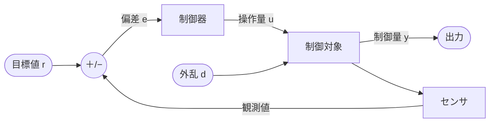
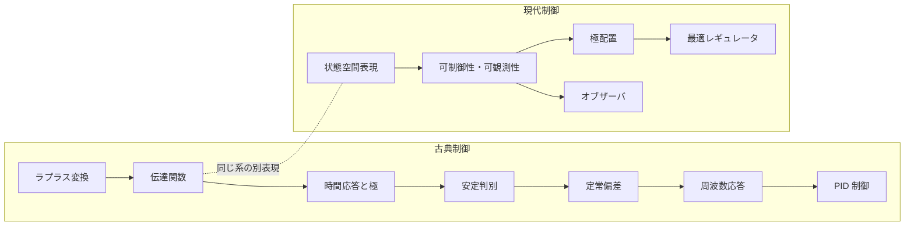
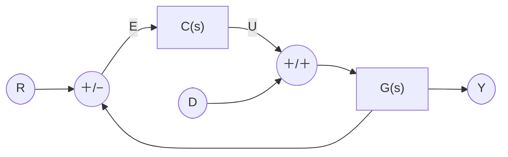
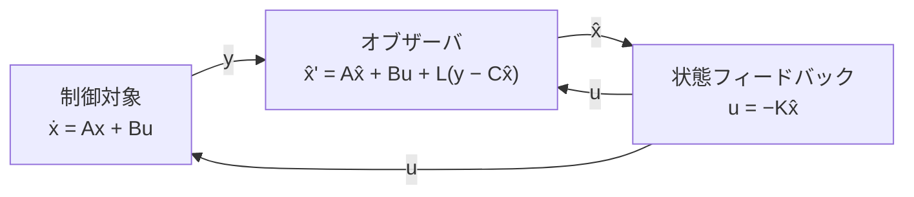

## 前提知識

- <Link href="/posts/differential-equation">微分方程式</Link>
  (線形常微分方程式)
- <Link href="/posts/complex-function-theory">複素関数論</Link>
  (複素平面・偏角・偏角の原理)
- <Link href="/posts/linear-algebra">線形代数</Link>
  (固有値・行列の階数)

## 制御とは

**制御 (control)** とは、対象の出力を思い通りの値に保つ、あるいは思い通りに動かすために、対象への入力を操作することである。
エアコンの室温、クルーズコントロールの車速、ドローンの姿勢、化学プラントの反応温度など、身の回りの「勝手に一定に保たれているもの」の裏にはほぼ例外なく制御がある。



| 用語                | 記号 | 意味                                           |
| ------------------- | ---- | ---------------------------------------------- |
| 制御対象 (plant)    | $G$  | 制御したいシステム。室温なら部屋そのもの       |
| 制御器 (controller) | $C$  | 偏差から操作量を決めるもの                     |
| 目標値 (reference)  | $r$  | 出力がとってほしい値                           |
| 制御量 (output)     | $y$  | 実際の出力                                     |
| 偏差 (error)        | $e$  | $e = r - y$                                    |
| 操作量 (input)      | $u$  | 制御器が対象に加える入力。ヒーターの出力など   |
| 外乱 (disturbance)  | $d$  | 外から勝手に入ってくる乱れ。窓からの隙間風など |

### フィードフォワードとフィードバック

目標値から操作量を「計算だけで」決めるのが**フィードフォワード制御**、出力を測って偏差をもとに操作量を決め直すのが**フィードバック制御**である。

フィードフォワードは対象のモデルが完璧で外乱がなければ理想的に働くが、現実にはモデル誤差も外乱もある。
フィードバックはそれらを「結果を見て直す」ことで吸収できる。その代わり、直し方を誤ると出力が振動したり発散したりする。

制御工学の中心的な問いは、フィードバックを掛けたシステムについて次の 3 つを保証することだと言える。

1. **安定性**: 出力が発散しないか
1. **性能**: 速く (速応性)、振動せず (減衰性)、ずれなく (定常特性) 目標値に追従するか
1. **ロバスト性**: モデルが多少違っていても 1 と 2 が保たれるか

### 古典制御と現代制御

| 観点         | 古典制御                        | 現代制御                             |
| ------------ | ------------------------------- | ------------------------------------ |
| モデル       | 伝達関数 $G(s)$                 | 状態空間表現 $(A, B, C, D)$          |
| 入出力       | 1 入力 1 出力 (SISO) が中心     | 多入力多出力 (MIMO) を自然に扱える   |
| 主な領域     | 周波数領域                      | 時間領域                             |
| 代表的な手法 | PID・ボード線図・ナイキスト判別 | 極配置・最適レギュレータ・オブザーバ |

このノートは次の順に進む。



## ラプラス変換

時刻 $t \ge 0$ で定義された関数 $f(t)$ の**ラプラス変換**を

$$
F(s) = \mathcal{L}[f(t)] = \int_0^\infty f(t)\, e^{-st}\, dt \quad (s \in \Bbb{C})
$$

で定める。
制御工学でラプラス変換を使う理由はただ 1 つで、**微分が $s$ の掛け算に、積分が $s$ の割り算になる**からである。
これにより、線形常微分方程式が $s$ の代数方程式になる。

$F(s)$ は複素数 $s = \sigma + j\omega$ の関数なので、$s$ 平面上の各点に $|F(s)|$ の高さをとると曲面として眺められる。
減衰振動 $f(t) = \frac{1}{2}e^{-0.5t}\sin 2t$ のラプラス変換 $F(s) = \dfrac{1}{(s+0.5)^2+4}$ を描くと次のようになる。


- 分母が $0$ になる**極** $s = -0.5 \pm 2j$ で、曲面はテントの支柱のように無限大へ突き上がる。極の実部 $-0.5$ が $f(t)$ の減衰率 $e^{-0.5t}$ に、虚部 $\pm 2$ が振動の角周波数 $\sin 2t$ に対応している。曲面の形はほぼ支柱の位置だけで決まるので、**$F(s)$ の性質は極の位置に集約される**
- 虚軸 $s = j\omega$ に沿って切った断面 (赤線) は、後で扱う**周波数応答** $|F(j\omega)|$ そのものである。虚軸が極の真横を通るあたりで盛り上がるのが共振である

<Hint level="info">
  定義の積分が実際に収束するのは、いちばん右の極より右側 ($\sigma > -0.5$)
  だけである。それより左の部分は、有理関数 $F(s)$
  の式をそのまま延長した値 (解析接続) を描いている。
</Hint>

### 主な変換対

| $f(t)\;(t \ge 0)$      | $F(s)$                             | 備考         |
| ---------------------- | ---------------------------------- | ------------ |
| $\delta(t)$            | $1$                                | インパルス   |
| $1$                    | $\dfrac{1}{s}$                     | 単位ステップ |
| $t$                    | $\dfrac{1}{s^2}$                   | 単位ランプ   |
| $\dfrac{t^n}{n!}$      | $\dfrac{1}{s^{n+1}}$               |              |
| $e^{-at}$              | $\dfrac{1}{s+a}$                   |              |
| $\sin \omega t$        | $\dfrac{\omega}{s^2+\omega^2}$     |              |
| $\cos \omega t$        | $\dfrac{s}{s^2+\omega^2}$          |              |
| $e^{-at}\sin \omega t$ | $\dfrac{\omega}{(s+a)^2+\omega^2}$ | 減衰振動     |

### 主な性質

| 性質       | 時間領域                                      | $s$ 領域                          |
| ---------- | --------------------------------------------- | --------------------------------- |
| 線形性     | $af(t) + bg(t)$                               | $aF(s) + bG(s)$                   |
| 微分       | $\dfrac{df}{dt}$                              | $sF(s) - f(0)$                    |
| 積分       | $\displaystyle\int_0^t f(\tau)d\tau$          | $\dfrac{F(s)}{s}$                 |
| 時間推移   | $f(t-L)\;(L \ge 0)$                           | $e^{-Ls}F(s)$                     |
| 畳み込み   | $\displaystyle\int_0^t g(t-\tau)u(\tau)d\tau$ | $G(s)U(s)$                        |
| 最終値定理 | $\displaystyle\lim_{t\to\infty} f(t)$         | $\displaystyle\lim_{s\to0} sF(s)$ |

<Details title="微分の性質の導出">
部分積分により

$$
\begin{aligned}
\mathcal{L}\left[\dfrac{df}{dt}\right]
&= \int_0^\infty \dfrac{df}{dt} e^{-st}\, dt \\
&= \Big[f(t)e^{-st}\Big]_0^\infty + s\int_0^\infty f(t) e^{-st}\, dt \\
&= sF(s) - f(0)
\end{aligned}
$$

ただし $\mathrm{Re}\,s$ を十分大きくとり、$f(t)e^{-st} \to 0\;(t\to\infty)$ とした。
繰り返し適用すれば $\mathcal{L}[f''] = s^2F(s) - sf(0) - f'(0)$ が得られる。

</Details>

<Hint level="warn">
  最終値定理が使えるのは $sF(s)$ の極がすべて左半平面にある (つまり $f(t)$
  が収束する) ときだけである。 たとえば $f(t) = \sin t$ に機械的に適用すると
  $\lim_{s\to0} \frac{s}{s^2+1} = 0$ となるが、$\sin t$ は収束しない。
</Hint>

## 伝達関数

### 定義

ばね・マス・ダンパ系を例にとる。質量 $m$ の物体に、ばね定数 $k$ のばね、粘性係数 $c$ のダンパがつながり、外力 $u(t)$ が加わるとき、変位 $y(t)$ は

$$
m\ddot{y} + c\dot{y} + ky = u
$$

に従う。初期値をすべて $0$ としてラプラス変換すると

$$
(ms^2 + cs + k)Y(s) = U(s)
\quad\Longrightarrow\quad
\dfrac{Y(s)}{U(s)} = \dfrac{1}{ms^2+cs+k}
$$

となる。この**初期値を $0$ としたときの出力と入力のラプラス変換の比**

$$
G(s) = \dfrac{Y(s)}{U(s)}
$$

を**伝達関数 (transfer function)** という。
$U(s) = 1$ (インパルス入力) のとき $Y(s) = G(s)$ なので、伝達関数は**インパルス応答のラプラス変換**でもある。
時間領域では出力は入力とインパルス応答の畳み込みで表されるが、$s$ 領域ではただの掛け算になる。

伝達関数が有理関数 $G(s) = \dfrac{N(s)}{D(s)}$ のとき、

- $D(s) = 0$ の根を**極 (pole)**
- $N(s) = 0$ の根を**零点 (zero)**
- $\deg D \ge \deg N$ のとき**プロパー**、$\deg D > \deg N$ のとき**厳密にプロパー**

という。物理的に実現できるシステムはプロパーである (入力を微分して即座に出力することはできない)。

### ブロック線図の結合

伝達関数で表したブロックは、次の 3 つの規則で 1 つにまとめられる。

| 結合           | 合成伝達関数                 |
| -------------- | ---------------------------- |
| 直列           | $G_1(s)G_2(s)$               |
| 並列           | $G_1(s) \pm G_2(s)$          |
| フィードバック | $\dfrac{G(s)}{1 + G(s)H(s)}$ |

最もよく使うのはフィードバック結合である。
目標値 $r$ と外乱 $d$ を含めた標準的なフィードバック系を考える。



**一巡伝達関数 (開ループ伝達関数)** を $L(s) = G(s)C(s)$ とおくと、

$$
Y(s) = \underbrace{\dfrac{L(s)}{1+L(s)}}_{T(s)}\, R(s) + \dfrac{G(s)}{1+L(s)}\, D(s),
\qquad
E(s) = \underbrace{\dfrac{1}{1+L(s)}}_{S(s)}\, R(s) - \dfrac{G(s)}{1+L(s)}\, D(s)
$$

となる。$T(s)$ を**相補感度関数** (閉ループ伝達関数)、$S(s)$ を**感度関数**という。

<Details title="導出">
図から $E = R - Y$、$Y = G(CE + D)$ である。前者を後者に代入して

$$
\begin{aligned}
Y &= GC(R - Y) + GD \\
(1 + GC)Y &= GCR + GD \\
Y &= \dfrac{GC}{1+GC} R + \dfrac{G}{1+GC} D
\end{aligned}
$$

$E = R - Y$ に代入すれば $E$ の式も得られる。

</Details>

$S(s) + T(s) = 1$ が恒等的に成り立つことに注意する。
$|L|$ が大きい周波数では $S \approx 0$ (偏差も外乱の影響も小さい)、$T \approx 1$ (よく追従する) となる。
**ループゲインを大きくすることがフィードバックの効き目そのもの**であり、これをどこまで大きくできるかを安定性が制限する、というのが古典制御の基本的な構図である。

## 時間応答

### 1 次遅れ系

$$
G(s) = \dfrac{K}{Ts + 1}
$$

を **1 次遅れ系**という。$K$ を**ゲイン**、$T$ を**時定数**と呼ぶ。RC 回路 ($T = RC$) や、水槽の水位、物体の温度変化などがこの形になる。

単位ステップ入力 $U(s) = 1/s$ に対する出力は、部分分数分解して逆変換すれば

$$
Y(s) = \dfrac{K}{s(Ts+1)} = K\left(\dfrac{1}{s} - \dfrac{1}{s + 1/T}\right)
\quad\Longrightarrow\quad
y(t) = K\left(1 - e^{-t/T}\right)
$$

となる。$t = T$ で最終値の $1 - e^{-1} \approx 63.2\%$ に達し、$t = 4T$ ではおよそ $98\%$ に達する。


### 2 次遅れ系

$$
G(s) = \dfrac{\omega_n^2}{s^2 + 2\zeta\omega_n s + \omega_n^2}
$$

を **2 次遅れ系**という。$\omega_n$ を**固有角周波数**、$\zeta$ を**減衰係数**と呼ぶ。
先のばね・マス・ダンパ系は $\omega_n = \sqrt{k/m}$、$\zeta = \dfrac{c}{2\sqrt{mk}}$ の 2 次遅れ系である (ゲインは $1/k$)。

極は $s = -\zeta\omega_n \pm \omega_n\sqrt{\zeta^2 - 1}$ であり、$\zeta$ によって応答の性格が変わる。

| $\zeta$         | 極                      | 応答                         |
| --------------- | ----------------------- | ---------------------------- |
| $\zeta > 1$     | 相異なる 2 つの負の実数 | 過減衰: 振動せずゆっくり収束 |
| $\zeta = 1$     | 負の実数の重根          | 臨界減衰: 振動しない最速     |
| $0 < \zeta < 1$ | 共役複素数 (左半平面)   | 不足減衰: 振動しながら収束   |
| $\zeta = 0$     | 純虚数                  | 無減衰: 持続振動             |

$0 < \zeta < 1$ のとき、減衰固有角周波数を $\omega_d = \omega_n\sqrt{1-\zeta^2}$ とすると、ステップ応答は

$$
y(t) = 1 - \dfrac{e^{-\zeta\omega_n t}}{\sqrt{1-\zeta^2}} \sin\left(\omega_d t + \phi\right),
\quad \phi = \arccos \zeta
$$

である。ここから応答の形を表す指標が求まる。

| 指標                          | 式                                     |
| ----------------------------- | -------------------------------------- |
| 行き過ぎ時間                  | $t_p = \dfrac{\pi}{\omega_d}$          |
| 行き過ぎ量 (オーバーシュート) | $M = e^{-\zeta\pi/\sqrt{1-\zeta^2}}$   |
| 整定時間 ($\pm2\%$)           | $t_s \approx \dfrac{4}{\zeta\omega_n}$ |


行き過ぎ量は $\zeta$ だけで決まる。
$\zeta = 1/\sqrt{2} \approx 0.707$ はわずかなオーバーシュート (約 $4.3\%$) と引き換えに速く立ち上がるので、設計の目安としてよく使われる。

### 極と応答の関係

一般に、伝達関数の極を $p_1, \dots, p_n$ (重根なし) とすると、インパルス応答は部分分数分解により

$$
g(t) = \sum_{i=1}^n c_i\, e^{p_i t}
$$

と書ける。各極は $e^{p_i t}$ という**モード**を 1 つずつ応答に持ち込む。$p = \sigma + j\omega$ とすると $e^{pt} = e^{\sigma t}e^{j\omega t}$ なので、

- **実部 $\sigma$** が減衰の速さを決める ($\sigma < 0$ なら減衰、$\sigma > 0$ なら発散)
- **虚部 $\omega$** が振動の角周波数を決める


虚軸に近い極ほど減衰が遅く、応答の最後まで残る。
そのため、虚軸に最も近い極 (**代表極**) だけで系の応答をおおまかに近似できることが多い。高次の系でも 2 次遅れ系の指標で議論できるのはこのためである。

## 安定性

入力が有界なら出力も有界であるシステムを **BIBO 安定** という。
前節の考察から、線形時不変システムが安定であるための必要十分条件は

<Hint level="info">伝達関数の極がすべて**左半平面** ($\mathrm{Re}\,s < 0$) にあること</Hint>

である。フィードバック系では閉ループ伝達関数 $T = L/(1+L)$ の極、すなわち**特性方程式** $1 + L(s) = 0$ の根を調べればよい。

### ラウス・フルビッツの安定判別法

特性方程式が高次になると根を手で求めるのは難しいが、**根を求めずに**左半平面にあるかどうかだけを判定する方法がある。

特性多項式を $a_n s^n + a_{n-1}s^{n-1} + \cdots + a_0$ ($a_n > 0$) とする。

1. **必要条件**: すべての係数 $a_i$ が正であること
1. 次の**ラウス表**を作る。1, 2 行目に係数を交互に並べ、3 行目以降は直上の 2 行から計算する

$$
\begin{array}{c|ccc}
s^n     & a_n     & a_{n-2} & \cdots \\
s^{n-1} & a_{n-1} & a_{n-3} & \cdots \\
s^{n-2} & b_1     & b_2     & \cdots \\
\vdots  & \vdots  &         &
\end{array}
\qquad
b_1 = \dfrac{a_{n-1}a_{n-2} - a_n a_{n-3}}{a_{n-1}},\;
b_2 = \dfrac{a_{n-1}a_{n-4} - a_n a_{n-5}}{a_{n-1}}
$$

1. **必要十分条件**: 表の左端の列 (ラウス数列) がすべて正であること。符号の変化の回数が右半平面の根の個数に等しい

**例**: $L(s) = \dfrac{K}{s(s+1)(s+2)}$ に単位フィードバックを掛けると、特性方程式は

$$
s(s+1)(s+2) + K = s^3 + 3s^2 + 2s + K = 0
$$

となる。ラウス表は

$$
\begin{array}{c|cc}
s^3 & 1 & 2 \\
s^2 & 3 & K \\
s^1 & \dfrac{6-K}{3} & 0 \\
s^0 & K &
\end{array}
$$

なので、安定であるための条件は $\dfrac{6-K}{3} > 0$ かつ $K > 0$、すなわち $0 < K < 6$ である。
$K = 6$ のとき $s^2$ の行から補助方程式 $3s^2 + 6 = 0$ が得られ、閉ループ極は虚軸上の $s = \pm j\sqrt{2}$ にある (持続振動)。

<Hint level="info">
  2 次系は係数がすべて正であれば必ず安定である。 3 次系 $a_3s^3 + a_2s^2 +
  a_1s + a_0$ では、係数がすべて正であることに加えて $a_2a_1 > a_3a_0$
  が必要十分条件になる。
</Hint>

### 根軌跡

ゲイン $K$ を $0$ から $\infty$ まで変えたときに閉ループ極が描く軌跡を**根軌跡**という。
同じ例 $1 + \dfrac{K}{s(s+1)(s+2)} = 0$ の根軌跡を描くと、ラウスの判別法で求めた $K = 6$ でちょうど虚軸を横切ることが確かめられる。


根軌跡は数値計算すればすぐ描けるが、手で概形をつかむための規則がある ($n$: 開ループ極の数、$m$: 開ループ零点の数)。

- $K = 0$ で開ループ極から出発し、$K \to \infty$ で開ループ零点に向かう。行き先のない $n - m$ 本は漸近線に沿って無限遠に向かう
- 実軸上では、その点より右にある実数の極と零点の個数の合計が奇数の区間が根軌跡になる
- 漸近線の角度は $\dfrac{(2k+1)\pi}{n-m}$、交点 (重心) は $\dfrac{\sum p_i - \sum z_j}{n-m}$
- 実軸からの分岐点は $\dfrac{dK}{ds} = 0$ の解のうち根軌跡上にあるもの

例では $n - m = 3$ なので漸近線は $\pm 60^\circ, 180^\circ$、重心は $\dfrac{0 - 1 - 2}{3} = -1$。
分岐点は $K = -(s^3 + 3s^2 + 2s)$ より $3s^2 + 6s + 2 = 0$ を解いて $s = -1 + 1/\sqrt{3} \approx -0.42$ となる。

ゲインを上げると、代表極の組が虚軸に近づいて振動的になり、ついには不安定になる。
**ゲインを上げれば偏差は小さくなるが、上げすぎると不安定になる**というトレードオフが一目でわかる。

## 定常偏差

十分時間が経ったあとに残る偏差を**定常偏差**という。
単位フィードバック系では $E(s) = \dfrac{R(s)}{1 + L(s)}$ なので、最終値定理から

$$
e_\infty = \lim_{s\to0} s \dfrac{R(s)}{1 + L(s)}
$$

である。目標値ごとに計算すると

- ステップ ($R = 1/s$): $e_\infty = \dfrac{1}{1 + K_p}$、ただし $K_p = \lim_{s\to0} L(s)$ (位置偏差定数)
- ランプ ($R = 1/s^2$): $e_\infty = \dfrac{1}{K_v}$、ただし $K_v = \lim_{s\to0} sL(s)$ (速度偏差定数)

となる。$L(s)$ が原点に持つ極 (積分器 $1/s$) の個数を**型**と呼ぶと、定常偏差は型で決まる。

| 型 ($L$ の積分器の数) | ステップ           | ランプ           | 加速度           |
| --------------------- | ------------------ | ---------------- | ---------------- |
| 0 型                  | $\dfrac{1}{1+K_p}$ | $\infty$         | $\infty$         |
| 1 型                  | $0$                | $\dfrac{1}{K_v}$ | $\infty$         |
| 2 型                  | $0$                | $0$              | $\dfrac{1}{K_a}$ |


<Hint level="info" title="内部モデル原理">
  ステップには $1/s$、ランプには $1/s^2$
  が対応する。ある信号に定常偏差なく追従するには、**その信号を生成するモデル
  (の極) を一巡伝達関数の中に持てばよい**。 これを内部モデル原理という。PID
  制御の I 動作 (積分) はステップに対する内部モデルにほかならない。
</Hint>

## 周波数応答

安定な系 $G(s)$ に正弦波 $u(t) = \sin\omega t$ を入れると、過渡応答が消えたあとの出力は

$$
y(t) = |G(j\omega)| \sin\left(\omega t + \angle G(j\omega)\right)
$$

になる。つまり、**同じ周波数の正弦波が、振幅が $|G(j\omega)|$ 倍、位相が $\angle G(j\omega)$ だけずれて出てくる**。
$G(j\omega)$ を**周波数伝達関数**という。

<Details title="導出">
$U(s) = \dfrac{\omega}{s^2+\omega^2} = \dfrac{\omega}{(s - j\omega)(s + j\omega)}$ なので、$Y(s) = G(s)U(s)$ を部分分数分解すると

$$
Y(s) = \dfrac{\alpha}{s - j\omega} + \dfrac{\bar\alpha}{s + j\omega} + (G \text{ の極による項})
$$

となる。$G$ が安定なら後者は $t \to \infty$ で $0$ に減衰する。留数を計算すると

$$
\alpha = \left.(s - j\omega)G(s)U(s)\right|_{s = j\omega} = \dfrac{G(j\omega)}{2j}
$$

なので、残る部分は

$$
y(t) = \dfrac{G(j\omega)e^{j\omega t} - \overline{G(j\omega)}e^{-j\omega t}}{2j}
= \mathrm{Im}\left[G(j\omega)e^{j\omega t}\right]
= |G(j\omega)|\sin(\omega t + \angle G(j\omega))
$$

</Details>

### ボード線図

横軸に角周波数 $\omega$ を対数でとり、**ゲイン** $20\log_{10}|G(j\omega)|$ [dB] と**位相** $\angle G(j\omega)$ [deg] を上下に並べた図を**ボード線図**という。
対数をとると直列結合 (積) がゲインの和になり、位相ももともと和なので、要素ごとのボード線図を足し合わせるだけで全体が描ける。


| 要素                       | ゲイン                                      | 位相                                           |
| -------------------------- | ------------------------------------------- | ---------------------------------------------- |
| 積分 $\dfrac{1}{s}$        | $-20$ dB/dec の直線 ($\omega=1$ で $0$ dB)  | $-90^\circ$ で一定                             |
| 1 次遅れ $\dfrac{1}{Ts+1}$ | 折れ点 $1/T$ まで $0$ dB、以降 $-20$ dB/dec | $0^\circ \to -90^\circ$ (折れ点で $-45^\circ$) |
| 2 次遅れ                   | $\omega_n$ 以降 $-40$ dB/dec                | $0^\circ \to -180^\circ$                       |
| むだ時間 $e^{-Ls}$         | $0$ dB で一定                               | $-\omega L$ [rad] で際限なく遅れる             |

2 次遅れ系は $\zeta < 1/\sqrt{2}$ のとき**共振ピーク** $M_p = \dfrac{1}{2\zeta\sqrt{1-\zeta^2}}$ を持つ。
ゲインが $-3$ dB に落ちる周波数を**帯域幅**といい、帯域幅が広い系ほど速い入力に追従できる (速応性が高い)。

### ナイキストの安定判別法

閉ループ極は $1 + L(s) = 0$ の根である。
複素関数論の**偏角の原理**によると、$s$ が閉曲線を時計回りに 1 周したとき、$1 + L(s)$ が原点のまわりを時計回りに回る回数は、内部の零点の数から極の数を引いたものに等しい。

$s$ を虚軸全体と右半平面を囲む大きな半円 (**ナイキスト経路**) に沿って動かすと、$L(s)$ の描く曲線 (**ナイキスト線図**) が $-1$ を時計回りに回る回数 $N$ について

$$
Z = N + P
$$

が成り立つ。$P$ は $L(s)$ の右半平面の極の数、$Z$ は閉ループ系の右半平面の極の数である。閉ループ系が安定 $\iff Z = 0$ である。

<Hint level="info" title="簡略化されたナイキストの安定判別法">
  $L(s)$ 自体が安定 ($P = 0$、虚軸上の極は避けて回る) な場合は、$\omega$ を $0
  \to \infty$ と動かしたときの $L(j\omega)$ の軌跡が、**点 $-1$
  を左手に見て進めば安定**である。
</Hint>

ラウスの判別法と違って、ナイキストの判別法は $L(j\omega)$ という**測定できる量**だけを使う。
実験で得た周波数特性や、むだ時間 $e^{-Ls}$ のような有理関数でない要素を含んでいても使えるのが強みである。

### ゲイン余裕と位相余裕

安定かどうかだけでなく、「不安定まであとどれくらい余裕があるか」を測る指標が**安定余裕**である。

- **ゲイン余裕 (GM)**: 位相が $-180^\circ$ になる周波数 $\omega_{pc}$ で、ゲインをあと何倍 (何 dB) 上げると $|L| = 1$ になるか。$\mathrm{GM} = 1/|L(j\omega_{pc})|$
- **位相余裕 (PM)**: ゲインが $0$ dB になる周波数 $\omega_{gc}$ で、位相があと何度遅れると $-180^\circ$ になるか。$\mathrm{PM} = 180^\circ + \angle L(j\omega_{gc})$

先の例で $K = 2$ とした $L(s) = \dfrac{2}{s(s+1)(s+2)}$ を見てみる。


位相交差周波数は $\angle L = -90^\circ - \arctan\omega - \arctan\dfrac{\omega}{2} = -180^\circ$ より $\omega_{pc} = \sqrt{2}$、そこでのゲインは

$$
|L(j\sqrt{2})| = \dfrac{2}{\sqrt{2}\cdot\sqrt{3}\cdot\sqrt{6}} = \dfrac{1}{3}
$$

なので、ゲイン余裕は $3$ 倍 ($\approx 9.5$ dB) である。
ラウスの判別法で求めた安定限界 $K = 6$ が、いまの $K = 2$ のちょうど $3$ 倍であることと整合している。
位相余裕は数値的に約 $33^\circ$ になる。

<Hint level="info">
  安定余裕の目安として、サーボ系では GM 10〜20 dB・PM 40〜60°、プロセス制御では
  GM 3〜10 dB・PM 20° 以上がよく挙げられる。 また 2 次遅れ系に近い閉ループ系では
  $\zeta \approx \mathrm{PM}/100$ (PM は度)
  という経験則があり、位相余裕は減衰性の指標にもなる。
</Hint>

## PID 制御

現場で使われているフィードバック制御器の大半は **PID 制御器**である。

$$
u(t) = K_p\left(e(t) + \dfrac{1}{T_i}\int_0^t e(\tau)\,d\tau + T_d \dfrac{de(t)}{dt}\right)
\quad\Longleftrightarrow\quad
C(s) = K_p\left(1 + \dfrac{1}{T_is} + T_ds\right)
$$

$K_p$ を比例ゲイン、$T_i$ を積分時間、$T_d$ を微分時間という。

| 動作     | 見ているもの              | 効果                                           | 副作用                                                 |
| -------- | ------------------------- | ---------------------------------------------- | ------------------------------------------------------ |
| P (比例) | 現在の偏差                | 偏差に比例して押し返す                         | 上げすぎると振動・不安定。0 型の対象では定常偏差が残る |
| I (積分) | 過去の偏差の蓄積          | 定常偏差を $0$ にする (1 型にする)             | 位相が遅れて振動的になる                               |
| D (微分) | 偏差の変化率 (未来の予測) | 変化を先読みしてブレーキを掛け、減衰性を上げる | 高周波ノイズを増幅する                                 |

### ジーグラー・ニコルスの限界感度法

PID のゲインを経験的に決める古典的な方法である。

1. I と D を切り、P 制御だけでゲイン $K_p$ を徐々に上げる
1. 出力が一定振幅で振動し続けるゲイン $K_u$ (**限界感度**) と、そのときの振動周期 $T_u$ を記録する
1. 次の表からゲインを決める

| 制御器 | $K_p$     | $T_i$     | $T_d$      |
| ------ | --------- | --------- | ---------- |
| P      | $0.5K_u$  | —         | —          |
| PI     | $0.45K_u$ | $T_u/1.2$ | —          |
| PID    | $0.6K_u$  | $0.5T_u$  | $0.125T_u$ |

対象を $G(s) = \dfrac{1}{(s+1)^3}$ とすると、$K_u = 8$、$T_u = 2\pi/\sqrt{3} \approx 3.63$ である。

<Details title="K_u と T_u の計算">
持続振動は閉ループ極が虚軸上にある状態なので、$1 + K\,G(j\omega) = 0$ を満たす $K, \omega$ を探す。

位相条件 $\angle G(j\omega) = -3\arctan\omega = -180^\circ$ より $\omega = \tan 60^\circ = \sqrt{3}$。
ゲイン条件 $K\,|G(j\sqrt{3})| = \dfrac{K}{(\sqrt{1+3})^3} = \dfrac{K}{8} = 1$ より $K_u = 8$。
周期は $T_u = 2\pi/\omega = 2\pi/\sqrt{3}$ である。

</Details>


P 制御だけでは 0 型の対象に定常偏差 $1/(1 + K_p) = 0.2$ が残る。
I を加えると偏差は $0$ に向かうが位相が遅れて振動的になり、D を加えると減衰が速くなる。
ジーグラー・ニコルスの調整則は振幅減衰比 $1/4$ 程度を狙った攻めた設定なので、行き過ぎ量は大きめである。実際には得られた値を出発点にして微調整する。

計算機に実装するときは、時間を刻み幅 $\Delta t$ で離散化して積分を和に、微分を差分に置き換える。
上の図の PID の応答はこの程度のコードで再現できる。

```python
import numpy as np


def simulate_pid(Kp, Ti, Td, dt=0.001, t_end=25.0):
    """G(s) = 1/(s+1)^3 を PID 制御したときの単位ステップ応答 (オイラー法)"""
    x = np.zeros(3)  # 1/(s+1) を 3 段つないだ各段の出力
    integral, prev_e = 0.0, 0.0
    ys = []
    for _ in range(int(t_end / dt)):
        y = x[2]
        e = 1.0 - y  # 目標値 r = 1
        integral += e * dt
        derivative = (e - prev_e) / dt
        prev_e = e
        u = Kp * (e + integral / Ti + Td * derivative)
        # 各段は x_i' = -x_i + (前段の出力)
        x += (-x + np.array([u, x[0], x[1]])) * dt
        ys.append(y)
    return np.array(ys)


Ku, Tu = 8.0, 2 * np.pi / np.sqrt(3)
y = simulate_pid(Kp=0.6 * Ku, Ti=0.5 * Tu, Td=0.125 * Tu)
print(f"最大値 {y.max():.3f}, 最終値 {y[-1]:.3f}")
# => 最大値 1.407, 最終値 1.000
```

<Hint level="warn" title="実装上の注意">
  - **微分キック**: 目標値がステップ状に変わると、偏差の微分が最初の 1
    ステップだけ $1/\Delta t$ に跳ね上がり、操作量にインパルスが出る (上のコードの
    `prev_e = 0.0` がそれに当たる)。偏差ではなく $-y$
    を微分する**微分先行型**にすれば避けられる。上のコードで `prev_e = 1.0`
    とすると微分先行型と同じ応答になり、最大値は $1.53$ に変わる。
  - **不完全微分**: 純粋な微分 $T_ds$ は高周波ノイズを際限なく増幅するので、
    $\dfrac{T_ds}{1 + \eta T_ds}\;(\eta \approx 0.1)$
    のようにローパスフィルタを掛ける。
  - **ワインドアップ**: 操作量が飽和している間も積分が溜まり続け、飽和が解けた後に大きく行き過ぎる。飽和中は積分を止める
    (アンチワインドアップ) のが定石である。
</Hint>

## 状態空間表現

ここから現代制御に入る。
伝達関数は入出力の関係だけを表すが、系の内部の状態を変数として明示的に扱うのが**状態空間表現**である。

$$
\begin{aligned}
& \dot{\bold{x}}(t) = A\bold{x}(t) + B\bold{u}(t) \\
& \bold{y}(t) = C\bold{x}(t) + D\bold{u}(t) \\[8pt]
& \text{where} \\
& \quad \bold{x} \in \Bbb{R}^n : \text{状態} \\
& \quad \bold{u} \in \Bbb{R}^m : \text{入力} \\
& \quad \bold{y} \in \Bbb{R}^p : \text{出力}
\end{aligned}
$$

ばね・マス・ダンパ系なら、状態を位置と速度 $\bold{x} = (y, \dot{y})^\top$ にとって

$$
\dfrac{d}{dt}\begin{pmatrix} y \\ \dot{y} \end{pmatrix}
= \begin{pmatrix} 0 & 1 \\ -k/m & -c/m \end{pmatrix}
\begin{pmatrix} y \\ \dot{y} \end{pmatrix}
+ \begin{pmatrix} 0 \\ 1/m \end{pmatrix} u,
\qquad
y = \begin{pmatrix} 1 & 0 \end{pmatrix}\begin{pmatrix} y \\ \dot{y} \end{pmatrix}
$$

となる。$n$ 階の微分方程式が、1 階の連立微分方程式 (行列の微分方程式) に書き直されている。

### 伝達関数との関係

初期値を $0$ としてラプラス変換すると $s\bold{X} = A\bold{X} + B\bold{U}$ より $\bold{X} = (sI - A)^{-1}B\bold{U}$ なので

$$
G(s) = C(sI - A)^{-1}B + D
$$

である。$(sI - A)^{-1} = \dfrac{\mathrm{adj}(sI - A)}{\det(sI - A)}$ だから、**伝達関数の極は $A$ の固有値**である (ただし後述する極零相殺がなければ)。
上のばね・マス・ダンパ系で計算すると、確かに $G(s) = \dfrac{1}{ms^2 + cs + k}$ に戻る。

状態方程式の解は、行列指数関数 $e^{At} = \sum_{k=0}^\infty \dfrac{(At)^k}{k!}$ を使って

$$
\bold{x}(t) = e^{At}\bold{x}(0) + \int_0^t e^{A(t-\tau)}B\bold{u}(\tau)\,d\tau
$$

と書ける。第 1 項が初期値への応答 (自由応答)、第 2 項が入力への応答 (強制応答) である。

<Hint level="info">
  同じ伝達関数を持つ状態空間表現は 1 つではない。 正則行列 $T$ で $\bold{x} =
  T\bold{z}$ と座標変換すると $(T^{-1}AT,\, T^{-1}B,\, CT,\, D)$
  という別の表現が得られるが、伝達関数も固有値も変わらない。
</Hint>

### 可制御性と可観測性

状態空間表現を使うと、伝達関数では見えなかった 2 つの性質を問えるようになる。

- **可制御性**: 入力 $\bold{u}$ を適当に選べば、任意の初期状態を任意の状態へ有限時間で移せるか
- **可観測性**: 出力 $\bold{y}$ と入力 $\bold{u}$ を有限時間観測すれば、初期状態を一意に決定できるか

どちらも行列の階数で判定できる。

$$
\begin{aligned}
\text{可制御} &\iff \mathrm{rank}\begin{pmatrix} B & AB & \cdots & A^{n-1}B \end{pmatrix} = n \\
\text{可観測} &\iff \mathrm{rank}\begin{pmatrix} C \\ CA \\ \vdots \\ CA^{n-1} \end{pmatrix} = n
\end{aligned}
$$

<Hint level="warn" title="極零相殺">
  $G(s) = \dfrac{s - 1}
  {(s - 1)(s + 2)}$ のように不安定な極と零点が打ち消し合うと、伝達関数の上では
  $\dfrac{1}
  {s + 2}$ という安定な系に見える。 しかし内部には入力から操作できない
  (あるいは出力に現れない)
  不安定なモードが残っていて、わずかな初期値のずれで内部状態が発散する。
  可制御かつ可観測な表現 (**最小実現**) であれば、伝達関数の極と $A$
  の固有値は一致する。
</Hint>

### 状態フィードバックと極配置

状態がすべて測れるとして、**状態フィードバック** $\bold{u} = -K\bold{x}$ を掛けると

$$
\dot{\bold{x}} = (A - BK)\bold{x}
$$

となる。閉ループ系の極は $A - BK$ の固有値であり、**$(A, B)$ が可制御ならば $K$ を選ぶことで固有値を任意の位置に配置できる** (極配置定理)。
古典制御ではゲインを 1 つ動かして根軌跡に沿って極を動かすことしかできなかったが、状態フィードバックでは極を好きな場所に置ける。

**例: 倒立振子**

長さ $l$ の棒を倒立させた振子は、角度 $\theta$ が小さい範囲で $\ddot\theta = \dfrac{g}{l}\theta + u$ と線形化できる。時間のスケールを取り直して $g/l = 1$ とすると

$$
\dfrac{d}{dt}\begin{pmatrix} \theta \\ \dot\theta \end{pmatrix}
= \underbrace{\begin{pmatrix} 0 & 1 \\ 1 & 0 \end{pmatrix}}_{A}
\begin{pmatrix} \theta \\ \dot\theta \end{pmatrix}
+ \underbrace{\begin{pmatrix} 0 \\ 1 \end{pmatrix}}_{B} u
$$

である。$A$ の固有値は $\pm 1$ で、$+1$ の極のために放っておくと倒れる。
可制御行列は $\begin{pmatrix} B & AB \end{pmatrix} = \begin{pmatrix} 0 & 1 \\ 1 & 0 \end{pmatrix}$ で階数 $2$ なので、可制御である。

$K = (k_1, k_2)$ とおくと

$$
A - BK = \begin{pmatrix} 0 & 1 \\ 1 - k_1 & -k_2 \end{pmatrix},
\qquad
\det(sI - (A - BK)) = s^2 + k_2 s + (k_1 - 1)
$$

なので、極を $-p$ (重根) に置きたければ $(s + p)^2 = s^2 + 2ps + p^2$ と係数比較して $K = (p^2 + 1,\; 2p)$ とすればよい。


極を左に置くほど速く収束するが、その分大きな操作量が要る。
現実のアクチュエータには上限があるので、極を際限なく左に置くことはできない。**どこに極を置くべきか**は極配置定理は教えてくれない。

### 最適レギュレータ (LQR)

極の位置を直接指定する代わりに、評価関数

$$
J = \int_0^\infty \left(\bold{x}^\top Q\bold{x} + \bold{u}^\top R\bold{u}\right) dt
\qquad (Q \succeq 0,\; R \succ 0)
$$

を最小にする入力を求めるのが**最適レギュレータ (LQR: Linear Quadratic Regulator)** である。
$Q$ は状態のずれへの罰、$R$ は操作量の大きさへの罰で、両者の重みで「速さ」と「入力の節約」のバランスを指定する。

最適な入力は状態フィードバック $\bold{u} = -K\bold{x}$ の形になり、

$$
K = R^{-1}B^\top P,
\qquad
A^\top P + PA - PBR^{-1}B^\top P + Q = 0
$$

で与えられる。後者を**リッカチ方程式**といい、その正定対称解 $P$ を使う。

倒立振子で $Q = I$ として $R$ を変えると次のようになる。$R = 1$ のときは $K = (1 + \sqrt{2},\; 1 + \sqrt{2}) \approx (2.41, 2.41)$ で、閉ループ極は $-1, -\sqrt{2}$ である。


<Hint level="info">

- $R \to \infty$ (入力をほとんど使わない) の極限でも、閉ループ極の 1 つは $-1$ に残る。不安定な極 $+1$ を虚軸に関して折り返した位置であり、安定化に最低限必要な分だけ入力を使うことを表している。
- 1 入力の LQR は、ゲイン余裕が $[1/2, \infty)$、位相余裕が $60^\circ$ 以上あることが保証される。
- LQR は離散時間・確率的に定式化すれば、<Link href="/posts/reinforcement-learning">強化学習</Link> のベルマン方程式を線形・2 次形式の場合に厳密に解いたものになっている。

</Hint>

### オブザーバ

状態フィードバックには全状態が必要だが、現実にはすべてを測れるとは限らない。倒立振子なら角度は測れても角速度は測れないかもしれない。
そこで、モデルを並走させ、実際の出力との差で補正しながら状態を推定する**オブザーバ (状態観測器)** を使う。

$$
\dot{\hat{\bold{x}}} = A\hat{\bold{x}} + B\bold{u} + L(\bold{y} - C\hat{\bold{x}})
$$

推定誤差 $\bold{e} = \bold{x} - \hat{\bold{x}}$ は

$$
\dot{\bold{e}} = (A - LC)\bold{e}
$$

に従うので、$A - LC$ の固有値を左半平面に置けば誤差は $0$ に収束する。
$(A, C)$ が可観測なら、$L$ を選んで $A - LC$ の固有値を任意に配置できる。これは $(A^\top, C^\top)$ に対する極配置と同じ問題である (**双対性**)。



推定値 $\hat{\bold{x}}$ を状態フィードバックに使った $\bold{u} = -K\hat{\bold{x}}$ でも、閉ループ系の極は $A - BK$ の固有値と $A - LC$ の固有値を合わせたものになる。
したがって、$K$ と $L$ は別々に設計してよい (**分離定理**)。

<Details title="分離定理の導出">
$\bold{u} = -K\hat{\bold{x}} = -K(\bold{x} - \bold{e})$ を代入すると

$$
\begin{aligned}
\dot{\bold{x}} &= A\bold{x} - BK(\bold{x} - \bold{e}) = (A - BK)\bold{x} + BK\bold{e} \\
\dot{\bold{e}} &= (A - LC)\bold{e}
\end{aligned}
$$

なので、$(\bold{x}, \bold{e})$ をまとめると

$$
\dfrac{d}{dt}\begin{pmatrix} \bold{x} \\ \bold{e} \end{pmatrix}
= \begin{pmatrix} A - BK & BK \\ 0 & A - LC \end{pmatrix}
\begin{pmatrix} \bold{x} \\ \bold{e} \end{pmatrix}
$$

となる。ブロック上三角行列の固有値は対角ブロックの固有値を合わせたものである。

</Details>

倒立振子で角度 $\theta$ だけを測る ($C = (1, 0)$) とすると、$\det(sI - (A - LC)) = s^2 + l_1 s + (l_2 - 1)$ なので、推定誤差の極を $-q$ (重根) に置くには $L = (2q,\; q^2 + 1)^\top$ とすればよい。
推定誤差の極は制御の極より数倍速くするのが目安で、ここでは制御の極を $-2$、推定の極を $-6$ とした ($K = (5, 4)$、$L = (12, 37)^\top$)。


推定値は $\hat{\bold{x}}(0) = \bold{0}$ から始まるが、測定していない角速度も含めて素早く真値に追いつき、その後は推定値を使った状態フィードバックで振子が立て直される。

<Hint level="info">
  観測ノイズやプロセスノイズの統計的性質を考慮して、推定誤差の分散を最小にするように
  $L$ を選んだものが**カルマンフィルタ**である。 LQR
  とカルマンフィルタを組み合わせた制御器を LQG 制御という。
</Hint>

## まとめ

- ラプラス変換で微分方程式を代数方程式にし、**伝達関数**で入出力の関係を表す
- 応答の性格は**極の位置**で決まる。実部が減衰、虚部が振動を決め、すべての極が左半平面にあれば安定
- フィードバックは**ループゲイン**を大きくするほど効くが、上げすぎると不安定になる。この境界を**ラウスの判別法・根軌跡・ナイキスト線図**で調べ、**ゲイン余裕・位相余裕**で余裕を測る
- 定常偏差は一巡伝達関数の**型** (積分器の数) で決まる
- **PID 制御**は P (現在)・I (過去)・D (未来) の 3 つの動作の組み合わせで、限界感度法などで調整する
- 現代制御では**状態空間表現**を使い、**可制御**なら状態フィードバックで極を任意に配置でき、**可観測**ならオブザーバで状態を推定できる。**LQR** は極の位置を評価関数から決める

ここから先の話題としては、モデルの不確かさを陽に扱う**ロバスト制御** ($H_\infty$ 制御)、制約付きの最適化を毎時刻解く**モデル予測制御**、計算機での実装のための**離散時間制御** ($z$ 変換)、**非線形制御**などがある。

## 参考文献

- 杉江俊治・藤田政之『フィードバック制御入門』コロナ社, 1999
- 佐藤和也・平元和彦・平田研二『はじめての制御工学 改訂第2版』講談社, 2018
- 小郷寛・美多勉『システム制御理論入門』実教出版, 1979
- K. J. Åström and R. M. Murray, _Feedback Systems: An Introduction for Scientists and Engineers_, 2nd ed., Princeton University Press, 2021
