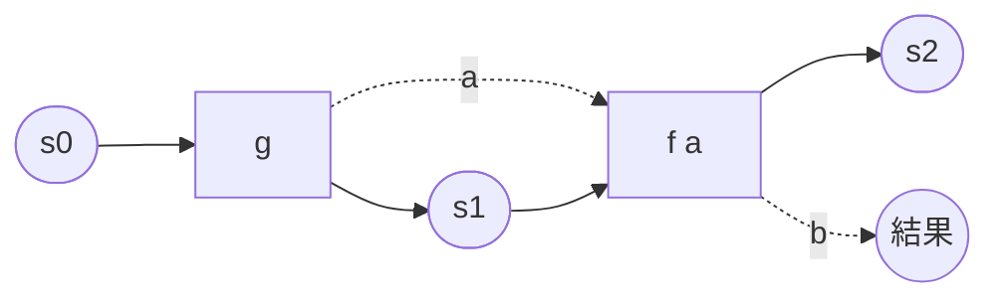
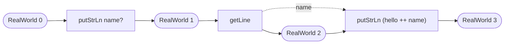

Haskellは、**純粋関数型・遅延評価・静的型付け**の3つをすべて徹底した言語。
どれか1つなら他の言語にもあるが (Rustの型推論、Kotlinの `Sequence` の遅延評価)、3つを同時に徹底すると書き方が根本から変わる。

- 純粋: 関数の結果は引数だけで決まり、副作用を起こさない。副作用は `IO` 型の値として型で分離される
- 遅延: 式は必要になるまで評価されない。無限リストが普通に書ける
- 静的型付け: 型はほぼ全て推論されるので署名は省略できるが、書くのが慣習。多相は型classで表す

このノートで扱うのは次の4つ。

- 基本: 式と関数、pattern match、リスト
- 型: 代数的データ型、型class、`Maybe` と `Either`
- Functor、Applicative、Monad: 「文脈付きの値」に関数を適用する3段階、`do` 記法、`State` と `IO` が同じ形をしていること
- 遅延評価と `IO`: 無限リスト、space leak、純粋な部分と副作用の分離

## 前提知識

- 何かの静的型付き言語でcodeを書いた経験 (対比はKotlinとRust)
- 代数的データ型とpattern matchの概念 ([代数的データ型](/posts/algebraic-data-types/))
- ラムダ計算は知らなくてよい。背景を知りたければ [型付きラムダ計算](/posts/typed-lambda-calculus/)

## コンセプト

### 全てが式で、関数は値

文 (statement) はなく、programは式の定義の集まり。`if` も `case` も値を返す式で、関数は他の値と同じく引数に渡し、戻り値として返せる。
関数は常に1引数で、複数引数は「1つ受け取って残りを待つ関数を返す」形 (currying)。引数を一部だけ渡した部分適用が、特別な構文なしに書ける。

```haskell
add :: Int -> Int -> Int    -- Int -> (Int -> Int) と読む
add x y = x + y

inc :: Int -> Int
inc = add 1                 -- 部分適用
```

### 副作用は型に現れる

`Int` を返す関数は、何回呼んでも同じ引数なら同じ `Int` を返し、画面にもfileにも触らない。
触る関数は `IO Int` を返す。「実行すると `Int` が得られる手続き」であって、`Int` そのものではない。
型を見るだけで、その関数が外界に触るかどうかが分かる。

### 評価は必要になるまで起きない

`let x = expensive` と書いても `x` を使わなければ計算されない。
引数も同じで、関数は使わない引数を評価しない。だから `if` 相当のものを普通の関数として自分で定義できる。
代償として、いつ評価されるかが読みにくく、未評価の式が溜まってmemoryを食う (space leak) ことがある。

## 基本

### 定義と型署名

```haskell
x :: Int
x = 42

square :: Int -> Int
square n = n * n

main :: IO ()
main = print (square x)
```

`::` は「型は」。型署名は省略でき、compilerが推論する。
名前は小文字で始まり、型と型constructorは大文字で始まる。これは慣習ではなく文法。

### pattern matchとguard

関数の定義を引数の形ごとに書き分ける。上から順に試され、最初に合ったものが使われる。

```haskell
factorial :: Integer -> Integer
factorial 0 = 1
factorial n = n * factorial (n - 1)

sign :: Int -> String
sign n
  | n < 0     = "negative"
  | n == 0    = "zero"
  | otherwise = "positive"
```

`|` のguardは条件分岐。`otherwise` は `True` の別名。式の途中で分岐するときは `case`。

```haskell
describe :: [a] -> String
describe xs = case xs of
  []  -> "empty"
  [_] -> "one"
  _   -> "many"
```

Rustの `match`、Kotlinの `when` と同じで、場合を尽くしていないとcompilerが警告する (`-Wincomplete-patterns`、`-Wall` に含まれる)。

### ローカル定義

`where` は定義の後ろに、`let` は式の前に置く。

```haskell
bmi :: Double -> Double -> Double
bmi weight height = weight / h2
  where
    h2 = height * height

bmi' :: Double -> Double -> Double
bmi' weight height =
  let h2 = height * height
   in weight / h2
```

### リスト

リストは同じ型の値の連結リスト。`[]` が空、`x : xs` が先頭 `x` と残り `xs`。`[1, 2, 3]` は `1 : 2 : 3 : []` の略記。

```haskell
length' :: [a] -> Int
length' []       = 0
length' (_ : xs) = 1 + length' xs

map' :: (a -> b) -> [a] -> [b]
map' _ []       = []
map' f (x : xs) = f x : map' f xs
```

`a` や `b` のような小文字の型は型変数で、どんな型でもよい (parametric polymorphism)。Kotlinの `<T>`、Rustの `<T>` と同じだが、宣言は不要。

標準の `map`、`filter`、`foldr`、`zip`、`take` と、リスト内包表記でほとんどの処理が書ける。

```haskell
[x * x | x <- [1 .. 10], even x]   -- [4,16,36,64,100]
```

`String` は `[Char]` の別名。文字列処理は文字のリスト処理であり、性能が要るときは `Text` や `ByteString` を使う。

### 関数合成と `$`

```haskell
(f . g) x == f (g x)
f $ x    == f x
```

`.` は合成。`$` は優先度が最も低い適用で、括弧を減らすために使う。

```haskell
print (sum (map square (filter even [1 .. 10])))
print $ sum $ map square $ filter even [1 .. 10]
print . sum . map square . filter even $ [1 .. 10]
```

3行目は「`filter even` して `map square` して `sum` して `print`」という処理のpipelineを、関数の合成として定義している。
データではなく関数を組み合わせるこの書き方が point-free style。

## 型

### 代数的データ型

`data` で直積と直和を同時に定義する。

```haskell
data Shape
  = Circle Double
  | Rect Double Double

area :: Shape -> Double
area (Circle r) = pi * r * r
area (Rect w h) = w * h
```

`Circle` と `Rect` はdata constructorで、値を作る関数でもあり (`Circle :: Double -> Shape`)、pattern matchで分解もできる。
Rustの `enum Shape { Circle(f64), Rect(f64, f64) }` と同じ。

fieldに名前を付けるならrecord構文。

```haskell
data User = User
  { name :: String
  , age  :: Int
  }

older :: User -> User
older u = u { age = age u + 1 }   -- 一部のfieldだけ変えたcopy
```

型引数を取ることもできる。

```haskell
data Maybe a = Nothing | Just a
data Either a b = Left a | Right b
data List a = Nil | Cons a (List a)
```

`Maybe a` は「あるかもしれない `a`」でRustの `Option<T>`、Kotlinの `T?` に当たる。`Either a b` はRustの `Result<T, E>` で、慣習として `Left` が失敗、`Right` が成功。
nullはなく、無いかもしれない値は必ず `Maybe` で型に現れる。

<Hint level="info">
  `data` のほかに、別名を付けるだけの `type` と、constructorが1つでfieldが1つの
  `newtype` がある。 `newtype` は実行時のコストが0で、`Int` に `UserId`
  のような別の型を付けて取り違えを防ぐのに使う。 Rustのnewtype pattern (`struct
  UserId(u64)`) と同じ発想。
</Hint>

### 型class

型classは「この型はこの操作を持つ」という宣言で、Rustのtrait、Kotlinのinterfaceに近い。
ただし型の定義と別の場所で `instance` を書けるので、既存の型に後から操作を足せる (Rustのtraitと同じで、Kotlinのinterfaceとは違う)。

```haskell
class Eq a where
  (==) :: a -> a -> Bool
  (/=) :: a -> a -> Bool
  x /= y = not (x == y)    -- default実装

instance Eq Shape where
  Circle r1  == Circle r2  = r1 == r2
  Rect w1 h1 == Rect w2 h2 = w1 == w2 && h1 == h2
  _          == _          = False
```

型署名の `=>` の左が制約。「`Eq a` である任意の `a` について」と読む。

```haskell
elem' :: Eq a => a -> [a] -> Bool
elem' _ []       = False
elem' x (y : ys) = x == y || elem' x ys
```

よく使う型classと、`deriving` で自動導出できるもの。

| 型class   | 操作                  | deriving |
| --------- | --------------------- | -------- |
| `Eq`      | `==`                  | 可       |
| `Ord`     | `<`、`compare`        | 可       |
| `Show`    | `show` (文字列化)     | 可       |
| `Read`    | `read` (文字列から)   | 可       |
| `Enum`    | `succ`、`[a .. b]`    | 可       |
| `Num`     | `+`、`*`、数値literal | 不可     |
| `Functor` | `fmap`                | 可       |

```haskell
data Color = Red | Green | Blue
  deriving (Eq, Ord, Show, Enum)
```

数値literalの `1` は `Num a => a` という多相な値で、文脈から `Int` にも `Double` にもなる。`length xs / 2` が型エラーになるのはこのため (`length` は `Int` を返し、`/` は `Fractional` を要求する)。`fromIntegral` で変換する。

### 型classの階層

型classは他の型classを前提にできる。`Ord a` は `Eq a` を要求する。

```haskell
class Eq a => Ord a where
  compare :: a -> a -> Ordering
  ...
```

後述の `Functor`、`Applicative`、`Monad` もこの形の階層で、`Monad` は `Applicative` を、`Applicative` は `Functor` を要求する。

## Functor、Applicative、Monad

この3つは「文脈の中にある値」を扱う型classで、Haskellの書き方の中心にある。
文脈とは `Maybe` (無いかもしれない)、`[]` (複数ある)、`IO` (外界に触って得る)、`Either e` (失敗するかもしれない) など、**型constructor `f` を1つ被せたもの**。
どれも `f a` から `a` を取り出せない、または取り出したくない状況で、`a` に関数を適用したい。

### Functor: 普通の関数を中に適用する

```haskell
class Functor f where
  fmap :: (a -> b) -> f a -> f b

fmap (+ 1) (Just 2)      -- Just 3
fmap (+ 1) Nothing       -- Nothing
fmap (+ 1) [1, 2, 3]     -- [2,3,4]
(+ 1) <$> Just 2         -- Just 3  (<$> は fmap の中置記法)
```

文脈を保ったまま中身だけ変える。Kotlinの `T?.let`、Rustの `Option::map` と同じ。
リストの `map` は `fmap` のリスト版。

### Applicative: 文脈の中の関数を中に適用する

2引数関数 `(+)` を `Just 1` と `Just 2` に適用したい。`fmap (+) (Just 1)` の型は `Maybe (Int -> Int)` で、関数が文脈の中に入ってしまい、`fmap` では次の引数を渡せない。

```haskell
class Functor f => Applicative f where
  pure  :: a -> f a
  (<*>) :: f (a -> b) -> f a -> f b

(+) <$> Just 1 <*> Just 2       -- Just 3
(+) <$> Just 1 <*> Nothing      -- Nothing
(,) <$> [1, 2] <*> ['a', 'b']   -- [(1,'a'),(1,'b'),(2,'a'),(2,'b')]
```

`pure` は値を文脈に入れる。`<*>` は文脈の中の関数を文脈の中の値に適用する。
`f <$> x <*> y <*> z` で、何引数の関数でも文脈の中に持ち上げられる。
引数同士は独立していて、`y` の文脈が `x` の結果に依存することはない。

### Monad: 前の結果で次の文脈が決まる

「`a` を受け取って、文脈付きの `b` を返す」関数を繋ぎたい。

```haskell
safeDiv :: Int -> Int -> Maybe Int
safeDiv _ 0 = Nothing
safeDiv x y = Just (x `div` y)

-- 100 を x で割り、その結果を y で割りたい
-- fmap (safeDiv 100) (Just x) の型は Maybe (Maybe Int) で、ネストする
```

`Functor` では文脈が二重になり、`Applicative` では2つ目の計算が1つ目の結果を見られない。
「1つ目の結果を取り出し、それを使って2つ目の文脈を作り、二重になった文脈を平らにする」操作が要る。それが `>>=` (bind)。

```haskell
class Applicative m => Monad m where
  return :: a -> m a              -- pure と同じ
  (>>=)  :: m a -> (a -> m b) -> m b

safeDiv 100 2 >>= \x -> safeDiv x 10   -- Just 5  (Just 50 の中身を取り出して次に渡す)
safeDiv 100 0 >>= \x -> safeDiv x 10   -- Nothing (最初で止まる)
```

Rustの `?`、Kotlinの `?.` の連鎖に当たるものを、`Maybe` 以外の文脈にも使える形で一般化したもの。

### `>>=` の意味は文脈ごとに違う

`>>=` の型は同じでも、「文脈から取り出して次に渡す」が何を意味するかはinstanceが決める。

```haskell
instance Monad Maybe where
  Nothing >>= _ = Nothing        -- 失敗したら以降を飛ばす
  Just x  >>= f = f x

instance Monad [] where
  xs >>= f = concatMap f xs      -- 各要素に適用して連結する (flatMap)

instance Monad (Either e) where
  Left e  >>= _ = Left e         -- 最初のエラーを持って抜ける
  Right x >>= f = f x
```

```haskell
[1, 2, 3] >>= \x -> [x, x * 10]          -- [1,10,2,20,3,30]
Right 1 >>= \x -> Left "boom" >>= \y -> Right (x + y)   -- Left "boom"
```

`IO` の `>>=` は「左を実行し、結果を右に渡し、右を実行する」。これだけは定義が見えないように思えるが、後述の通り `State` と同じ形をしている。

### `do` 記法

`>>=` の連鎖は読みにくいので、糖衣構文がある。

```haskell
calc :: Int -> Int -> Int -> Maybe Int
calc a b c = do
  x <- safeDiv a b
  y <- safeDiv x c
  return (x + y)

-- 脱糖すると
calc' a b c =
  safeDiv a b >>= \x ->
    safeDiv x c >>= \y ->
      return (x + y)
```

`x <- m` は「`m` の文脈から値を取り出して `x` と呼ぶ」。`do` の中は手続きのように見えるが、どの行も `>>=` で繋がれた式であり、文脈が `Maybe` なら途中で `Nothing` になった時点で `Nothing` が返る。
`do` を手続き型の構文だと思うと、`Maybe` やリストで `do` が使える理由が分からなくなる。**`do` は `>>=` の略記で、意味は文脈 (`m`) ごとに違う**。

リストで `do` を書くと、リスト内包表記と同じものになる。

```haskell
pairs = do
  x <- [1, 2]
  y <- "ab"
  return (x, y)
-- [(1,'a'),(1,'b'),(2,'a'),(2,'b')]
-- [(x, y) | x <- [1, 2], y <- "ab"] と同じ
```

<Hint level="warn">
  `Monad` を「副作用を扱う仕組み」と説明する入門記事が多いが、正しくない。
  `Maybe` も `[]` も `Monad` であり、副作用とは無関係。 副作用を扱うのは `IO`
  という1つの型で、`IO` が `Monad` のinstanceだから `do`
  で順序付けて書けるというだけ。
</Hint>

### Monad則

instanceは次の3つの等式を満たすことが期待される (compilerは検査しない)。

```haskell
return a >>= f    ==  f a                          -- 左単位元
m >>= return      ==  m                            -- 右単位元
(m >>= f) >>= g   ==  m >>= (\x -> f x >>= g)      -- 結合律
```

`do` 記法で言い直すと、`x <- return a` は `let x = a` に置き換えてよい、末尾の `return` を剥がしてよい、`do` blockの一部を別の `do` に切り出してよい、ということ。
この3つが成り立つから、`do` blockを関数に切り出すrefactoringが意味を変えない。

### State: 状態を引き回す

状態を更新しながら計算したいが、変数は書き換えられない。純粋に書くと、状態を引数で受け取り、新しい状態を返す関数になる。

```haskell
-- 連番を発行する。「今の番号」が状態
fresh' :: Int -> (Int, Int)
fresh' n = (n, n + 1)

labels' :: Int -> ((Int, Int, Int), Int)
labels' s0 =
  let (a, s1) = fresh' s0
      (b, s2) = fresh' s1
      (c, s3) = fresh' s2
   in ((a, b, c), s3)
```

動くが、状態の受け渡し (`s0` → `s1` → `s2` → `s3`) を手で書いていて、1つ取り違えると静かに壊れる。
この「`s -> (a, s)` という関数」を型にし、受け渡しを `>>=` に任せたのが `State`。

```haskell
newtype State s a = State { runState :: s -> (a, s) }

instance Monad (State s) where
  State g >>= f = State $ \s ->
    let (a, s1) = g s          -- 左を今の状態で走らせ
     in runState (f a) s1      -- 結果で右を作り、新しい状態で走らせる

get :: State s s               -- 状態を読む
get = State $ \s -> (s, s)

put :: s -> State s ()         -- 状態を置き換える
put s = State $ \_ -> ((), s)
```



`>>=` は、左の計算に今の状態を渡して結果と次の状態を受け取り、結果で右の計算を作って次の状態を渡す。
状態は一本の線として計算を貫き、利用者は `get` と `put` で触るだけになる。

```haskell
fresh :: State Int Int
fresh = do
  n <- get
  put (n + 1)
  return n

labels :: State Int (Int, Int, Int)
labels = (,,) <$> fresh <*> fresh <*> fresh

runState labels 0   -- ((0,1,2),3)
```

`labels` は `labels'` と同じ計算で、状態の受け渡しだけが消えている。
`State` は `Monad` のinstanceであり、ただの純粋な関数のnewtypeで、副作用はどこにもない。

### IOはRealWorldを引き回すState

`IO` の定義はGHCでは次の通り (`GHC.Types`)。

```haskell
newtype IO a = IO (State# RealWorld -> (# State# RealWorld, a #))
```

`State# RealWorld` は「外界の状態」を表すtokenで、実行時には大きさ0 (何も入っていない)。`(# , #)` はheapを使わないtuple。
細部を外すと `RealWorld -> (a, RealWorld)` で、**`IO a` は `State RealWorld a` と同じ形**をしている。
`>>=` も `State` と同じ書き方になる (`GHC.Base` の `bindIO`)。

```haskell
bindIO :: IO a -> (a -> IO b) -> IO b
bindIO (IO m) k = IO $ \s ->
  case m s of
    (# s1, a #) -> unIO (k a) s1
```



`main` の `do` blockは、上の `State` の図の `s` を `RealWorld` に置き換えたもの。
`putStrLn` は世界を受け取り、文字を出した後の世界を返す。`getLine` は世界を受け取り、読んだ文字列と、1行消費された後の世界を返す。
これで次のことが説明できる。

- **順序が決まる理由**: 次の手続きは前の手続きが返した世界を引数に取る。引数が揃うまで実行できないので、遅延評価でも順番が入れ替わらない。`case` での分解は正格なので、前の手続きが飛ばされることもない
- **`main` だけが実行される理由**: 最初の `RealWorld` を持っているのはruntimeだけで、それを `main` に渡す。`IO` の値を作っても世界を渡さない限り何も起きない
- **純粋な関数から `IO` を実行できない理由**: 世界を受け取っていない関数は、手続きに渡す世界を持っていない
- **`unsafePerformIO` が危険な理由**: 世界を偽造して手続きに渡し、返ってきた世界を捨てる。順序の保証が消え、遅延評価の都合で実行されない、2回実行される、といったことが起こる

つまり `IO` に特別な仕組みはない。
状態を引き回す純粋な関数という `State` の形に、「状態は外界そのもので、runtimeしか作れない」という制約を加えたものが `IO`。

<Hint level="info">
  `State RealWorld` はGHCの実装であり、Haskellの言語仕様が `IO`
  の中身を決めているわけではない。 また本物の `State` と違って `RealWorld`
  は複製も捨てることもできない (線形に1回だけ使う前提で、違反すると未定義動作)。
  「状態を引き回す関数」と見るのは正確な比喩であって、`IO` を `runState`
  で剥がす手段はない。
</Hint>

同じ形はもう1つある。`ST s a` は `State# s -> (# State# s, a #)` で、`RealWorld` の代わりに型変数 `s` を取り、`runST :: (forall s. ST s a) -> a` で純粋な値として取り出せる。
関数の内側だけで配列を破壊的に更新し、外からは純粋な関数に見せるのに使う。

| 型          | 状態                       | 取り出し方         | 用途               |
| ----------- | -------------------------- | ------------------ | ------------------ |
| `State s a` | 任意の値 `s`               | `runState`         | 純粋な状態付き計算 |
| `ST s a`    | `State# s` (mutableな領域) | `runST`            | 局所的な破壊的更新 |
| `IO a`      | `State# RealWorld`         | なし (`main` のみ) | 外界との入出力     |

### 3つの違いの整理

| 型class       | 適用するもの | 文脈同士の関係          |
| ------------- | ------------ | ----------------------- |
| `Functor`     | `a -> b`     | 文脈は1つ               |
| `Applicative` | `f (a -> b)` | 独立 (前の結果に依らず) |
| `Monad`       | `a -> m b`   | 前の結果で次が決まる    |

`Applicative` で書けるなら `Monad` は使わない。文脈同士が独立していることが型で保証され、並列実行や静的解析ができるから。

## 遅延評価

### 無限リスト

リストは必要な要素だけ評価されるので、無限リストを定義して途中まで使える。

```haskell
naturals :: [Integer]
naturals = [0 ..]

fibs :: [Integer]
fibs = 0 : 1 : zipWith (+) fibs (tail fibs)

take 10 fibs                        -- [0,1,1,2,3,5,8,13,21,34]
takeWhile (< 100) (map (^ 2) [1 ..]) -- [1,4,9,16,25,36,49,64,81]
```

`fibs` は自分自身を参照して定義されているが、先頭2つが確定しているので、3つ目以降は順に計算できる。
「どう生成するか」と「どこまで使うか」を別々の式に書けるのが、遅延評価の最大の利点。

### thunkとspace leak

未評価の式はthunkとしてheapに置かれる。
`foldl` で総和を取ると、`((0 + 1) + 2) + 3 + ...` という式がthunkとして積み上がり、最後に一気に評価されてstackを食う。

```haskell
foldl (+) 0 [1 .. 10000000]    -- thunkが積み上がる
foldl' (+) 0 [1 .. 10000000]   -- 各段階で評価する (Data.List)
```

`foldl'` は積算値を各段階で評価する正格版。`seq a b` で `a` を先に評価する、`!x` (BangPatterns) で引数を正格にする、`data` のfieldに `!` を付ける、が正格性を指示する手段。
accumulatorを持つ再帰では、原則として正格にする。

<Hint level="info">
  遅延評価が必要な場面 (無限構造、使わない引数を評価しない)
  は限られ、大半のcodeは正格でも困らない。 GHCの `StrictData`
  拡張はfieldを全て正格にする。実務のcodebaseでは有効にしていることが多い。
</Hint>

## IO

### `IO a` は手続きを表す値

`IO a` 型の値は「実行すると `a` が得られる手続き」で、作っただけでは何も起きない。
実行されるのは `main :: IO ()` から繋がった手続きだけ (前述の通り、`RealWorld` を渡されるのは `main` だけ)。

```haskell
main :: IO ()
main = do
  putStrLn "name?"
  name <- getLine
  putStrLn ("hello, " ++ name)
```

`getLine :: IO String` から `name :: String` を取り出しているのは `do` の `<-`、つまり `>>=`。
`IO` から取り出した値を純粋な関数に渡すことはできるが、純粋な関数の中で `IO` を実行することはできない。型が許さない。

### 純粋な部分と副作用を分ける

典型的な構成は、入力を受け取る `IO`、計算する純粋な関数、結果を出す `IO` の3層。

```haskell
main :: IO ()
main = do
  input <- readFile "numbers.txt"
  let total = sum (map read (lines input)) :: Int   -- 純粋
  print total
```

純粋な部分はGHCiで値を渡して確かめられ、propertyベースのtest (QuickCheck) で網羅的に検査できる。
`IO` に触る部分を薄くするのは、純粋性がcompilerで強制されるHaskellでは設計方針ではなく、自然にそうなる。

### `IO` の中の `let` と `<-`

```haskell
  let x = f y        -- 純粋な値に名前を付ける
  z <- action        -- IO a から a を取り出す
```

`let` は `=`、`<-` は `>>=`。`x <- return (f y)` と書いても動くが、`let` が正しい。

## 道具

- GHC: 事実上唯一のcompiler。`ghc Main.hs` でbinaryができる
- GHCi: REPL。`:t expr` で型、`:i Name` で定義とinstance、`:l File.hs` で読み込み。型を確かめながら書くのが基本の作業
- cabal: package管理とbuild。`cabal init`、`cabal build`、`cabal repl`
- stack: cabalの上に、GHCのversionとpackageの組み合わせを固定する層 (Stackage) を足したもの。どちらか一方を使う
- GHCup: GHC、cabal、stack、HLSのinstaller
- HLS (Haskell Language Server): editor連携。型の表示、補完、hint
- Hackage: packageのregistry。Hoogleで型から関数を検索できる (`(a -> b) -> [a] -> [b]` で `map` が出る)

`-Wall` は常に付ける。網羅していないpattern match、使っていない変数、型のdefault化を全部拾ってくれる。

## 参考

- Graham Hutton, _Programming in Haskell_, 2nd ed. (Cambridge University Press, 2016)。邦訳『プログラミングHaskell 第2版』(ラムダノート)。薄く、順に読めば一通り書けるようになる
- Miran Lipovača, _Learn You a Haskell for Great Good!_ (No Starch Press, 2011)。邦訳『すごいHaskellたのしく学ぼう!』(オーム社)。FunctorからMonadまでの説明はこれが分かりやすい
- Christopher Allen, Julie Moronuki, _Haskell Programming from First Principles_ (2016)。演習が多く、型classの理解を固めるのに向く
- [Haskell Language](https://www.haskell.org/)。GHCupとドキュメントの入口
