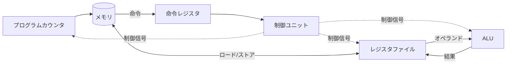
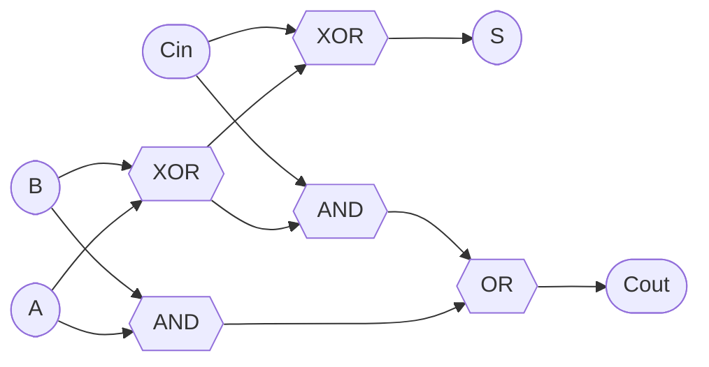
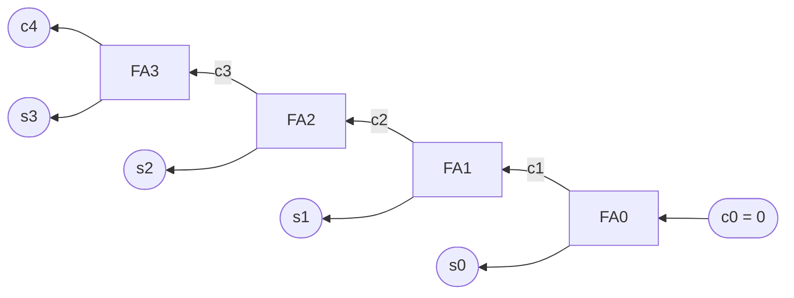
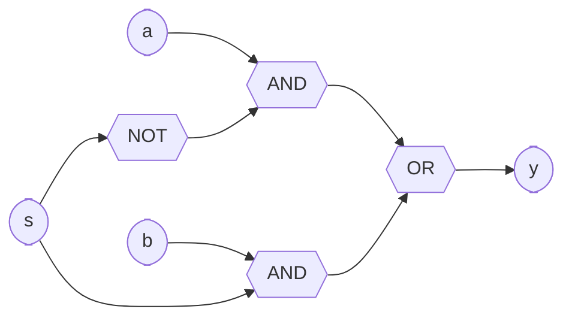
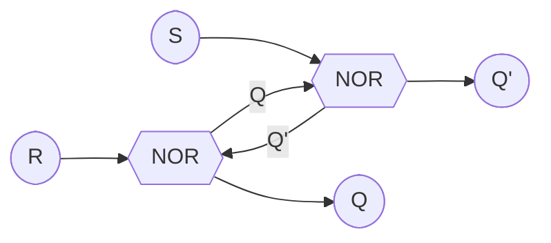
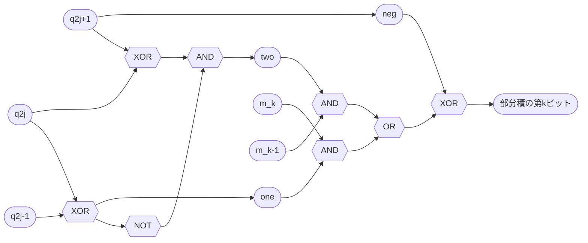
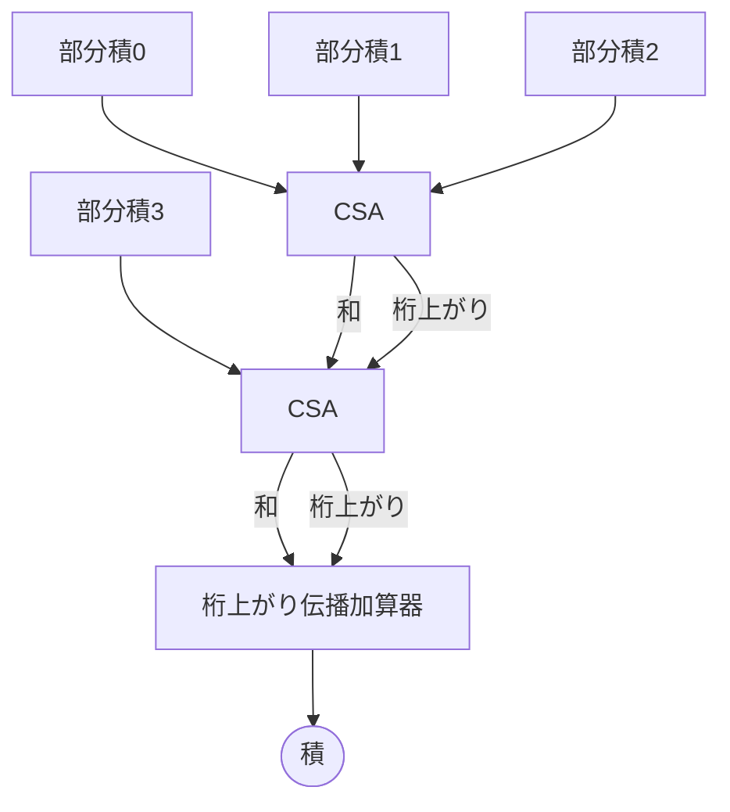
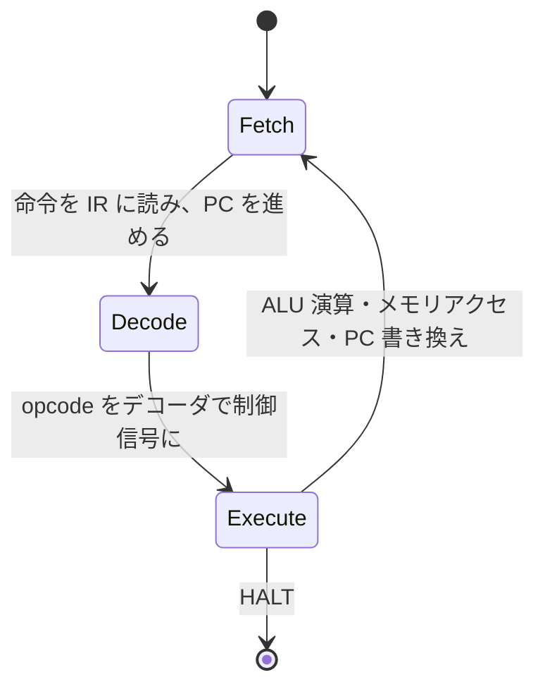

CPUは、**組み合わせ回路** (入力だけで出力が決まる回路) と**順序回路** (過去の入力を覚えている回路) を、**クロック**に合わせて動かしたものである。
このノートでは、論理ゲートから加算器、ALU、レジスタ、乗算器 (ブースエンコーディング) を順に組み上げ、最後に命令を実行する流れをまとめる。
パイプラインやキャッシュなど、ここより上の層は[コンピュータアーキテクチャ](/posts/processor/)のノートにまとめてある。

Pythonのコードは回路の振る舞いを確かめるためのもので、各関数が1つの回路に対応する。
ビット列は**LSBが先頭**のリストで表す。

## 全体像



- **データパス** (レジスタファイル、ALU、メモリとそれらをつなぐ配線) がデータを運び、計算する
- **制御ユニット**が命令を解読し、データパスのどの経路を使うかを制御信号で選ぶ
- 1クロックごとにレジスタが新しい値を取り込み、状態が1歩進む

## 論理ゲート

| $A$ | $B$ | AND | OR  | XOR | NAND | NOR |
| --- | --- | --- | --- | --- | ---- | --- |
| 0   | 0   | 0   | 0   | 0   | 1    | 1   |
| 0   | 1   | 0   | 1   | 1   | 1    | 0   |
| 1   | 0   | 0   | 1   | 1   | 1    | 0   |
| 1   | 1   | 1   | 1   | 0   | 0    | 0   |

CMOSでは、NANDとNORがトランジスタ4個で作れて最も安い。
ANDやORはNAND/NORの後ろにNOTを付けて作る。

### NANDの完全性

NANDだけで任意の論理関数が作れる (**関数完全**)。
NOTとANDとORが作れれば、真理値表の1の行をORでつなぐ積和形 (主加法標準形) で何でも書けるからである。

$$
\lnot A = \overline{A \cdot A}, \quad A \cdot B = \lnot \overline{A \cdot B}, \quad A + B = \overline{\lnot A \cdot \lnot B}
$$

最後の式はド・モルガンの法則 $\overline{\lnot A \cdot \lnot B} = A + B$ による。

```python
def nand(a, b):
    return 1 - (a & b)

def not_(a):
    return nand(a, a)

def and_(a, b):
    return not_(nand(a, b))

def or_(a, b):
    return nand(not_(a), not_(b))

def xor(a, b):
    # NAND 4 個で作る XOR
    n = nand(a, b)
    return nand(nand(a, n), nand(b, n))
```

## 加算器

### 半加算器と全加算器

1ビットの足し算は、和 $S$ と桁上がり $C$ の2出力になる。

- **半加算器** (half adder): $S = A \oplus B$, $C = A \cdot B$
- **全加算器** (full adder): 下の桁からの桁上がり $C_\mathrm{in}$ も足す。半加算器2つとORで作れる

$$
S = A \oplus B \oplus C_\mathrm{in}, \quad C_\mathrm{out} = A \cdot B + (A \oplus B) \cdot C_\mathrm{in}
$$



```python
def half_adder(a, b):
    return xor(a, b), and_(a, b)  # (和, 桁上がり)

def full_adder(a, b, cin):
    s1, c1 = half_adder(a, b)
    s, c2 = half_adder(s1, cin)
    return s, or_(c1, c2)
```

### リプルキャリー加算器

全加算器を $n$ 個並べ、桁上がりを下位から上位へ順に渡せば $n$ ビットの加算器になる。
これを**リプルキャリー加算器** (ripple-carry adder) という。



```python
def ripple_carry_add(a_bits, b_bits, cin=0):
    out, c = [], cin
    for a, b in zip(a_bits, b_bits):
        s, c = full_adder(a, b, c)
        out.append(s)
    return out, c

def to_bits(x, n):
    return [(x >> i) & 1 for i in range(n)]

def from_bits(bits):
    return sum(b << i for i, b in enumerate(bits))

s, c = ripple_carry_add(to_bits(11, 4), to_bits(6, 4))
assert from_bits(s) + (c << 4) == 17
```

構造は単純だが、最上位の和は最下位からの桁上がりを待つので、遅延がビット数 $n$ に比例する ($O(n)$)。
64ビットの加算で64段の待ちが出るのは、1クロックに収めるには遅すぎる。

### キャリールックアヘッド加算器

桁上がりを待たずに先読みするのが**キャリールックアヘッド加算器** (carry-lookahead adder) である。
各桁について次の2つを、桁上がりと無関係に並列で求めておく。

- **生成** (generate) $g_i = a_i \cdot b_i$: その桁だけで桁上がりが出る
- **伝播** (propagate) $p_i = a_i \oplus b_i$: 下からの桁上がりがあればそのまま上に渡す

すると $c_{i+1} = g_i + p_i c_i$ であり、これを展開すると、どの桁上がりも $c_0$ と $g, p$ だけで書ける。

$$
\begin{aligned}
c_1 &= g_0 + p_0 c_0 \\
c_2 &= g_1 + p_1 g_0 + p_1 p_0 c_0 \\
c_3 &= g_2 + p_2 g_1 + p_2 p_1 g_0 + p_2 p_1 p_0 c_0
\end{aligned}
$$

そのまま展開すると上位ほどゲートの入力数が増えるので、実際には4ビット程度のブロックを木状に重ねて、遅延を $O(\log n)$ に抑える。

## 負の数と減算

### 2の補数

$n$ ビットの**2の補数**表現では、最上位ビットの重みを $-2^{n-1}$ とする。

$$
x = -x_{n-1} 2^{n-1} + \sum_{i=0}^{n-2} x_i 2^i
$$

4ビットなら $-8$ から $7$ を表せ、たとえば $1101_2 = -8 + 4 + 1 = -3$ である。
全ビットを反転して1を足すと符号が反転する ($-x = \lnot x + 1$)。

### 減算は加算器で済む

$x - y = x + \lnot y + 1$ なので、$y$ の各ビットをXORで反転し、最下位の桁上がり入力 $c_0$ に1を入れれば、加算器がそのまま減算器になる。
XORの片方に「減算か」を表す信号 $\mathit{sub}$ をつなぎ、同じ信号を $c_0$ にも入れれば、1本の制御信号で加算と減算を切り替えられる ($b \oplus 0 = b$, $b \oplus 1 = \lnot b$)。

## マルチプレクサとデコーダ

CPUの中で「どれを使うか選ぶ」部品は、ほぼこの2つでできている。

- **マルチプレクサ** (MUX): 選択信号 $s$ に従って入力の1つを出力に通す。2入力なら $y = \lnot s \cdot a + s \cdot b$
- **デコーダ**: $k$ ビットの入力を、$2^k$ 本のうち1本だけが1になる出力 (one-hot) に変換する。命令のopcodeから制御信号を作る、アドレスからレジスタを選ぶ、などに使う



## ALU

**ALU** (Arithmetic Logic Unit) は、加減算と論理演算の回路を並べて、結果をマルチプレクサで選ぶ回路である。
結果と一緒に**フラグ**を出し、条件分岐はこのフラグを見る。

| フラグ | 意味                                                        |
| ------ | ----------------------------------------------------------- |
| Z      | 結果が0                                                     |
| N      | 結果の最上位ビット (符号付きとして負)                       |
| C      | 最上位からの桁上がり (符号なしとしての桁あふれ)             |
| V      | 符号付きとしてのオーバーフロー (同符号の和で符号が変わった) |

```python
def alu(op, x, y, n=8):
    a, b = to_bits(x, n), to_bits(y, n)
    if op == "ADD":
        r, c = ripple_carry_add(a, b)
    elif op == "SUB":  # x - y = x + ~y + 1
        r, c = ripple_carry_add(a, [not_(v) for v in b], cin=1)
    elif op == "AND":
        r, c = [and_(p, q) for p, q in zip(a, b)], 0
    elif op == "OR":
        r, c = [or_(p, q) for p, q in zip(a, b)], 0
    else:
        raise ValueError(op)
    flags = {
        "Z": int(not any(r)),
        "N": r[-1],
        "C": c,
        # 加算器に入る 2 数 (減算なら y は反転済み) が同符号で、結果の符号が変わった
        "V": int(op in ("ADD", "SUB") and a[-1] == (b[-1] ^ (op == "SUB")) and r[-1] != a[-1]),
    }
    return from_bits(r), flags

alu("SUB", 5, 7)    # (254, {'Z': 0, 'N': 1, 'C': 0, 'V': 0})  254 は -2
alu("ADD", 100, 100)  # (200, {'Z': 0, 'N': 1, 'C': 0, 'V': 1})  符号付きでは溢れた
alu("SUB", 7, 7)    # (0, {'Z': 1, 'N': 0, 'C': 1, 'V': 0})
```

減算でのCは「借りがなかった」ことを表す ($x \ge y$ なら $C = 1$)。
`x < y` (符号なし) の分岐は $C = 0$、`x == y` は $Z = 1$ を見ればよい。

## 順序回路

組み合わせ回路は値を覚えられない。
出力を入力に戻す (フィードバック) と、値を保持する回路になる。

### SRラッチ

NORを2つたすき掛けにしたのが**SRラッチ**である。



| $S$ | $R$ | 次の $Q$                                                  |
| --- | --- | --------------------------------------------------------- |
| 0   | 0   | 保持 (前の $Q$)                                           |
| 1   | 0   | 1 (セット)                                                |
| 0   | 1   | 0 (リセット)                                              |
| 1   | 1   | 禁止 ($Q = Q' = 0$ になり、両方を0に戻すと値が定まらない) |

$S = R = 0$ のとき、$Q$ と $Q'$ が互いを支え合って前の値が残る。これが1ビットの記憶である。

### Dフリップフロップ

禁止入力をなくし、書き込むタイミングをクロックで決めたのが**Dフリップフロップ**である。

- **Dラッチ**: $S = D \cdot \mathit{clk}$, $R = \lnot D \cdot \mathit{clk}$ とする。$\mathit{clk} = 1$ の間は $Q$ が $D$ に追従し、0になると値を保持する
- **Dフリップフロップ**: Dラッチを2段つなぎ、前段 (マスタ) は $\mathit{clk} = 0$ の間、後段 (スレーブ) は $\mathit{clk} = 1$ の間だけ開く。どちらかは必ず閉じているので、出力が変わるのはクロックの立ち上がりの瞬間だけになる (**エッジトリガ**)

ラッチのままだと、$\mathit{clk} = 1$ の間に組み合わせ回路を一周して戻ってきた値まで取り込んでしまう。
エッジトリガなら1クロックに1回だけ状態が進むので、「レジスタ → 組み合わせ回路 → レジスタ」の構造が素直に書ける。

### レジスタとクロック周期

$n$ 個のDフリップフロップを並べたものが $n$ ビットの**レジスタ**、レジスタを並べて読み書きのポートを付けたものが**レジスタファイル**である。

同期回路では、すべてのレジスタが同じクロックの立ち上がりで値を取り込む。
クロック周期は、レジスタ間で最も遅い組み合わせ回路の経路 (**クリティカルパス**) で決まる。

$$
T_\mathrm{clk} \ge t_\mathrm{clk \to Q} + t_\mathrm{logic,max} + t_\mathrm{setup}
$$

加算器をリプルキャリーからキャリールックアヘッドにすると速くなるのは、この $t_\mathrm{logic,max}$ が縮むからである。
パイプラインも、組み合わせ回路の途中にレジスタを挟んで $t_\mathrm{logic,max}$ を分割する手法と見ることができる。

## 乗算器

### シフトと加算

筆算と同じく、乗数 $Q$ の各ビットに応じて被乗数 $M$ をシフトしたもの (**部分積**) を足す。

$$
M \times Q = \sum_{i=0}^{n-1} q_i \cdot (M \ll i)
$$

2進数なので部分積は $0$ か $M \ll i$ のどちらかで、ANDゲートだけで作れる。
問題は2つある。

1. 部分積が $n$ 個あり、足し合わせるのに時間がかかる
2. このままでは符号付き (2の補数) の $Q$ を扱えない。最上位ビットの重みが $-2^{n-1}$ なので、最後の部分積だけ引く必要がある

ブースエンコーディングは両方に効く。

### ブースエンコーディング (基数2)

$2^i = 2^{i+1} - 2^i$ を使って、2の補数の $Q$ を各桁が $\{-1, 0, +1\}$ の数に書き換える。
$q_{-1} = 0$ として

$$
Q = -q_{n-1} 2^{n-1} + \sum_{i=0}^{n-2} q_i 2^i = \sum_{i=0}^{n-1} (q_{i-1} - q_i) \, 2^i
$$

<Details title="確認">

右辺を2つの和に分け、前の和の添字をずらす。

$$
\sum_{i=0}^{n-1} q_{i-1} 2^i - \sum_{i=0}^{n-1} q_i 2^i
= \sum_{i=0}^{n-2} q_i 2^{i+1} - \sum_{i=0}^{n-1} q_i 2^i
= \sum_{i=0}^{n-2} q_i 2^i - q_{n-1} 2^{n-1}
$$

これは2の補数の定義そのものである。

</Details>

つまり、隣り合う2ビット $(q_i, q_{i-1})$ を見るだけで各桁 $d_i = q_{i-1} - q_i$ が決まる。

| $q_i$ | $q_{i-1}$ | $d_i$ | 意味              |
| ----- | --------- | ----- | ----------------- |
| 0     | 0         | 0     | 0の並びの途中     |
| 0     | 1         | +1    | 1の並びが終わった |
| 1     | 0         | −1    | 1の並びが始まった |
| 1     | 1         | 0     | 1の並びの途中     |

1が連続する区間 $2^j + \cdots + 2^k$ を $2^{k+1} - 2^j$ と書き直していることになる。
たとえば $0111\,1110_2 = 126$ は、7個の部分積の代わりに $2^7 - 2^1$ の2個で済む。

**例** $7 \times (-3)$ (4ビット)。$-3 = 1101_2$ で、$q_{-1} = 0$ を付けて右から2ビットずつ見る。

| $i$ | $(q_i, q_{i-1})$ | $d_i$ | 部分積 $d_i \cdot 7 \cdot 2^i$ |
| --- | ---------------- | ----- | ------------------------------ |
| 0   | (1, 0)           | −1    | $-7$                           |
| 1   | (0, 1)           | +1    | $+14$                          |
| 2   | (1, 0)           | −1    | $-28$                          |
| 3   | (1, 1)           | 0     | $0$                            |

合計 $-21$ で、符号付きの乗数を特別扱いせずに正しく掛けられた。

ただし、基数2のままでは $0101\ldots$ のように0と1が交互に並ぶと、すべての桁が $\pm 1$ になり、部分積は減らない (最悪 $n$ 個のまま)。

### 2次のブースエンコーディング (基数4)

ハードウェアで使われるのは、2桁ずつまとめた**2次のブースエンコーディング** (modified Booth, 基数4) である。
基数2の式で $i = 2j$ と $2j + 1$ の項を足すと

$$
(q_{2j-1} - q_{2j}) 2^{2j} + (q_{2j} - q_{2j+1}) 2^{2j+1} = (q_{2j-1} + q_{2j} - 2 q_{2j+1}) \, 4^j
$$

なので、3ビット $(q_{2j+1}, q_{2j}, q_{2j-1})$ を1ビットずつ重ねながら見て、各桁 $d_j \in \{-2, -1, 0, +1, +2\}$ を決める。

| $q_{2j+1}$ | $q_{2j}$ | $q_{2j-1}$ | $d_j$ | 部分積 |
| ---------- | -------- | ---------- | ----- | ------ |
| 0          | 0        | 0          | 0     | $0$    |
| 0          | 0        | 1          | +1    | $+M$   |
| 0          | 1        | 0          | +1    | $+M$   |
| 0          | 1        | 1          | +2    | $+2M$  |
| 1          | 0        | 0          | −2    | $-2M$  |
| 1          | 0        | 1          | −1    | $-M$   |
| 1          | 1        | 0          | −1    | $-M$   |
| 1          | 1        | 1          | 0     | $0$    |

ビットの並びによらず、**部分積が $n/2$ 個に半減する**。
しかも各部分積は掛け算なしで作れる。

- $\pm 2M$ は $M$ を1ビット左シフトするだけ (配線をずらすだけで、ゲートは要らない)
- $-M$ は全ビット反転して1を足す。この「+1」は部分積の加算のときに桁上がり入力として一緒に足すので、別の加算器は要らない

先ほどの $7 \times (-3)$ なら、$1101_2$ に $q_{-1} = 0$ を付けた $11010$ を右から3ビットずつ (1ビット重ねて) 見る。

- $j = 0$: $(q_1, q_0, q_{-1}) = (0, 1, 0) \Rightarrow d_0 = +1$, 部分積 $+7$
- $j = 1$: $(q_3, q_2, q_1) = (1, 1, 0) \Rightarrow d_1 = -1$, 部分積 $-7 \cdot 4 = -28$

部分積2個で $-21$ が出る。

### エンコーダとセレクタの回路

3ビットから「符号」「$M$ を使う」「$2M$ を使う」の3本の信号を作れば、部分積の各ビットはマルチプレクサとXORで選べる。

$$
\mathit{neg} = q_{2j+1}, \quad
\mathit{one} = q_{2j} \oplus q_{2j-1}, \quad
\mathit{two} = (q_{2j+1} \oplus q_{2j}) \cdot \lnot (q_{2j} \oplus q_{2j-1})
$$

部分積の第 $k$ ビットは $\bigl( \mathit{one} \cdot m_k + \mathit{two} \cdot m_{k-1} \bigr) \oplus \mathit{neg}$ で、最後のXORが「全ビット反転」にあたる。



$(1, 1, 1)$ では $\mathit{one} = \mathit{two} = 0$ なのに $\mathit{neg} = 1$ になり、部分積は全ビット1 (つまり $-1$) になる。
これには桁上がり入力の「+1」が足されるので、合わせて0となり、正しい。

```python
def booth_radix2(m, q, n):
    """n ビット 2 の補数の乗数 q (ビット列を符号なし整数で渡す) と m の積。"""
    product, prev = 0, 0  # prev は q_{i-1}
    for i in range(n):
        cur = (q >> i) & 1
        product += (prev - cur) * (m << i)
        prev = cur
    return product

def booth_radix4(m, q, n):
    """n は偶数。部分積は n/2 個。"""
    product = 0
    q <<= 1  # 末尾に q_{-1} = 0 を付ける
    for i in range(0, n, 2):
        q_prev = (q >> i) & 1        # q_{i-1}
        q_cur = (q >> (i + 1)) & 1   # q_i
        q_next = (q >> (i + 2)) & 1  # q_{i+1}
        d = -2 * q_next + q_cur + q_prev  # ∈ {-2, -1, 0, +1, +2}
        product += d * (m << i)
    return product

# 8 ビットの全組み合わせで確かめる
for m in range(-128, 128):
    for q in range(-128, 128):
        assert booth_radix2(m, q & 0xFF, 8) == m * q
        assert booth_radix4(m, q & 0xFF, 8) == m * q
```

Pythonの整数は無限精度なので、ここでは負の部分積を `d * (m << i)` で直接足している。
ハードウェアでは部分積を固定幅で作り、符号拡張と上の「+1」を足し込む。

### 部分積の足し合わせ

$n/2$ 個に減った部分積も、加算器を直列につなぐと遅い。
そこで**キャリーセーブ加算器** (CSA) を使う。
全加算器を桁ごとに独立に並べ、桁上がりを横に伝えずに「和の列」と「桁上がりの列」の2つの数として出力する。

$$
x + y + z = s + (c \ll 1) \quad (s_i, c_i \text{ は } x_i, y_i, z_i \text{ の全加算器の出力})
$$

3つの数を2つに減らす処理が、ビット幅によらず全加算器1段の遅延で済む。
これを木状に重ねて部分積を2つまで減らし (**ワレスツリー**)、最後に1回だけキャリールックアヘッド加算器で足す。
段数は $O(\log n)$ になる。



8ビット×8ビットなら、部分積8個がブースエンコーディングで4個になり、CSA2段と最終加算1回で積が出る。

## 命令の実行

ここまでの部品を制御ユニットでつなぐと、CPUは次の3ステップを繰り返す。



1. **フェッチ**: プログラムカウンタ (PC) の指すアドレスから命令を読み、命令レジスタ (IR) に入れる。PCを次の命令に進める
2. **デコード**: 命令のopcode部分をデコーダに通し、ALUの演算の種類、どのレジスタを読み書きするか、などの制御信号を作る
3. **実行**: データパスが制御信号に従って計算し、結果をレジスタやメモリに書く。分岐命令はフラグを見てPCを書き換える

制御ユニットの作り方は2通りある。

- **ハードワイヤード制御**: opcodeとフラグから制御信号を組み合わせ回路で直接作る。速い
- **マイクロプログラム制御**: 制御信号の並びを内部のROM (マイクロコード) に書いておき、命令ごとに順に読み出す。複雑な命令を作りやすく、修正もしやすい

1命令1ステップで動く、アキュムレータ1本だけのCPUをPythonで書くと次のようになる。
命令は1バイトで、上位4ビットがopcode、下位4ビットがアドレスである。

```python
LOAD, ADD, SUB, STORE, JNZ, HALT = range(6)

def run(mem):
    pc, acc = 0, 0
    while True:
        ir = mem[pc]                       # フェッチ
        pc += 1
        op, addr = ir >> 4, ir & 0x0F      # デコード
        if op == LOAD:                     # 実行
            acc = mem[addr]
        elif op == ADD:
            acc = (acc + mem[addr]) & 0xFF
        elif op == SUB:
            acc = (acc - mem[addr]) & 0xFF
        elif op == STORE:
            mem[addr] = acc
        elif op == JNZ:                    # フラグ Z を見る分岐
            if acc != 0:
                pc = addr
        elif op == HALT:
            return mem

# 5 + 4 + 3 + 2 + 1 を計算する
prog = [
    LOAD << 4 | 0xD,   # 0: acc = sum
    ADD << 4 | 0xE,    # 1: acc += i
    STORE << 4 | 0xD,  # 2: sum = acc
    LOAD << 4 | 0xE,   # 3: acc = i
    SUB << 4 | 0xF,    # 4: acc -= 1
    STORE << 4 | 0xE,  # 5: i = acc
    JNZ << 4 | 0x0,    # 6: if acc != 0: goto 0
    HALT << 4,         # 7
    0, 0, 0, 0, 0,
    0,                 # 0xD: sum
    5,                 # 0xE: i
    1,                 # 0xF: 定数 1
]
assert run(prog)[0xD] == 15
```

`if op == ...` の分岐がデコーダとマルチプレクサ、`acc` と `pc` の代入がクロックごとのレジスタの書き込みにあたる。
プログラムとデータが同じ `mem` に並んでいる点 (プログラム内蔵方式) も実物と同じである。

実際のCPUは、この1サイクルを複数のステージに分けて重ねて実行し (パイプライン)、命令の順序を入れ替え、メモリの遅さをキャッシュで隠す。
その話は[コンピュータアーキテクチャ](/posts/processor/)にまとめた。

## 参考

- David A. Patterson and John L. Hennessy, _Computer Organization and Design: The Hardware/Software Interface_, RISC-V ed. (Morgan Kaufmann)。邦訳『コンピュータの構成と設計』(日経BP)
- David Harris and Sarah Harris, _Digital Design and Computer Architecture_ (Morgan Kaufmann)。ゲートからCPUまで一冊で組み上げる
- Noam Nisan and Shimon Schocken, _The Elements of Computing Systems_, 2nd ed. (MIT Press)。邦訳『コンピュータシステムの理論と実装』(オライリー・ジャパン)。NANDだけからCPUを作る
- Andrew D. Booth, "A Signed Binary Multiplication Technique", _The Quarterly Journal of Mechanics and Applied Mathematics_ 4(2), 1951
