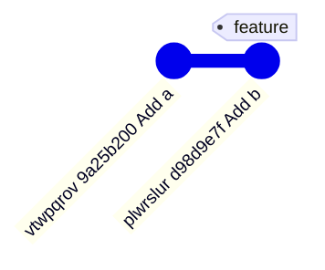
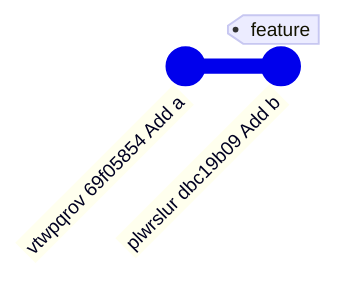
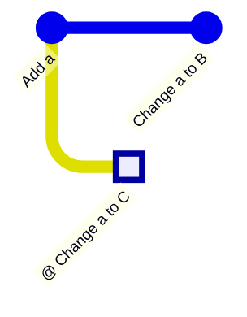
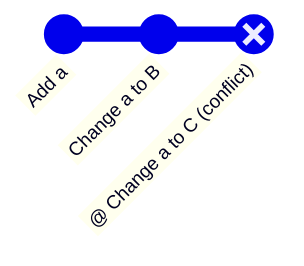
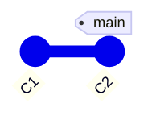
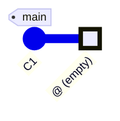

Jujutsu (`jj`) はバージョン管理システムで、Git repositoryをそのまま扱える。
Gitとの一番の違いは、**commitを後から直す前提で設計されている**こと。

- Git: 一度commitしたら直さない前提。直すには `commit --amend` や `rebase -i` という特別な操作が要る
- jj: pushする前のcommitは遡って直す前提。過去のcommitの編集が日常操作

この前提から、jjには次の性質がある。

- 過去のcommitを直すと、子孫は自動でrebaseされる
- 作業コピーそのものがcommit。staging areaはない
- 先にcommitを作り、メッセージは後から書く
- conflictが起きても操作は止まらず、conflictごとcommitに記録される
- すべての操作が記録され、`jj undo` で取り消し、`jj redo` でやり直せる

## 前提知識

- Gitのcommit、branch、rebaseの基本

## コンセプト

### commitは後から直す前提

Gitは、一度作ったcommitを直さない前提で設計されている。
直す手段として `commit --amend` や `rebase -i` はあるが、例外的な操作という扱い。

jjは逆に、**pushする前のcommitは遡って直す前提**で設計されている。

`jj edit` で過去のcommitを作業コピーにしてファイルを書き換えると、次にjjのコマンドを実行した時点でそのcommitが更新され、**子孫のcommitは新しい親の上へ自動でrebaseされる**。

編集前:



```
$ jj edit vtwpqrov
$ echo A > a.txt
$ jj st
Rebased 1 descendant commits onto updated working copy
...
```

編集後:



`Add b` は `Add a` の上に載ったままrebase済み (commit IDだけが変わる)。

<Hint level="info">
  Magitのinstant fixup (`c F`) を使いこなしている人なら、jjの考え方に馴染みやすい。
  instant fixupは、手元の変更を過去の任意のcommitへ取り込み、その場でrebaseまで済ませる。
  jjではこれが標準の動き方で、`jj squash --into <rev>` で同じことができる。
</Hint>

一方、remoteの `main` branchやtagが指すcommitとその祖先は書き換えられないよう守られている (後述のimmutableなcommit)。

### 作業コピーはcommitである

Gitではファイルを編集し、`git add` でstageし、`git commit` でcommitを作る。
jjにはこの区別がない。
作業コピーは**常に1つのcommit** (working-copy commit) に対応していて、コマンドではこのcommitを `@` と書く。
ファイルを書き換えた時点ではcommitは変わらず、**次にjjのコマンドを実行したときに**作業コピーの状態がそのcommitへ取り込まれる (snapshot)。

<Hint level="warn">
  stagingがない分、**commitしたくないファイルは厳格にignoreしておく必要がある**。
  jjは、ignoreされていない新しいファイルをsnapshotのたびに自動でtrackする
  (`.gitignore` は尊重される)。
  取り込んでしまったファイルは、ignoreに追加してから `jj file untrack` で外す
  (ignoreしないまま外しても、次のsnapshotでまたtrackされる)。
</Hint>

そのため作業の順序がGitと逆になる。
**Gitは変更を書いてからcommitし、jjは先にcommitを作ってから変更とメッセージを書く。**

| 順序 | Git                             | jj                               |
| ---- | ------------------------------- | -------------------------------- |
| 1    | ファイルを編集する              | `jj new` で空のcommitを作る      |
| 2    | `git add` でstageする           | ファイルを編集する               |
| 3    | `git commit` でメッセージを書く | `jj describe` でメッセージを書く |

Gitのメッセージは、commitを作る瞬間に書いて確定させるもの (直すには `commit --amend` が要る)。
jjのメッセージは、commitの中身と同じく**後から何度でも直せる**。
作業を始める前に `jj describe` で意図を書いておいても、終わってから書いてもよい。

```bash
jj new               # 空のcommitを作り、作業コピーをそこへ移す
# ファイルを編集する
jj describe -m "Add a"   # commit messageを付ける (いつでもよい)
jj new               # 次の作業用に空のcommitを作る
```

`git commit` に相当する `jj commit` もある (中身は `jj describe` + `jj new`)。

`git stash` も不要。
作業途中の変更はすでにcommitなので、`jj new <rev>` で別のcommitの上へ移るだけで退避が済む。

### conflictで操作が止まらない

Gitではrebase中にconflictが起きると、解消するまで先へ進めない。
jjはconflictをcommitの状態として記録し、**操作をそのまま完了させる**。

rebase前:



```
$ jj rebase -s @ -d snnmnnqu
...
Warning: There are unresolved conflicts at these paths:
a.txt    2-sided conflict
```

rebase後:



解消は後回しにできる。
**「rebase中」という中断状態がない**ので、conflictを残したまま別の作業へ移ったり、さらにrebaseしたりできる。

### すべての操作を取り消せて、やり直せる

jjはrepositoryへの操作を1つずつoperation logに記録している。
`jj undo` で直前の操作を取り消し、`jj redo` でやり直せる。
**rebaseの失敗も誤った `jj abandon` も元に戻せる**ので、履歴の書き換えを気軽に試せる。

### ストレージはbackendで差し替えられる

jjはcommitの保存先をbackendとして抽象化していて、Gitはその1つ。
Git backendなら、GitHubへのpushも `git` コマンドの併用もでき、既存のGit repositoryも `jj git init` するだけで使い始められる。

## 概念

### change IDとcommit ID

jjのcommitには2種類のIDがある。

| ID        | 例         | commitの中身やメッセージを書き換えると |
| --------- | ---------- | -------------------------------------- |
| change ID | `vtwpqrov` | 変わらない                             |
| commit ID | `69f05854` | 変わる                                 |

commit IDはcommitの中身やメッセージから計算されるhash (Git backendではGitのcommit hashそのもの)。

change IDはjjが付けるIDで、書き換えても変わらない。

**IDが2つあるのは、jjがcommitを後から直す前提だから。**
commit IDだけでは、書き換えのたびにIDが変わり、書き換え前と後が同じ作業だと分からなくなる (Gitで `commit --amend` すると元のhashとの対応はreflogにしか残らない)。
change IDは書き換えをまたいで同じ作業を指し続けるので、jjはこれを手がかりに次のことができる。

- 書き換えたcommitの子孫を、新しいcommitの上へ自動でrebaseする
- bookmarkを書き換え後のcommitへ移す
- `jj evolog` で、あるcommitの書き換え履歴をたどる

ユーザーも書き換えのたびにIDを調べ直さずに済むので、普段は**change IDでcommitを指定する**。
change IDは `k`〜`z` の文字だけで書かれ、16進数のcommit IDと見分けがつく。

作業コピーにファイルを足す前後で `jj log` を見ると、commit IDだけが変わっている。

```
@  ksmtrlvu 34a9e2c0     # 編集前
@  ksmtrlvu bf70fba7     # 編集後
```

<Hint level="info">
  jjのドキュメントでは、change
  IDで指しているものも含めて単に「revision」と呼ぶことが多い。
</Hint>

### `@` (working-copy commit)

`@` は作業コピーが対応しているcommit。
`@-` はその親、`@--` は親の親。

- `jj new`: `@` の上に空のcommitを作り、`@` をそこへ移す
- `jj edit <rev>`: 既存のcommitを `@` にする
- `jj squash`: `@` の変更を親 (`@-`) へ移す
- `jj split`: `@` を2つのcommitに分ける

`jj new` → 編集 → `jj squash` と進めると、親commitに「確定前の追加分」を積んでから取り込める。
Gitのstagingに近い使い方。

### revset

commitを指定する式をrevsetと呼ぶ。
change IDや `@` もrevsetの一種で、関数や演算子で組み合わせられる。

| revset                         | 意味                                            |
| ------------------------------ | ----------------------------------------------- |
| `@-`                           | `@` の親                                        |
| `x::`                          | `x` とその子孫                                  |
| `::x`                          | `x` とその祖先                                  |
| `x::y`                         | `x` の子孫かつ `y` の祖先 (`x`, `y` 自身を含む) |
| `x..y`                         | `y` の祖先のうち `x` の祖先でないもの           |
| `mine()`                       | 自分が作ったcommit                              |
| `description(substring:"fix")` | メッセージに `fix` を含むcommit                 |
| `x \| y`, `x & y`, `~x`        | 和、積、補集合                                  |

### bookmark

bookmarkはcommitに付ける名前で、bookmark名はそのままrevsetとして使える。
Git backendではGitのbranch (`refs/heads/`) として保存される。
そのためpushすると同名のbranchになり、fetchしたbranchはbookmarkとして取り込まれる。

- **新しいcommitを作っても動かない。** jjには「今いるbranch」という概念がない。進めたいときは `jj bookmark move` か `jj bookmark set` で明示的に動かす
- **書き換えには追従する。** 指しているcommitがrebaseなどで書き換えられると、bookmarkは新しいcommitへ移る

どちらも、**作ったcommitに後から修正が入りうる**という設計に則っている。
新しいcommitができても、それが仕上がった作業とは限らない (`jj new` 直後の `@` は空のcommit) ので、bookmarkを自動では進めない。
逆に書き換えられたcommitは同じ作業の新しい版なので、bookmarkはそちらへ付け替える。

Git (`git commit` 後):



jj (`jj new` 後):



bookmarkがなくても作業はできる。
jjのcommitは**名前なしで存在でき** (anonymous branch)、`jj log` に表示され続ける。
名前が必要になるのは、pushしてPRを作るときくらい。

```bash
jj bookmark create feature -r @-   # @- に feature を付ける
jj bookmark move feature --to @-   # feature を @- へ動かす
jj git push --bookmark feature     # feature を push する
jj git push --change @-            # @- に自動で名前を付けて push する
```

<Hint level="info">
  pushするのは `@` ではなく `@-` であることが多い。 `jj commit`
  の後は、仕上がった作業が `@-` にあり、`@` は空のcommitだから。
</Hint>

### remote bookmarkとtracking

remote bookmarkはGitのremote-tracking branchに相当し、`<名前>@<remote名>` で表される (`main@origin` は `origin/main` に対応する)。
**local bookmarkは自分で動かすが、remote bookmarkは自分では動かさない**。
`jj git fetch` するたびに、jjがremoteのbranchの位置へ更新する。

localのbookmarkとremote bookmarkは、trackingで結び付ける。
trackingしている組は、fetchするとlocalのbookmarkも動き、pushでremoteのbranchを更新できる。

- `jj git clone` はdefault branch (`main@origin` など) を自動でtrackする
- 新しくpushしたbookmarkも自動でtrackされる
- それ以外は `jj bookmark track main@origin` のように明示する

### trunk

trunkは開発の本流になるbranchのこと。
revsetでは `trunk()` と書き、remote `origin` か `upstream` にある `main`、`master`、`trunk` のうち見つかったbookmarkを指す (どれもなければ全commitの根である `root()`)。
別の名前を本流にしているrepositoryでは、設定の `revset-aliases."trunk()"` で変えられる。

`jj log -r 'trunk()..@'` なら、trunkから分岐した自分の作業だけが表示される。

### immutableなcommit

書き換えが簡単なぶん、`main` などの履歴を壊さないための歯止めがある。
`immutable_heads()` とその祖先はimmutableとして扱われ、**書き換えようとするとエラーになる**。
デフォルトは `trunk() | tags() | untracked_remote_bookmarks()`。
`jj log` で `◆` と表示されるのがimmutableなcommit。

### tag

tagはcommitに付ける、動かない名前。
Git backendではGitのtag (`refs/tags/`) として保存される。
`jj tag set v1.0 -r @-` で作り、`jj tag list` で一覧を見る。

bookmarkとの違いは、**tagが指すcommitとその祖先はimmutableになる**こと (`immutable_heads()` のデフォルトに `tags()` が含まれるため)。
bookmarkは書き換えに追従して動く名前で、tagは書き換えそのものを止める名前。

`@` にtagを付けると、`@` 自体が書き換えられなくなるので、jjはその上に新しい空のcommitを作って `@` を移す。

```
$ jj tag set v1.0 -r @
Created 1 tags pointing to ynqmpupx 6ae66856 Add a
Warning: The working-copy commit in workspace 'default' became immutable, so a new commit has been created on top of it.
```

### conflict

conflictしたcommitには `(conflict)` と表示され、ファイルには次のようなマーカーが書かれる。

```
<<<<<<< conflict 1 of 1
%%%%%%% diff from: vtwpqrov 69f05854 "Add a" (parents of rebased revision)
\\\\\\\        to: snnmnnqu bc95a5be "Change a to B" (rebase destination)
-A
+B
+++++++ ovyvqyrn 668d8cfc "Change a to C" (rebased revision)
C
>>>>>>> conflict 1 of 1 ends
```

- `%%%%%%%`: 一方の差分 (`A` → `B`)
- `+++++++`: もう一方の内容 (`C`)

差分を `C` に当てた結果を書けば解消。

解消は、conflictしたcommitの上に `jj new` で作業用のcommitを作り、そこでマーカーを直してから `jj squash` で取り込むのが定石。
`jj resolve` で外部のmerge toolも使える。

### operation log

`jj op log` で、repositoryに対して実行した操作の一覧が見られる。

```
@  cd9b1042fc24 default@ now
│  snapshot working copy
│  args: jj log
○  a1565a959569 default@ now
│  new empty commit
│  args: jj new
```

各操作はその時点の**repository全体** (commit、bookmark、`@` の位置) を記録している。
`jj undo` は1つ前の状態に戻し、`jj op restore <ID>` は任意の時点へ戻す。

### evolog

`jj evolog` は、同じchange IDのcommitが書き換えでどう変わってきたかを表示する (operation logがrepository全体の履歴なのに対し、evologはchange ID単位の履歴)。

```
$ jj evolog
@  ynqmpupx 6ae66856
│  Add a
│  -- operation cf7f82810522 snapshot working copy
○  ynqmpupx/1 980abcc2 (hidden)
│  Add a
│  -- operation 7fe7a2ddc623 describe commit e62d97eaeed6b3342a6c538e2bc9cfa22fd091bb
○  ynqmpupx/2 e62d97ea (hidden)
│  (no description set)
│  -- operation 43a22ed6a9d0 snapshot working copy
○  ynqmpupx/3 9634a959 (hidden)
   (empty) (no description set)
   -- operation 965073723c0a new empty commit
```

下から順に、`jj new` で空のcommitを作る → ファイルを足す (snapshot) → `jj describe` でメッセージを付ける → さらにファイルを書き換える (snapshot)、という4つの版が並ぶ。
change IDは同じまま、版ごとにcommit IDが変わっている。
古い版は `(hidden)` で、`ynqmpupx/1` のように何個前の版かが付く。
各版の下には、その版を作った操作のIDが表示される。

### divergent change

同じchange IDを持つcommitが2つ以上表示されることがある。
これをdivergent changeと呼ぶ。
別のマシンで同じcommitを書き換えた場合や、operation logの古い状態から分岐して書き換えた場合に起きる。
不要なほうを `jj abandon` すれば解消。

### workspace

workspaceは、同じrepositoryに作業コピーを追加する仕組み (Gitのworktreeに相当する)。
時間のかかるbuildやtestを片方で回しながら、もう片方で作業を続ける、といった使い方をする。

- `jj workspace add ../foo` で作る
- **workspaceごとに自分の `@` を持つ**。`jj log` では `<workspace名>@` と表示される (最初のworkspaceは `default`)
- commit、bookmark、operation logは全workspaceで共有される

```
$ jj workspace add ../evo-ws
$ jj log
@  xynzlpmz default@ a477c63f
│  (empty) (no description set)
│ ○  tpynoqzw evo-ws@ b860734a
├─╯  (empty) (no description set)
◆  ynqmpupx v1.0 6ae66856
│  Add a
```

別のworkspaceの操作で自分の `@` が書き換えられると、そのworkspaceはstaleになる。
その場合は `jj workspace update-stale` で作業コピーを更新する。
