モデル検査 (model checking) は、**初期状態と遷移規則から到達可能な状態をすべて列挙し**、仕様に反する状態がないかを自動で確かめる手法。
入力は次の2つ。

- モデル: システムを有限の状態遷移系として書いたもの
- 仕様: 「2つのprocessが同時にcritical sectionに入らない」のような、状態について成り立つべき性質

満たしていれば「成り立つ」と答え、満たしていなければ**仕様に反する状態と、初期状態からそこへ至る遷移の列 (反例) を返す**。
遷移をたどった先の状態に条件を課す性質 (時相論理で書く) も、到達可能な状態の列挙に帰着させて検査する (後述)。

テストや定理証明と比べると、次の位置にある。

- テスト: 人が実行を1本ずつ選び、結果を期待値と比べる。ケースをいくら増やしても、調べられるのは人が選んだ実行だけ
- 定理証明: 無限の状態も扱えるが、証明は人が組み立てる
- モデル検査: 人が書くのは「各状態から次にどの状態へ行けるか」と「全状態で成り立つべき性質」だけで、到達可能な状態は機械がすべて列挙して調べる。ただし状態が有限で、探索しきれる数に収まる必要がある

最後の制約が**状態爆発**で、モデル検査の研究の多くはこれとの戦い。

## 前提知識

- 命題論理
- グラフの探索 (DFS、BFS)
- 有限オートマトンの基本

## コンセプト

### 全状態を調べ尽くす

システムを状態遷移系として見ると、1つの状態から次の状態への遷移は1通りではない。
外部からの入力、どのprocessが先に進むか、messageが届くか消えるか、といった選択肢ごとに遷移が分岐する。
初期状態からこの分岐をたどって行ける状態が**到達可能な状態**で、バグは到達可能な状態のどこかにある。

テストは、分岐を1つずつ選んでたどった1本の実行を調べる。
ケースを網羅的に書いても、通るのは人が列挙した分岐の組み合わせだけ。
カバレッジが100%でも、コードの各分岐を1回ずつ通っただけで、分岐の組み合わせ (状態) をすべて通ったことにはならない。

モデル検査では、ケースを書かない。
書くのは遷移の規則 (各状態から次にどの状態へ行けるか) で、到達可能な状態は機械がこの規則からすべて作って訪れる。
並行処理なら、「次にどのprocessを進めるか」というschedulerの選択を遷移の分岐として規則に入れる。
判定もケースごとの期待値ではなく、全状態で成り立つべき性質 (仕様) と照らし合わせる。
**人が列挙しなくても、到達可能なバグは必ず見つかる。**

### 反例が手に入る

成り立たないとき、モデル検査は仕様に反する状態だけでなく、初期状態からその状態へ至る遷移の列を示す。
**反例は到達可能性の証拠そのもので、遷移を順にたどればその状態を再現できる。**
仕様の誤りやモデルの書き間違いも、この反例を読んで見つかることが多い。

### 状態爆発

状態数は、状態を構成する変数の数に対して指数的に増える。
$n$ 通りの値をとる変数が $k$ 個あれば、最大 $n^k$ 状態 ($n$ 状態のprocessを $k$ 個並べた場合も同じ)。
32bit整数の変数が1つあるだけで $2^{32}$ 状態。

モデル検査を実用にする技術の大半 (状態の集合をBDDで表す記号モデル検査、独立な遷移の順序を1通りに絞る半順序簡約、変数を述語に置き換える抽象化) は、この爆発を抑えるか避けるためにある。

## 概念

### Kripke構造

モデル検査では、システムをKripke構造 $M = (S, S_0, R, L)$ として書く。

- $S$: 状態の有限集合
- $S_0 \subseteq S$: 初期状態の集合
- $R \subseteq S \times S$: 遷移関係
- $L : S \to 2^{AP}$: 各状態に、その状態で真になる原子命題の集合を割り当てる関数

原子命題 (atomic proposition) は、状態を1つ見れば真偽が決まる命題で、使う原子命題の集合を $AP$ と書く。
$2^{AP}$ は $AP$ のべき集合、つまり $AP$ の部分集合全体。
$S$ が有限なのは、全状態を列挙するため。

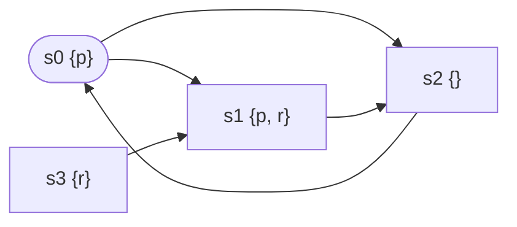

角丸が初期状態 ($S_0 = \{s_0\}$)、矢印が $R$、波括弧の中が $L(s)$。

**モデル検査が求めるのは、初期状態 $S_0$ から $R$ をたどって行ける状態の集合 $\text{Reach}(S_0)$。**
これが「到達しうる全状態」で、仕様はこの集合の各状態に対して照らし合わせる。
$R^*$ を $R$ の反射推移閉包 (0回以上たどる関係) として、

$$
\text{Reach}(S_0) = \{ s \in S \mid \exists s_0 \in S_0.\ (s_0, s) \in R^* \}
$$

計算するには、$S_0$ から始めて、遷移先を増えなくなるまで足していく。

$$
X_0 = S_0, \qquad
X_{i+1} = X_i \cup \{ t \mid \exists s \in X_i.\ (s, t) \in R \}
$$

$S$ が有限なので、この列はいずれ増えなくなり、そのときの $X_i$ が $\text{Reach}(S_0)$ (最小不動点)。
上の例なら $X_0 = \{s_0\}$、$X_1 = \{s_0, s_1, s_2\}$、$X_2 = X_1$ で止まり、$\text{Reach}(S_0) = \{s_0, s_1, s_2\}$。

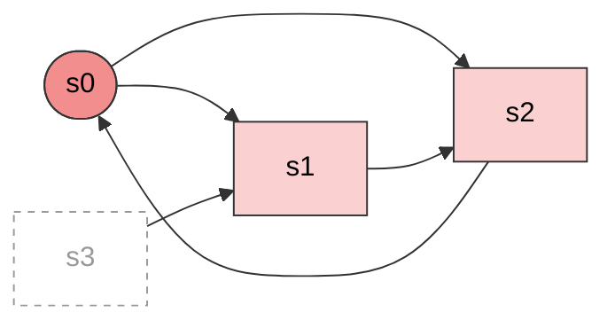

濃い色が $X_0$、薄い色が $X_1$ で足された状態。
点線の $s_3$ は $S$ の要素だが到達できないので、$s_3$ で仕様が破れていても検査には関係ない。
$X_i$ は「初期状態から $i$ 回以内の遷移で行ける状態」。
この計算を状態1つずつ進めたものがBFSで、コードにすると次の通り。
各状態を最初に見つけたときの遷移元 (親) に対応づけて返す (反例を初期状態からたどるため)。

<Details title="コード: 状態空間の探索 (reach)">

```python
from collections import deque


def reach(init, next_states):
    """初期状態から到達可能な状態をBFSで列挙し、各状態をその親 (最初に見つけた遷移元) に対応づけて返す"""
    parent = {init: None}
    queue = deque([init])
    while queue:
        s = queue.popleft()
        for t in next_states(s):
            if t not in parent:
                parent[t] = s
                queue.append(t)
    return parent
```

</Details>

始点を $S_0$ 以外の集合にしたり $R$ を逆向きにしたりしても計算は同じで、後述のCTLやLTLの検査はそうやって $\text{Reach}$ に帰着させる (始点 $X$ からのものを $\text{Reach}(X)$ と書く)。

仕様は、原子命題を組み合わせた式で書く。
状態を1つ見れば ($L(s)$ を見れば) 判定できる式なら、$\text{Reach}(S_0)$ の各状態で照らし合わせ、破る状態がなければ成り立つ。
これがモデル検査の基本の形 (invariantの検査) で、遷移をたどった先まで見る性質は後述の時相論理で書く。
コードでは、`reach` が返した各状態でinvariantを調べ、破る状態があれば親をたどって初期状態からの状態の列を返す。

<Details title="コード: invariantの判定 (check_invariant)">

```python
def check_invariant(parent, invariant):
    """到達可能な各状態でinvariantを調べ、破る状態があれば初期状態からそこへ至る状態の列を返す"""
    for s in parent:
        if not invariant(s):
            trace = []
            while s is not None:
                trace.append(s)
                s = parent[s]
            return trace[::-1]
    print(f"OK: {len(parent)} states")
    return None
```

</Details>

### 時相論理

遷移をたどった先の状態にも条件を課す性質は、状態を1つ見ただけでは判定できない。
そのためにKripke構造の上に**path**を定義する。
pathは $s_0$ から $R$ に沿って無限に続く状態の列 $s_0 s_1 s_2 \cdots$ で、分岐のたびに1つを選んでたどった1本の道筋。
先頭から途中までの有限の列をprefixと呼ぶ (行き止まりの状態には自分への遷移を足し、pathをすべて無限にそろえる)。

**時相論理は、pathについて成り立つ性質を書く言語。**
たとえば「$p$ が2回続けて成り立たない」は、pathの隣り合う2つの状態を見ないと判定できない性質で、時相論理で書ける。
代表がLTLとCTL (後述)。
先に、時相論理で書いた性質 $\varphi$ の検査が $\text{Reach}$ の計算に帰着することを示す。

**履歴をオートマトンの状態に持たせる。**
$\varphi$ はpathの先まで見ないと判定できないので、そのままでは状態を1つずつ見る $\text{Reach}$ の計算に乗らない。
そこで、pathの先まで見る代わりに「ここまでの履歴」を状態に持たせる。
履歴を持つのが有限オートマトン $A = (Q, Q_0, \delta, F)$。
$A$ は $M$ とは別の機械で、$M$ の遷移には関与しない。
$M$ がpath $s_0\, s_1\, s_2 \cdots$ を進むのを横で見て、各状態で成り立つ原子命題の集合の列 $L(s_0)\, L(s_1)\, L(s_2) \cdots$ を先頭から1つずつ入力として受け取り、自分の状態を更新する。
文字列を1文字ずつ読むオートマトンの、文字が「原子命題の集合」になったもの。
$\varphi$ がpathについて言っていることはこの列だけで決まる (状態の名前は関係なく、そこで何が成り立つかだけが効く) ので、$A$ はこの列を読めば足りる。

- $Q$: $A$ の状態の集合。各状態が「ここまでの履歴」を表す
- $Q_0 \subseteq Q$: 初期状態の集合。「まだ何も受け取っていない」状態
- $\delta : Q \times 2^{AP} \to 2^Q$: 遷移関数。$A$ が状態 $q$ にいて入力が $\ell$ のとき、$\delta(q, \ell)$ のいずれかの状態に移る
- $F \subseteq Q$: 受理状態の集合。ここに入ったら「ここまでの入力で $\varphi$ が破れた」

「$p$ が2回続けて成り立たない」なら、$A$ は $p$ を続けて何回受け取ったかを数える。
$Q = \{q_0, q_1, q_2\}$ ($q_k$: $p$ が $k$ 回続いている)、$Q_0 = \{q_0\}$、$\delta(q_0, \ell) = \{q_1\}$ if $p \in \ell$ else $\{q_0\}$、$\delta(q_1, \ell) = \{q_2\}$ if $p \in \ell$ else $\{q_0\}$、$F = \{q_2\}$。

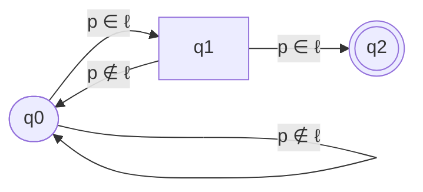

角丸が初期状態、二重丸が受理状態。
辺のlabelが、その遷移を取る入力 $\ell$ の条件。

Kripke構造の節の図で確かめる。
$L(s_0) = \{p\}$、$L(s_1) = \{p, r\}$、$L(s_2) = \emptyset$ なので、path $s_0\, s_1\, s_2\, s_0 \cdots$ から作られる入力の列は $\{p\},\ \{p, r\},\ \emptyset,\ \{p\},\ \cdots$。

- $q_0$ で $\{p\}$ を受け取る。$p \in \{p\}$ なので $q_1$ へ
- $q_1$ で $\{p, r\}$ を受け取る。$p \in \{p, r\}$ なので $q_2$ へ (受理)

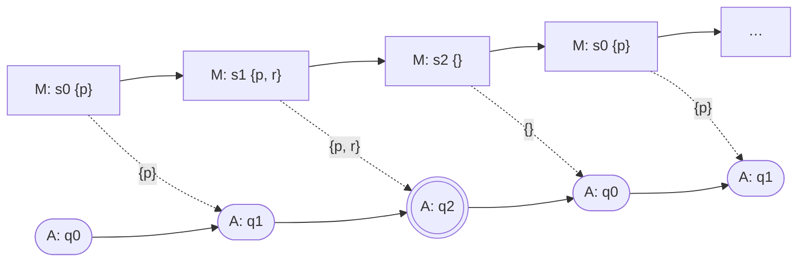

**ここでは2つの状態遷移が同時に進んでいる。**

- 四角の行は $M$ の状態遷移。$s_i \to s_{i+1}$ は $R$ だけで決まり、命題は関係ない
- 丸の行は $A$ の状態遷移。$q_i \to q_{i+1}$ は $\delta$ で決まり、入力は $M$ が今いる状態の $L(s_i)$

点線は、$M$ の状態 $s_i$ の $L(s_i)$ が $A$ への入力になることを表す。
$M$ から $A$ へ情報が流れるだけで、$A$ から $M$ へは何も流れない。
2つ目の状態まで見た時点で「$p$ が2回続いた」と分かる。
一方、path $s_0\, s_2\, s_0\, s_2 \cdots$ の入力は $\{p\},\ \emptyset,\ \{p\},\ \emptyset,\ \cdots$ で、$A$ は $q_0 \to q_1 \to q_0 \to q_1 \to \cdots$ を繰り返し、受理状態には入らない。

**$M$ と $A$ の積を作る。**
$M$ の状態と $A$ の状態の組を状態とするKripke構造 $M \times A$ を作る。

- 状態: $S \times Q$
- 初期状態: $S_0 \times Q_0$
- 遷移: $(s, q) \to (s', q')$ となるのは、$M$ が $s$ から $s'$ へ遷移でき ($(s, s') \in R$)、$A$ が $s$ の原子命題を受け取って $q$ から $q'$ へ移れる ($q' \in \delta(q, L(s))$) とき
- $L'(s, q) = L(s) \cup \{\text{acc}\}$ ($q \in F$ のとき)、そうでなければ $L(s)$

$(s, q)$ は「$M$ が $s$ にいて、$A$ がここまでの $L$ の列を受け取って $q$ にいる」こと。
上の例なら $(s, q_1)$ は「直前の状態で $p$ が成り立っていて、今 $s$ にいる」こと。
履歴が $q$ に畳み込まれているので、**「$\varphi$ が破れたか」は $\text{acc} \in L'(s, q)$ と、積の状態を1つ見れば分かる。**

**積の上で $\text{Reach}$ を計算する。**
$M \times A$ の上で $\text{Reach}(S_0 \times Q_0)$ を計算し、$\text{acc}$ の状態が含まれていれば $\varphi$ は破れる。
積の上のinvariant $\neg\text{acc}$ の検査そのもので、Kripke構造の節の `reach` と `check_invariant` がそのまま使える。

これで検査できるのは、有限のprefixを見れば「破れた」と分かる性質。
「いつか $p$ になる」のように、破れていることが無限のpathを見ないと分からない性質もある。
その場合は $A$ を「受理状態を無限回通る列」を受理するオートマトン (Büchiオートマトン) にし、積の上で「$\text{acc}$ の状態 $f$ に到達でき、かつ $f$ の遷移先からの $\text{Reach}$ に $f$ 自身が含まれる (cycleがある)」かを調べる。
こちらも $\text{Reach}$ の計算を2回するだけ。

LTLの検査はこの形 (後述)。
CTLは式ごとに部分式が成り立つ状態の集合を $R^{-1}$ についての $\text{Reach}$ で求め、その集合を新しい原子命題として $L$ に足していく (後述)。
どちらも、モデル検査の基礎は到達可能な状態の列挙で、時相論理はその上の応用。

### 安全性と活性

仕様の性質は大きく2種類に分かれる。

| 性質            | 意味                     | 例                                    | 反例                         |
| --------------- | ------------------------ | ------------------------------------- | ---------------------------- |
| 安全性 (safety) | 悪いことが決して起きない | 2つが同時にcritical sectionに入らない | 悪い状態に至るprefix         |
| 活性 (liveness) | 良いことがいつか起きる   | 要求したら、いつか応答が返る          | 良いことが永遠に起きないpath |

安全性は、時相論理の節の「有限のprefixを見れば破れたと分かる性質」。
状態を1つ見れば判定できるもの (invariant) はそのまま $\text{Reach}(S_0)$ の検査で、「$\text{req}$ の後は $\text{ack}$ まで $\text{busy}$」のように履歴に依存するものは積を取って積の上のinvariantにする。
活性は「破れていることが無限のpathを見ないと分からない性質」で、Büchiオートマトンとの積の上でcycleを探す。

活性の反例は無限に続くpathそのもので、そのままでは有限のデータとして返せない。
ただし状態が有限なので、無限のpathは $|S|$ 回以内の遷移で必ず**同じ状態を2度通る**。
2度目に通った時点から先は、1度目から2度目までの区間を繰り返すpathがある。
そのため、反例は「有限のprefix + 繰り返すcycle」という形のpathだけ考えれば足りる。
縄の先に輪がある形なので、投げ縄 (lasso) と呼ぶ。

$$
\underbrace{s_0\, s_1\, \cdots\, s_k}_{\text{prefix}}\;
\underbrace{(t_1\, t_2\, \cdots\, t_m)}_{\text{cycle}}\;
(t_1\, t_2\, \cdots\, t_m)\; \cdots
$$

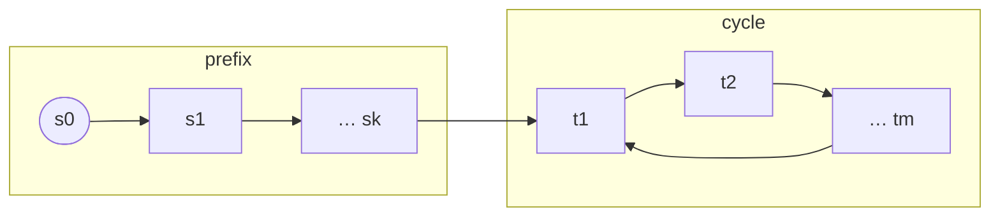

prefixは初期状態からcycleの入口 $t_1$ までの有限の列、cycleは $t_1$ から $t_1$ に戻る有限の列。
この2つの列を返せば、「cycleを無限に繰り返す」という読み方で無限のpathを一意に表せる。
「良いことが永遠に起きない」反例なら、cycleの中のどの状態でも良いことが起きていない。

<Hint level="info">
  活性は、状態が無限にありうる一般のプログラムでは判定できない。「いつか停止する」も活性の一種で、これを判定するのが停止性問題だから。
  **モデル検査で活性を判定できるのは、状態が有限だから。**
  無限のpathは必ず同じ状態に戻るので、活性の判定は有限グラフのcycle探しになる。
</Hint>

### LTL

LTL (線形時相論理) は、1本のpathについて成り立つ性質を書くための論理。
式は、$AP$ の原子命題を部品にして、命題論理の演算子 ($\neg$, $\land$, $\lor$, $\to$) と次の時相演算子で組み立てる (CTLはこれにpath量化子を足す)。
たとえば $\mathbf{G}\,\neg(\text{crit}_0 \land \text{crit}_1)$ では、$\text{crit}_0$ と $\text{crit}_1$ が原子命題で、$\mathbf{G}$, $\neg$, $\land$ が演算子。
原子命題の真偽は1つの状態の $L(s)$ で決まるが、$\mathbf{G}$ を含む式の真偽はpath全体を見ないと決まらない。

以下の $p$, $q$ は任意の式 (原子命題でもよい)。

| 演算子               | 読み     | pathで成り立つ条件                    |
| -------------------- | -------- | ------------------------------------- |
| $\mathbf{X}\,p$      | next     | 次の状態で $p$                        |
| $\mathbf{F}\,p$      | finally  | いつか $p$                            |
| $\mathbf{G}\,p$      | globally | ずっと $p$                            |
| $p \,\mathbf{U}\, q$ | until    | いつか $q$ になり、それまでずっと $p$ |

$\mathbf{G}$ は時点についての $\forall$、$\mathbf{F}$ は時点についての $\exists$ なので、$\neg\forall = \exists\neg$ と同じ関係が成り立つ。

$$
\neg\mathbf{G}\,p = \mathbf{F}\,\neg p, \qquad \neg\mathbf{F}\,p = \mathbf{G}\,\neg p
$$

「ずっと $p$」の否定は「どこかで $\neg p$」、「いつか $p$」の否定は「ずっと $\neg p$」。
後述のLTLのモデル検査では、仕様の否定をこの関係で書き換える。

$M \models \varphi$ は「初期状態から始まる**すべての**pathで $\varphi$ が成り立つ」という意味。

時相演算子を重ねると、よく使う形が次の通り。

| 式                                     | 意味                                                                              |
| -------------------------------------- | --------------------------------------------------------------------------------- |
| $\mathbf{G}\,\mathbf{F}\,p$            | $p$ が無限回成り立つ (どの時点から見ても、その後のどこかで $p$。連続でなくてよい) |
| $\mathbf{F}\,\mathbf{G}\,p$            | ある時点から先はずっと $p$                                                        |
| $\mathbf{G}(p \to \mathbf{F}\,q)$      | $p$ になるたびに、その後いつか $q$ (応答性)                                       |
| $\mathbf{G}(p \to \mathbf{X}\,q)$      | $p$ になるたびに、次の状態で $q$                                                  |
| $\mathbf{G}(p \to p \,\mathbf{U}\, q)$ | $p$ になったら、$q$ になるまで $p$ のまま                                         |
| $\mathbf{F}\,p \to \mathbf{F}\,q$      | $p$ が起きるなら $q$ も起きる (順序は問わない)                                    |

具体的な性質にすると次の通り。

- $\mathbf{G}\,\neg(\text{crit}_0 \land \text{crit}_1)$: 同時にcritical sectionに入らない (安全性)
- $\mathbf{G}(\text{req} \to \mathbf{F}\,\text{ack})$: 要求したら、いつか応答が返る (活性)

### CTL

CTL (計算木論理) は、ある状態から枝分かれしていくpath全体 (計算木) について書く。
時相演算子の前に、必ずpath量化子が付く。
path量化子は、pathを変数にした $\forall$ と $\exists$ にあたる。

- $\mathbf{A}\,\psi$: その状態から始まる**すべての**pathで $\psi$ ($\forall \pi.\ \pi \models \psi$)
- $\mathbf{E}\,\psi$: その状態から始まる**ある**pathで $\psi$ ($\exists \pi.\ \pi \models \psi$)

$\forall$ と $\exists$ の関係と同じく $\mathbf{A}\,\psi = \neg\mathbf{E}\,\neg\psi$ で、$\mathbf{A}$ は $\mathbf{E}$ で書き換えられる。

組み合わせは8つ。
いずれも「その状態から始まるpath」について言っている。

| 式                               | 意味                                                         |
| -------------------------------- | ------------------------------------------------------------ |
| $\mathbf{AX}\,p$                 | すべてのpathで、次の状態で $p$ (= 遷移先のすべてで $p$)      |
| $\mathbf{EX}\,p$                 | あるpathで、次の状態で $p$ (= 遷移先のどれかで $p$)          |
| $\mathbf{AF}\,p$                 | すべてのpathで、いつか $p$ (どう進んでも $p$ を避けられない) |
| $\mathbf{EF}\,p$                 | あるpathで、いつか $p$ (進み方しだいで $p$ に行ける)         |
| $\mathbf{AG}\,p$                 | すべてのpathで、ずっと $p$ (到達できる状態すべてで $p$)      |
| $\mathbf{EG}\,p$                 | あるpathで、ずっと $p$ ($p$ の状態だけを通り続ける道がある)  |
| $\mathbf{A}[p \,\mathbf{U}\, q]$ | すべてのpathで、いつか $q$ になり、それまでずっと $p$        |
| $\mathbf{E}[p \,\mathbf{U}\, q]$ | あるpathで、いつか $q$ になり、それまでずっと $p$            |

- $\mathbf{AG}\,\neg(\text{crit}_0 \land \text{crit}_1)$: どの到達可能な状態でも、同時に入っていない
- $\mathbf{AG}\,\mathbf{EF}\,\text{reset}$: どの状態からでも、resetの状態へ行ける道がある

### LTLとCTLの表現力は比較不能

$\mathbf{AG}\,\mathbf{EF}\,\text{reset}$ はLTLで書けない。
LTLの式は暗黙に $\mathbf{A}$ (すべてのpathで) が先頭に1つ付いた形しか取れず、$\mathbf{E}$ (あるpathで) を途中に書けないため。

逆に、LTLの $\mathbf{F}\,\mathbf{G}\,p$ はCTLで書けない。
CTLでは $\mathbf{G}$ の前にも量化子が要るので、候補は次の2つだが、どちらも一致しない。

- $\mathbf{AF}\,\mathbf{AG}\,p$: 強すぎる。$s_0$ から自分自身と $s_1$ へ、$s_1$ から $s_2$ へ、$s_2$ から自分自身へ遷移し、$p$ が $s_0$ と $s_2$ で成り立つKripke構造を考える。どのpathも最後はずっと $p$ なので $\mathbf{F}\,\mathbf{G}\,p$ は成り立つが、$s_0$ に留まり続けるpathではどの時点でも $s_1$ へ抜ける枝が残っていて $\mathbf{AG}\,p$ になる時点が来ないので、$\mathbf{AF}\,\mathbf{AG}\,p$ は成り立たない
- $\mathbf{AF}\,\mathbf{EG}\,p$: 弱すぎる。$s_0$ から自分自身と $s_1$ へ、$s_1$ から自分自身へ遷移し、$p$ が $s_0$ でだけ成り立つKripke構造を考える。$s_0$ に留まり続けるpathがあるので $\mathbf{AF}\,\mathbf{EG}\,p$ は成り立つが、path $s_0\, s_1\, s_1 \cdots$ では $p$ が途中で終わるので $\mathbf{F}\,\mathbf{G}\,p$ は成り立たない

$\mathbf{F}\,\mathbf{G}\,p$ と一致するCTLの式がないことは証明されている。

両方を含む論理としてCTL\*がある。

## アルゴリズム

どの検査も、到達可能な状態の列挙 ($\text{Reach}$ の計算) に帰着する。
invariantはKripke構造の上でそのまま列挙し、CTLとLTLは集合やグラフを作り替えてから列挙する。

### invariantの検査

例として、2つのprocessによるmutexを考える。
各processは `idle` → `check` → `set` → `crit` → `idle` と進む。
`check` で相手のフラグが下りているのを確かめ、`set` で自分のフラグを立ててからcritical section (`crit`) に入り、出るときにフラグを下ろす。

- 状態: `(pc0, pc1, flag0, flag1)` の組 (`pc` は各processがどこにいるか)
- 初期状態: `('idle', 'idle', False, False)`
- 遷移: どちらか一方のprocessが1つ進む。どちらを進めるかがschedulerの分岐で、両方を遷移にする

コードでは、状態をtupleで持ち、遷移関係 $R$ を「状態を受け取って遷移先を列挙する関数」`naive_next` で表す。
`step` が1つのprocessを1歩進める規則で、`naive_next` はそれをprocess 0と1のそれぞれに当てて遷移先を返す。
2つの `yield` がschedulerの分岐。

invariantは「2つが同時に `crit` にいない」(`mutex`)。
これをKripke構造の節の `reach` と `check_invariant` にかける。

<Details title="コード: mutexの検査">

```python
# 素朴なmutex: 相手のフラグを見てから自分のフラグを立てる (check-then-act)
def step(pc, my_flag, other_flag):
    """1つのprocessを1歩進めた (pc, フラグ) を返す。進めなければNone"""
    if pc == "idle":
        return "check", my_flag
    if pc == "check" and not other_flag:
        return "set", my_flag
    if pc == "set":
        return "crit", True
    if pc == "crit":
        return "idle", False
    return None


# 状態 = (pc0, pc1, flag0, flag1)
def naive_next(s):
    pc0, pc1, flag0, flag1 = s
    if moved := step(pc0, flag0, flag1):  # process 0 を進める
        pc0, flag0 = moved
        yield (pc0, pc1, flag0, flag1)
    pc0, pc1, flag0, flag1 = s
    if moved := step(pc1, flag1, flag0):  # process 1 を進める
        pc1, flag1 = moved
        yield (pc0, pc1, flag0, flag1)


mutex = lambda s: not (s[0] == "crit" and s[1] == "crit")
for s in check_invariant(reach(("idle", "idle", False, False), naive_next), mutex):
    print(s)
```

</Details>

```
('idle', 'idle', False, False)
('check', 'idle', False, False)
('set', 'idle', False, False)
('set', 'check', False, False)
('set', 'set', False, False)
('crit', 'set', True, False)
('crit', 'crit', True, True)
```

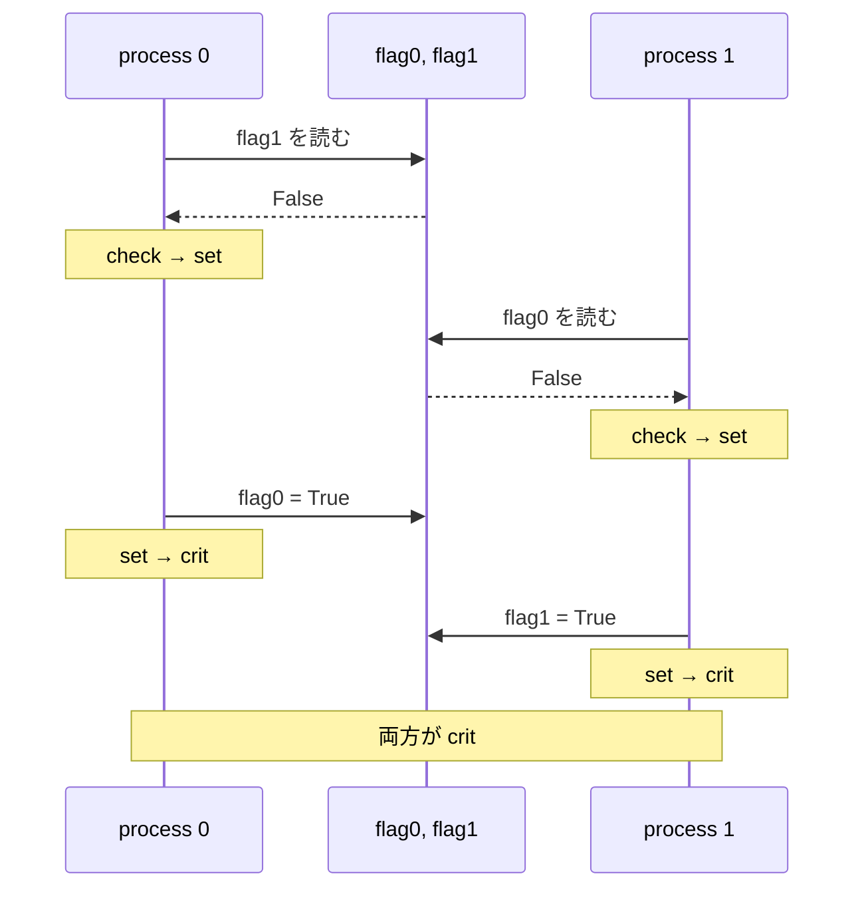

フラグを立てるのが「相手のフラグを見る」より後なので、process 0が見終えてから立てるまでの間に、process 1も「下りている」を見てしまう (check-then-act)。
BFSの順に調べているので、返る反例は最短。

processを1つずつ動かすテストなら、`naive_next` の分岐はすべて通る (カバレッジ100%) が、このバグは出ない。
バグが出るのは「両方が `check` を通り過ぎた」という状態の組み合わせに至ったときだけで、そこへ至る実行順をテストのケースとして書くには、バグの場所を先に知っている必要がある。
モデル検査は到達可能な状態をすべて訪れるので、知らなくても見つかる。

### CTLのモデル検査

CTLのモデル検査は、式の内側から順に、各部分式が成り立つ状態の集合を求めていく (labeling)。
$\mathbf{EX}$, $\mathbf{EU}$, $\mathbf{EG}$ の3つがあれば、残りはこれらで書き換えられる ($\mathbf{EF}\,p = \mathbf{E}[\top \,\mathbf{U}\, p]$、$\mathbf{AG}\,p = \neg\mathbf{EF}\,\neg p$ など)。

- $\mathbf{EX}\,p$: $p$ の状態へ遷移できる状態の集合
- $\mathbf{E}[p \,\mathbf{U}\, q]$: $q$ の状態から始め、遷移を逆にたどって $p$ の状態を足していく。増えなくなったら終わり (最小不動点)
- $\mathbf{EG}\,p$: $p$ の状態から始め、$p$ の状態へ遷移できない状態を削っていく。減らなくなったら終わり (最大不動点)

$\mathbf{EX}$ と $\mathbf{EU}$ は、$R$ を逆向きにした関係 $R^{-1}$ についての $\text{Reach}$ の計算 ($\mathbf{EF}\,q$ なら $R^{-1}$ での $\text{Reach}(\{s \mid q \in L(s)\})$ そのもの)。
$\mathbf{EG}$ は逆に、$p$ の中に留まり続けられない状態を削っていく反復。

<Details title="図: EX、EU、EG の計算">

塗った状態が、その時点で式が成り立つと分かっている状態の集合。

**$\mathbf{EX}\,p$**: $p$ の状態 $\{d\}$ へ遷移できる状態。$R$ を逆向きに1歩たどって $\{c, d\}$ ($d$ は自分自身へ遷移できる)。

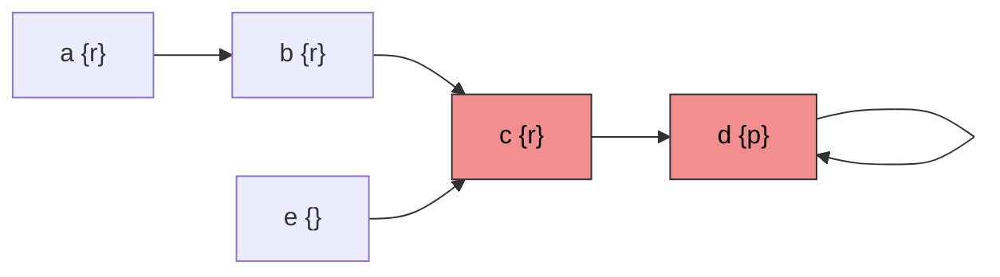

**$\mathbf{E}[r \,\mathbf{U}\, p]$**: $p$ の状態から始め、「$r$ が成り立ち、かつ今の集合へ遷移できる状態」を増えなくなるまで足す。
$p$ が最初から成り立つ状態は、$r$ がなくても入る。

$Z_0 = \{d\}$ ($p$ の状態):

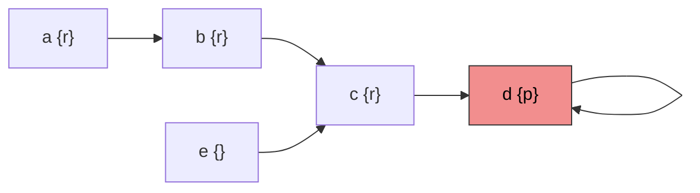

$Z_1 = \{c, d\}$ ($c$ は $r$ が成り立ち、$d$ へ遷移できる。$e$ も $c$ へ遷移できるが $r$ が成り立たないので入らない):


$Z_2 = \{b, c, d\}$:

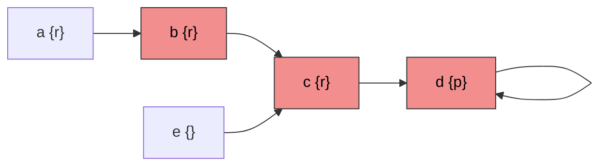

$Z_3 = \{a, b, c, d\}$。次の反復で増えないので、ここで止まる:

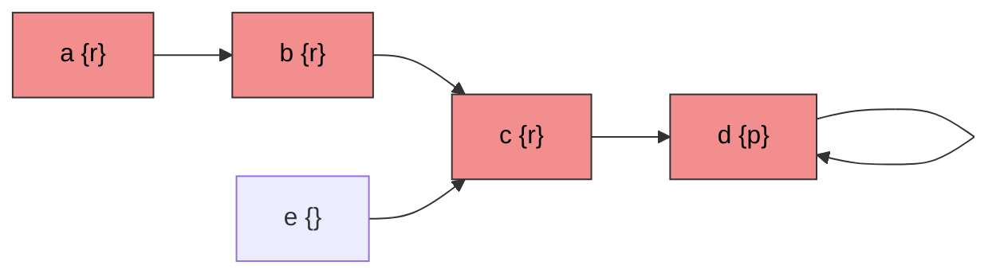

$R$ を逆向きにたどる $\text{Reach}$ の計算そのもので、$r$ が成り立たない $e$ で止まっている。

**$\mathbf{EG}\,q$**: 別の構造で確かめる。$q$ の状態から始め、「今の集合の中へ遷移できない状態」を減らなくなるまで削る。

$Z_0 = \{f, g, h\}$ ($q$ の状態):

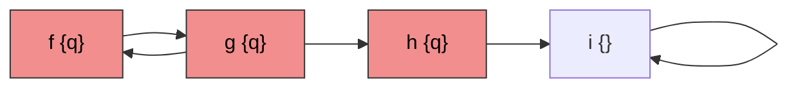

$Z_1 = \{f, g\}$ ($h$ の遷移先は $i$ だけで、$i \notin Z_0$ なので削る)。$f \to g$、$g \to f$ とどちらも集合の中へ遷移できるので、ここで止まる:

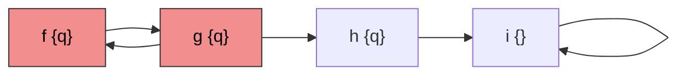

$f \to g \to f \to \cdots$ と $q$ の状態だけを通り続けるpathがある、ということ。
$h$ は $q$ が成り立つが、そこから先は必ず $i$ に出てしまうので入らない。

</Details>

不動点で書くと次の通り。

$$
\mathbf{E}[p \,\mathbf{U}\, q] = \mu Z.\; q \lor (p \land \mathbf{EX}\,Z)
\qquad
\mathbf{EG}\,p = \nu Z.\; p \land \mathbf{EX}\,Z
$$

$\mathbf{EG}$ をSCC分解で求めれば、全体の計算量は $O(|M| \cdot |\varphi|)$ になる ($|M|$ は状態数と遷移数の和)。
モデルの大きさにも式の長さにも線形。

### LTLのモデル検査

LTLは、オートマトンを使って検査する (automata-theoretic approach)。

1. 仕様の否定 $\neg\varphi$ を、それを満たす無限列だけを受理するBüchiオートマトン $A_{\neg\varphi}$ に変換する
2. $M$ と $A_{\neg\varphi}$ の積を作る
3. 積の中に、初期状態から到達でき、受理状態を通るcycleがあるかを探す。受理状態の集合を $F$ として、$\text{Reach}(S_0) \cap F$ の各 $f$ について、$f$ の遷移先からの $\text{Reach}$ に $f$ 自身が含まれるかを調べる。$\text{Reach}$ を2回計算するだけで、どちらも到達可能な状態の列挙。見つかった「初期状態から $f$ までの道」がprefix、「$f$ から $f$ に戻る道」がcycleで、つなげるとlasso形の反例になる

Büchiオートマトンは、時相論理の節のオートマトン $A$ と同じく原子命題の集合の列を入力に取るが、無限列を読み、**受理状態を無限回通る列を受理する**。
有限の入力で「破れた」と確定できない性質 (「いつか $\text{ack}$」が永遠に来ない、など) を捉えるためにこの受理条件を使う。

$\varphi = \mathbf{G}(\text{req} \to \mathbf{F}\,\text{ack})$ (要求したら、いつか応答が返る) を例にする。
否定は、LTLの節の関係で $\mathbf{G}$ と $\mathbf{F}$ を入れ替えながら内側へ押し込む。

$$
\begin{aligned}
\neg\mathbf{G}(\text{req} \to \mathbf{F}\,\text{ack})
&= \mathbf{F}\,\neg(\text{req} \to \mathbf{F}\,\text{ack}) \\
&= \mathbf{F}(\text{req} \land \neg\mathbf{F}\,\text{ack}) \\
&= \mathbf{F}(\text{req} \land \mathbf{G}\,\neg\text{ack})
\end{aligned}
$$

2行目は $\neg(x \to y) = x \land \neg y$。
結果は「いつか、要求が来たのにその後ずっと応答が返らない」で、これを受理する $A_{\neg\varphi}$ は2状態。

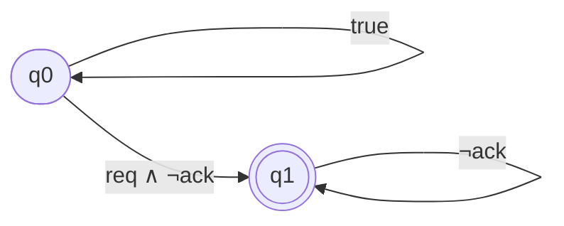

- $q_0$: まだ「応答が返らない要求」を見つけていない。何を受け取っても $q_0$ に留まれる
- $q_0 \to q_1$: $\text{req}$ が成り立ち $\text{ack}$ が成り立たない入力を受け取ったとき、「この要求に応答は返らない」と**賭けて** $q_1$ へ移る (非決定性。$q_0$ に留まる選択肢も残る)
- $q_1$: 受理状態。$\neg\text{ack}$ の入力を受け取る間だけ留まれる。$\text{ack}$ が来ると行き先がなく、この賭けは失敗

$q_1$ に無限に留まれる列、つまり $\text{req}$ の後に $\text{ack}$ が二度と来ない列だけが受理される。

| 入力の列 (原子命題の集合)                                                     | $A_{\neg\varphi}$ の動き                                                    | 受理   |
| ----------------------------------------------------------------------------- | --------------------------------------------------------------------------- | ------ |
| $\{\text{req}\},\ \emptyset,\ \emptyset,\ \emptyset,\ \cdots$ (応答なし)      | $q_0 \to q_1 \to q_1 \to q_1 \to \cdots$                                    | する   |
| $\{\text{req}\},\ \emptyset,\ \{\text{ack}\},\ \emptyset,\ \cdots$ (応答あり) | $q_0 \to q_1 \to q_1 \to$ 行き先なし。$q_0$ に留まる動きは $q_1$ を通らない | しない |

積の中で受理状態を通るcycleは「$M$ の実行のうち $\varphi$ を破るもの」に対応する。
そんなcycleがなければ $M \models \varphi$。

cycle探しには、DFSを2重に回すnested DFSが使われる (SPINの方式)。
積は探索しながら必要な分だけ作る (on-the-fly) ので、反例が早く見つかれば全状態を作らずに済む。

計算量は $O(|M| \cdot 2^{O(|\varphi|)})$。
式に対しては指数的だが、実際の仕様の式は短いので、効いてくるのはモデルの大きさのほう。

## 手法

コードに対してモデル検査を使う方法は、**モデルを誰が書くか**で3つに分かれる。

| 手法                             | モデル     | コードとのずれ                             | 抽象化       | 扱える規模                        | 活性の検査 | 代表的なtool               | 向いている対象                      |
| -------------------------------- | ---------- | ------------------------------------------ | ------------ | --------------------------------- | ---------- | -------------------------- | ----------------------------------- |
| frameworkでコードをそのまま検査  | コード自身 | 起きない                                   | できない     | unit単位 (threadとdata structure) | toolによる | JPF、Lincheck、Loom        | 並行data structure、lockの手順      |
| 専用言語でモデルを書き写す       | 人が書く   | 起きる。trace validationなどで突き合わせる | 自由         | システムの設計全体                | できる     | TLA+ / TLC、Promela / SPIN | 分散protocol、業務フローの設計      |
| 専用言語のモデルからコードを生成 | 人が書く   | 構造的に起きない                           | 言語の範囲で | state machineで書ける部分         | できる     | P、Event-B、SCADE          | event駆動のstate machine、制御logic |

### frameworkでコードをそのまま検査する

モデルを別に書かず、**実装の言語で書いたコードを検査系が実行し、schedulingの分岐をすべて列挙する**。
前節までの `check_invariant` に遷移関数を渡すのと同じことを、frameworkが実行時に行う。

- Java PathFinder (JPF): JVMのbytecodeを専用のVMで実行し、threadの切り替えを全通り試す
- Lincheck (Kotlin / Java): 並行data structureに対して、操作の列を生成して全interleavingを調べる
- Loom (Rust): 並行処理のテストをLoomの下で走らせ、schedulingを列挙する

コードとモデルがずれる心配はない。
その代わり状態爆発がそのまま効くので、**検査の単位を小さく切り、外部I/Oはin-memoryの代替に差し替える**。
unit testと同じ粒度で、unit testが選べないinterleavingを網羅する道具と考えるとよい。

### 専用言語でモデルを書き写す

TLA+、Promela、Alloyなどの言語で、**コードの設計を人が書き写す**。
状態を小さい集合に抽象化できる (在庫は `0..2`、clientは2つ、など) ので、frameworkでは扱えない規模の設計も検査できる。
AWSがS3やDynamoDBの設計で使っているのはこの方法。

弱点は、**モデルとコードが別物であること**。
コードだけ直してモデルを直し忘れれば、検査は何も保証しなくなる。
突き合わせる方法が2つある。

- trace validation: 実装を動かしてlogに状態の列を記録し、その列がモデルの許す遷移の列かをcheckerで確かめる。MongoDBがreplicationのTLA+ specに対して行った
- model-based testing: モデルの到達可能な状態の列を生成し、それをテストケースとして実装に流す

どちらも、モデルを「仕様」、コードを「実装」として、実装が仕様の遷移から外れていないかを見る。

### 専用言語のモデルからコードを生成する

モデルを書くのは同じだが、**検査したモデルからそのままコードを生成し、production codeとして使う**。
ずれは構造的に起きない。

- P: 通信するstate machineの集まりとしてシステムを書き、モデル検査してから、Javaなどのコードを生成する。Windows 8のUSB driver stackの中核や、AWSのS3、EBS、DynamoDBなどで使われている
- Event-B / Bメソッド: 抽象モデルから段階的に詳細化し、最後の段階からコードを生成する。鉄道の制御 (パリのメトロ14号線) など
- SCADE: 組込みの制御logicをモデルで書き、Cを生成する。航空機の制御など

生成できるのはstate machineやlogicの部分で、I/Oや性能に関わる周辺は手で書く。
言語の表現力の制約も受ける (Pは非同期のevent駆動に特化している)。
