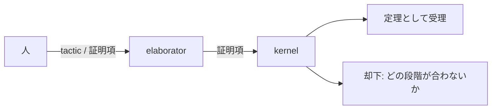

定理証明支援系 (proof assistant) は、**人が組み立てた証明を機械が検査する**ソフトウェア。
証明を自動で見つけるのは自動定理証明器 (ATP) の仕事で、支援系は人が書いた証明の各段階が推論規則に従っているかを確かめる。
人が書くのは次の2つ。

- 定義と命題: 対象 (自然数、list、プログラム) と、それについて成り立つべき性質
- 証明: 命題が成り立つ理由を、推論規則の適用の列として書いたもの

機械は証明を1段ずつ検査し、通れば命題を定理として受け入れ、通らなければどの段階が規則に合わないかを示す。

前回の <Link href="/posts/model-checking">モデル検査</Link> と比べると、次の位置にある。

- モデル検査: 状態を有限に収め、到達可能な状態を機械がすべて列挙する。人が書くのはモデルと仕様だけだが、無限の状態は扱えない
- 定理証明: すべての自然数、すべての入力列、といった無限の対象を扱える。その代わり証明は人が組み立てる

本稿の軸は**Curry-Howard同型対応**。
Lean、Rocq (旧Coq)、Agdaはこの対応の上に作られていて、**命題は型、証明はその型を持つプログラム**として表す。
証明を検査することは、プログラムの型検査にほかならない。

## 前提知識

- 命題論理と述語論理 ($\land$, $\lor$, $\to$, $\neg$, $\forall$, $\exists$)
- 型付きの関数型プログラミングの初歩 (代数的データ型、pattern match、再帰)。例はLean 4で書き、ところどころRustとKotlinを添える
- 数学的帰納法

## コンセプト

### 命題は型、証明はプログラム

論理の命題と、プログラミング言語の型を並べると、構造が一致する。

| 論理                   | 型                                    | 証明 = 値                                 |
| ---------------------- | ------------------------------------- | ----------------------------------------- |
| $A \land B$            | pair型 $A \times B$                   | $A$ の証明と $B$ の証明の組               |
| $A \lor B$             | sum型 $A + B$ (Rustの `Result<A, B>`) | どちらか一方の証明に、どちらかの印        |
| $A \to B$              | 関数型 $A \to B$                      | $A$ の証明を受け取り $B$ の証明を返す関数 |
| $\top$ (真)            | unit型                                | 唯一の値 `()`                             |
| $\bot$ (偽)            | 空の型 (Rustの `enum Void {}`)        | 値がない                                  |
| $\neg A$               | $A \to \bot$                          | $A$ の証明から空の型の値を作る関数        |
| $\forall x : A.\ P(x)$ | 依存関数型 $\Pi x : A.\ P(x)$         | 各 $x$ に $P(x)$ の証明を返す関数         |
| $\exists x : A.\ P(x)$ | 依存pair型 $\Sigma x : A.\ P(x)$      | $x$ と $P(x)$ の証明の組                  |

この対応がCurry-Howard同型対応 (Curry 1934、Howard 1969)。
**命題 $A$ が証明できることと、型 $A$ を持つ値 (項) を書けることは同じ**。
$A \land B \to B \land A$ の証明は、pairを入れ替える関数そのもの。

```lean
theorem and_swap (A B : Prop) : A ∧ B → B ∧ A :=
  fun h => ⟨h.2, h.1⟩
```

```rust
fn and_swap<A, B>(h: (A, B)) -> (B, A) {
    (h.1, h.0)
}
```

$\bot$ の値はないので、$\bot$ を受け取る関数は、どんな型の値も返せる (爆発律 $\bot \to A$)。
Rustでは `match v {}` で、Kotlinでは `Nothing` が全型の部分型であることで表す。

```rust
enum Void {}

fn absurd<A>(v: Void) -> A {
    match v {}
}
```

```kotlin
fun <A> absurd(v: Nothing): A = v
```

「同型」というのは、対応が命題と型だけでなく、証明の変形にも及ぶため。
証明の中の回り道 (導入してすぐ除去する箇所) を消す操作は、$\beta$簡約 (関数適用の評価) に一致する (後述)。

### 証明の検査は型検査

命題が型で証明が項なら、**証明が正しいかは、項にその型が付くかで決まる**。
型検査は決定可能なので、機械的に確かめられる。

検査するのは**kernel**と呼ばれる小さなプログラム。
Leanのkernelは数千行で、証明を書きやすくする上物 (tactic、記法、自動化) はすべてkernelの外にある。
上物にバグがあっても、作られた証明項がkernelを通らなければ却下されるので、**信頼すべきものはkernelと、命題の書き方だけ** (de Bruijn criterion)。



### すべての関数が停止しなければならない

型が付くことを証明と見なすには、**すべての関数が停止する** (全域性) 必要がある。
停止しない関数は、どんな型の値でも作れるため。

```rust
fn prove_anything<A>() -> A {
    loop {}
}
```

```kotlin
fun <A> proveAnything(): A = TODO()
```

RustやKotlinでは `loop {}`、例外、`TODO()` があるので、型が付いてもそれは証明ではない。
Curry-Howard対応はこれらの言語では「型を命題として読む視点」にとどまり、証明になるのは全域性を保証する言語の上だけ。

Leanは再帰関数に停止性を要求し、示せなければ受理しない。

```lean
def loop : False := loop
-- error: fail to show termination for loop
```

`partial def` で停止性の検査を外すこともできるが、それは返り値の型に値があると分かっている (`Inhabited` な) ときだけ。
`False` には値がないので、`partial` でも `loop` は書けない。

### 証明は構成である

Curry-Howard対応の論理側は**直観主義論理**で、排中律 $A \lor \neg A$ を公理に持たない。
$A \lor \neg A$ の証明は「$A$ の証明か、$\neg A$ の証明か、どちらかを印付きで返す」ことで、任意の $A$ についてそれを決める関数は書けないため。

その代わり、証明がそのまま計算になる。
$\exists x.\ P(x)$ の証明は $x$ の具体値 (witness) とその証明の組なので、**証明から $x$ を取り出せる**。
「解が存在する」の証明は、解を求めるプログラムでもある (program extraction)。

古典論理が要るときは、排中律を公理として足す (Leanの `Classical.em`)。
公理を使った証明からはプログラムを取り出せないが、命題の証明としては問題ない。

## 概念

### 自然演繹

証明を書く規則の体系が**自然演繹**。
結合子ごとに、その結合子を含む命題を作る**導入規則** (I) と、それを使う**除去規則** (E) がある。

$$
\dfrac{A \qquad B}{A \land B}\,(\land\text{I})
\qquad
\dfrac{A \land B}{A}\,(\land\text{E}_1)
\qquad
\dfrac{A \land B}{B}\,(\land\text{E}_2)
$$

$$
\dfrac{\begin{array}{c}[A]\\ \vdots\\ B\end{array}}{A \to B}\,(\to\text{I})
\qquad
\dfrac{A \to B \qquad A}{B}\,(\to\text{E})
$$

横線の上が前提、下が結論。
$\to\text{I}$ は「$A$ を仮定して $B$ を導けたら、仮定を取り下げて $A \to B$ を結論してよい」で、$[A]$ が取り下げる仮定。
$A \land B \to B \land A$ の証明は、規則を次のように積む。

$$
\dfrac{
  \dfrac{
    \dfrac{[A \land B]^1}{B}\,(\land\text{E}_2)
    \qquad
    \dfrac{[A \land B]^1}{A}\,(\land\text{E}_1)
  }{B \land A}\,(\land\text{I})
}{A \land B \to B \land A}\,(\to\text{I}, 1)
$$

### 型付け規則との対応

各規則に、作られる項を書き添える。
$\Gamma$ は文脈 (使える仮定とその名前)。

$$
\dfrac{\Gamma \vdash a : A \qquad \Gamma \vdash b : B}{\Gamma \vdash (a, b) : A \times B}
\qquad
\dfrac{\Gamma \vdash p : A \times B}{\Gamma \vdash \pi_1\, p : A}
\qquad
\dfrac{\Gamma \vdash p : A \times B}{\Gamma \vdash \pi_2\, p : B}
$$

$$
\dfrac{\Gamma,\ x : A \vdash b : B}{\Gamma \vdash \lambda x.\,b : A \to B}
\qquad
\dfrac{\Gamma \vdash f : A \to B \qquad \Gamma \vdash a : A}{\Gamma \vdash f\,a : B}
$$

形は自然演繹と同じで、項を消せば元の規則に戻る。
これが単純型付き$\lambda$計算の型付け規則で、上の証明木は項 $\lambda h.\,(\pi_2\, h,\ \pi_1\, h)$ の型付けの木と一致する。
**証明木を書くことと、項を書くことは同じ作業。**

証明の変形も対応する。
$\to\text{I}$ の直後に $\to\text{E}$ を使う箇所は回り道で、仮定 $A$ に $A$ の証明を代入すれば消せる。
項の側では $(\lambda x.\,b)\,a \to b[x := a]$ で、これが$\beta$簡約。
**証明の正規化 (回り道の除去) は、プログラムの評価。**
直観主義論理では正規化が必ず停止し、正規形の証明は結論の主結合子の導入規則で終わるので、$\exists$ の証明の正規形にはwitnessが現れる。
前節の「証明から取り出せる」はこの性質による。

### 依存型

述語 $P(x)$ は、$x$ ごとに命題を返すもの。
Curry-Howardでは**項を受け取って型を返す関数 (型族)** になる。
型が項に依存するので依存型と呼ぶ。

- $\forall x : A.\ P(x)$ は、各 $x$ に $P(x)$ の証明を返す関数の型。返り値の型が引数に依存するので、$\Pi x : A.\ P(x)$ と書く
- $\exists x : A.\ P(x)$ は、$x$ と $P(x)$ の証明の組の型。2つ目の型が1つ目に依存するので、$\Sigma x : A.\ P(x)$ と書く

```lean
example : ∀ n : Nat, n + 0 = n := fun n => rfl
example : ∃ n : Nat, n * n = 49 := ⟨7, rfl⟩
```

依存型は命題だけでなく、プログラムのデータにも使える。
長さを型に持つlistは、空でないことを型で表せるので、先頭を取る関数に空の場合がない。

```lean
inductive Vec (α : Type) : Nat → Type where
  | nil  : Vec α 0
  | cons : {n : Nat} → α → Vec α n → Vec α (n + 1)

def Vec.head {α : Type} {n : Nat} : Vec α (n + 1) → α
  | .cons a _ => a
```

`nil` の型は `Vec α 0` で `Vec α (n + 1)` と一致しないので、`head` の `nil` の場合は型検査が除く。
RustやKotlinのgenericsは型が型に依存するまでで、項には依存できない。

### 帰納型と帰納法

自然数は帰納型 (inductive type) として定義する。
Rustの `enum`、Kotlinの `sealed class` と同じ、構成子で値を作るデータ型。

```lean
inductive Nat where
  | zero : Nat
  | succ : Nat → Nat
```

帰納型を定義すると、「構成子ごとに場合分けし、再帰的な部分には帰納法の仮定を使う」関数 (recursor) が自動で付く。
**数学的帰納法は、`Nat` のrecursorそのもの。**
$P(0)$ の証明と、$P(k)$ の証明から $P(k+1)$ の証明を作る関数を渡せば、$\forall n.\ P(n)$ の証明が返る。

帰納法による証明は、構造的再帰で書く関数と同じ形になる。
$0 + n = n$ は、Leanの `+` が第2引数で再帰するので計算だけでは出ず、帰納法が要る。

```lean
theorem zero_add' : ∀ n : Nat, 0 + n = n
  | 0     => rfl
  | k + 1 => congrArg Nat.succ (zero_add' k)
```

`k + 1` の場合、`0 + (k + 1)` は定義から `Nat.succ (0 + k)` に計算できるので、帰納法の仮定 `zero_add' k : 0 + k = k` の両辺に `Nat.succ` をかければよい。
再帰呼び出し `zero_add' k` が帰納法の仮定で、引数が構造的に小さくなっているので停止性も通る。

### 等式

$a = b$ も帰納型で、構成子は $a = a$ を作る `refl` だけ。

```lean
inductive Eq {α : Sort u} : α → α → Prop where
  | refl (a : α) : Eq a a
```

`2 + 2 = 4` の証明が `rfl` で済むのは、kernelが `2 + 2` を計算して `4` にし、両辺が同じ項になるため。
計算して一致する等式 (定義的等価) は `rfl`、そうでない等式 (`0 + n = n` のような、変数を含んで計算が進まないもの) は帰納法などで証明する (命題的等価)。
後者の証明も、最後は `refl` で作られる。

<Details title="PropとType">

Leanでは命題の型 `Prop` と、データの型 `Type` を区別する。
`A ∧ B → B ∧ A : Prop` に対して `(A × B) → (B × A) : Type`。
構造は同じだが、`Prop` の値 (証明) には次の扱いがある。

- 証明無関連: 同じ命題の証明はすべて等しいと見なす。証明の中身で場合分けして `Type` の値を作ることはできない (証明の内容で計算結果が変わらない)
- 消去: 実行コードを生成するとき `Prop` の値は消える。`Vec.head` に渡す「空でない」証明は実行時のコストにならない

Rocqも同様に `Prop` と `Type` (`Set`) を分ける。
Agdaには区別がなく、証明もデータと同じ扱い。

</Details>

### tactic

証明項を直接書く代わりに、**goalを変形する命令 (tactic) を並べて証明を組み立てる**。
tacticは裏で証明項を生成し、最後にkernelがその項を検査する。

```lean
theorem and_swap' (A B : Prop) : A ∧ B → B ∧ A := by
  intro h       -- 仮定 h : A ∧ B を取り、goal は B ∧ A
  constructor   -- goal を B と A の2つに分ける
  · exact h.2
  · exact h.1
```

`intro h` の直後、editorにはgoalが次のように表示される。

```
A B : Prop
h : A ∧ B
⊢ B ∧ A
```

$\vdash$ の上が使える仮定 (文脈 $\Gamma$)、下が示すべき命題。
`intro` は $\to\text{I}$、`constructor` は $\land\text{I}$ を、結論の側から逆向きに適用している。
証明木を根から葉へ向かって書くのがtactic、葉から根へ向かって書くのが証明項。
数学の証明はほぼtacticで書き、プログラム (依存型を使った定義) は項で書くことが多い。

### 自動化

定型の部分は、証明項を機械に探させる。
いずれも**見つけた証明項はkernelが検査する**ので、自動化のバグで誤った定理が通ることはない。

- `decide`: 命題が決定可能 (有限の計算で真偽が決まる) なら、計算して証明する。`2 ^ 10 = 1024` など
- `simp`: 書き換え規則の集合で両辺を単純化し、一致させる
- `omega`: 整数の線形算術 ($a < b \to a + 1 \le b$ など) の決定手続き
- 外部の自動証明器: Isabelleの Sledgehammer は、SMT solverやATPに証明を探させ、見つかった証明をIsabelleの中で再構成する
- 言語モデル: 証明の候補を生成させ、kernelで検査する。候補が誤っていても検査で落ちるので、生成器の精度は検証の信頼性に影響しない

```lean
example : 2 ^ 10 = 1024 := by decide
example (a b : Nat) (h : a < b) : a + 1 ≤ b := by omega
```

## 手法

### 主な定理証明支援系

| 名前         | 基礎                  | 特徴                                                                 |
| ------------ | --------------------- | -------------------------------------------------------------------- |
| Lean 4       | CIC (依存型)          | 数学libraryのMathlibが大きい。tacticや拡張をLean自身で書く           |
| Rocq (旧Coq) | CIC (依存型)          | 最も歴史が長い。四色定理、CompCert。2025年にRocqに改名               |
| Agda         | Martin-Löf型理論      | tacticがなく、証明項を直接書く。依存型プログラミングの研究で使われる |
| Isabelle/HOL | 高階論理 (依存型なし) | Sledgehammerで外部の自動証明器を呼ぶ。seL4                           |

CIC (Calculus of Inductive Constructions) は、依存型の$\lambda$計算に帰納型を足した体系で、本稿の内容はこれに沿っている。
Isabelle/HOLは依存型を持たず、Curry-Howardの上には作られていないが、小さなkernelが証明を検査する構成は同じ。

### 数学の形式化

- 四色定理 (Rocq、2005): 場合分けの計算機による検査を、証明の一部として検証した
- Kepler予想 (HOL Light と Isabelle、2014): 1998年の証明の査読が難航し、著者自身が形式化して決着させた
- Liquid Tensor Experiment (Lean、2022): Scholzeが自分の証明の正しさに不安を持ち、形式化を依頼した
- Fermatの最終定理 (Lean、2024年から進行中)

形式化で定理が誤りと分かった例は少なく、むしろ**証明に書かれていない暗黙の補題や、場合分けの抜けが見つかる**。
Mathlibのような共通のlibraryがあると、形式化は「定理を一から証明する」ではなく「libraryの定理を組み合わせる」作業になる。

### 検証済みソフトウェア

プログラムを支援系の中で定義し、仕様を命題として書き、証明する。

- CompCert (Rocq): Cのcompiler。生成コードが元のプログラムの意味を保つことを証明した。compilerのfuzzingで、検証済みの部分からはバグが見つからなかった
- seL4 (Isabelle/HOL): OSのkernel。Cの実装が抽象仕様に従うことを証明した

Rustでは、Rustの型システム自体と、Rustで書いたプログラムの両方が対象になっている。

- RustBelt (Rocq): Rustの所有権と借用の型システムが安全性を保証することを証明し、`unsafe` を含む標準libraryの部品がその保証を破らないことを確かめた
- Aeneas: Rustのプログラムを純粋関数の形に翻訳してLeanやRocqに持ち込み、性質を証明する。所有権によってpointerの別名がないことが翻訳を可能にしている
- Verus: Rustの文法のまま仕様と証明を書き、SMT solverで自動検証する。支援系というより自動検証器だが、Rustのプログラムに証明を付ける現在の主流

Javaでは、KeY がJMLで書いた仕様をJavaのコードに対して対話的に証明する。
2015年に、JDKの `TimSort` の証明を試みて不変条件が成り立たないことに気づき、実際に例外を起こす入力を見つけた例がある。

### 日々のコードとの接点

全域性のない言語でも、Curry-Howardの視点は型の設計に使える。
**型を「それが保証する性質」として読む。**

- `Nothing` (Kotlin) と `!` (Rust) は $\bot$。「ここには到達しない」を型で言う
- `sealed class` と `enum` の網羅的な `when` / `match` は、$\lor$ の除去規則。場合の抜けはcompilerが指摘する
- 検証済みの値に別の型を付ける (`String` を検証して `Email` にする) のは、「検証を通った」という証明を値に持たせること。関数が `Email` を受け取るなら、検証済みであることを前提にできる (parse, don't validate)
- 型状態 (typestate): `File<Open>` と `File<Closed>` のように状態を型に持たせ、`read` を `File<Open>` だけに定義する。状態の誤りを型検査で弾く

支援系の証明との違いは、性質を保証するのがcompilerではなく、その型の値を作る関数 (検証関数、constructor) の正しさに委ねられていること。
その関数だけを慎重に書けば、残りは型が守る。
