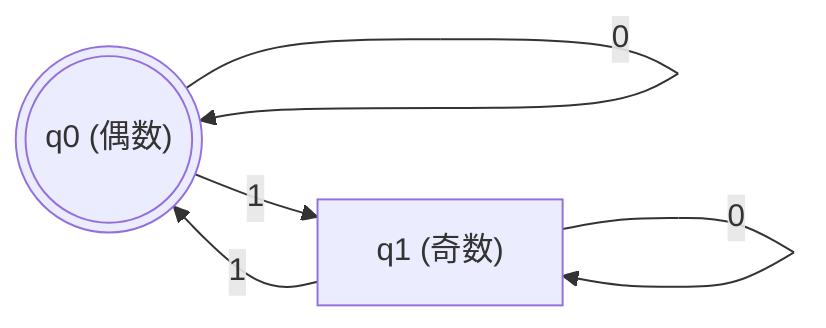
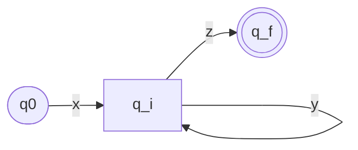
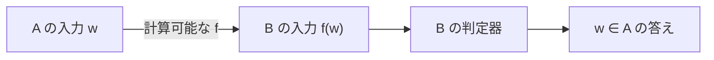
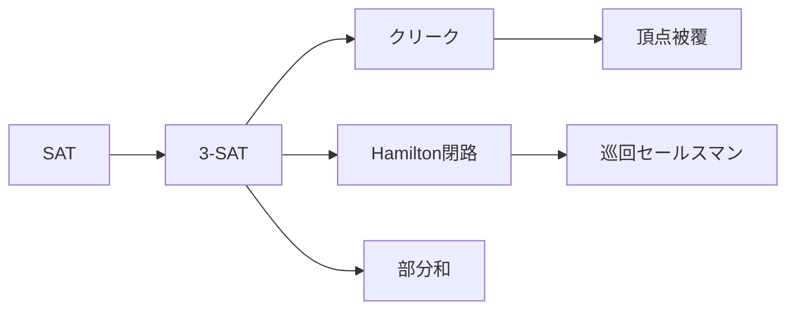

計算理論 (theory of computation) は、**「計算できる」を数学的に定義し、何が計算できて何ができないか、できるとしてどれだけの資源が要るかを扱う分野**。
問いは3段階に分かれ、それぞれが分野の柱になっている。

- オートマトンと形式言語: 能力を制限した機械で何が認識できるか
- 計算可能性: どんな機械を使っても解けない問題はあるか (ある)
- 計算複雑性: 解けるとして、現実的な時間で解けるか (P対NP)

正規表現がなぜ括弧の対応を取れないのか、なぜcompilerは「このプログラムは止まらない」と警告できないのか、なぜ巡回セールスマン問題に多項式時間のアルゴリズムが見つからないのか、の答えはすべてここにある。

## 前提知識

- 集合と写像の記法、可算と非可算の区別
- 背理法と鳩の巣原理
- 正規表現を使ったことがあれば正規言語の節がすぐ読める

## 文字列と言語

このノートに出てくる機械はどれも、**記号の列を1つ受け取り、受理か拒否かを答える**。
そこで問題のほうも、記号の列についての問いに書き直しておく。

### アルファベット、文字列、言語

- アルファベット $\Sigma$: 記号の有限集合。たとえば $\Sigma = \{0, 1\}$
- 文字列 (string): $\Sigma$ の記号を有限個並べた列。$0110$ など。自然言語の文のことではなく、使える記号は $\Sigma$ で決めたものだけ
- $|w|$: 文字列 $w$ の長さ
- $\varepsilon$: 長さ0の文字列 (空文字列)
- $\Sigma^*$: $\Sigma$ 上の文字列全体。$\{0, 1\}^* = \{\varepsilon, 0, 1, 00, 01, 10, 11, 000, \ldots\}$
- 言語 (language): $\Sigma^*$ の部分集合。これも文字列の集合の呼び名で、日本語や英語とは関係ない

### 記法

- $uv$: 文字列 $u$ の後ろに $v$ を続けた文字列 (連接)
- $a^n$: $a$ を $n$ 個並べた文字列。$0^3 1^2 = 00011$、$a^0 = \varepsilon$
- $\{0^n 1^n \mid n \ge 0\}$: $n$ を0以上で動かしたときの $0^n 1^n$ の全体、つまり $\{\varepsilon, 01, 0011, 000111, \ldots\}$。以後 $\{0^n 1^n\}$ と略す
- $\overline{L}$: 言語 $L$ の補集合 $\Sigma^* \setminus L$
- $\langle X \rangle$: 数、グラフ、機械などの対象 $X$ を文字列に符号化したもの。$\langle X, Y \rangle$ は組 $(X, Y)$ の符号化

### 問題を言語に置き換える

「$n$ は素数か」という問題は、素数を2進で書いた文字列の集合

$$
\{\langle n \rangle \mid n \text{ は素数}\} = \{10, 11, 101, 111, \ldots\}
$$

という言語に対応する。
問題を解くとは、与えられた文字列がこの言語に入るかを判定すること。
入力がグラフでも数の組でも、$\langle G \rangle$ のように文字列に符号化すれば同じ枠に乗る。

機械 $M$ が受理する文字列の全体を $L(M)$ と書き、$M$ が認識する言語と呼ぶ。
以下の各節は、機械の種類ごとにどんな言語が $L(M)$ になりうるかを調べていく。

yes/noで答える問題 (決定問題) に絞るが、「最適解を求める」問題も「値 $k$ 以下の解はあるか」という決定問題に言い換えられるので、理論を立てるにはこれで足りる。

## オートマトンと形式言語

### 決定性有限オートマトン

決定性有限オートマトン (DFA) は5つ組 $(Q, \Sigma, \delta, q_0, F)$。

- $Q$: 状態の有限集合
- $\Sigma$: アルファベット
- $\delta : Q \times \Sigma \to Q$: 遷移関数。今の状態と読んだ記号から次の状態を決める
- $q_0 \in Q$: 初期状態
- $F \subseteq Q$: 受理状態の集合

入力を左から1文字ずつ読んで $\delta$ で状態を更新し、読み終えたときの状態が $F$ に入っていれば受理 (accept)。
受理する文字列の集合が、そのDFA $M$ が認識する言語 $L(M)$。

「1の個数が偶数」の言語を認識するDFAは状態2つ。

二重丸が受理状態で、$q_0$ は初期状態でもある。辺のlabelが読む記号。

**記憶が「今どの状態にいるか」しかない**のがDFAの本質で、入力の長さによらず一定量の記憶で判定する。
だから $\{0^n 1^n\}$ は認識できない。
$n$ を数えておく必要があるが、状態が $k$ 個なら $k+1$ 個目の0で区別がつかなくなる。

### 非決定性と正規表現

非決定性有限オートマトン (NFA) は $\delta$ が状態の集合を返す ($\delta : Q \times \Sigma_\varepsilon \to \mathcal{P}(Q)$)。
$\Sigma_\varepsilon = \Sigma \cup \{\varepsilon\}$ は「記号を読まない」も含めた読み方、$\mathcal{P}(Q)$ は $Q$ の部分集合全体 (べき集合)。
1つの入力に対して遷移の枝が複数あり、**どれか1つでも受理状態に至れば受理**。
記号を読まずに遷移する $\varepsilon$ 遷移も許す。

NFAはDFAより書きやすいが、認識できる言語は増えない。
NFAの「今いるかもしれない状態の集合」をDFAの1状態とみなせば (部分集合構成)、同じ言語のDFAが作れる。状態数は最悪 $2^{|Q|}$。

正規表現 (regular expression) は言語を式で書いたもの。
$\emptyset$、$\varepsilon$、1文字 $a$ から、和 $R_1 \mid R_2$、連接 $R_1 R_2$、Kleene閉包 $R^*$ で組み立てる。
正規表現で書ける言語、NFAが認識する言語、DFAが認識する言語は**すべて同じ**で、これを正規言語 (regular language) と呼ぶ。
正規表現 → NFAは、式の構造に沿って小さなNFAを繋いでいくだけ (Thompson構成)。

正規表現エンジンがやっているのはこれで、backtrackせずにDFAで走る実装 (RE2、Rustの `regex`) の実行時間が入力長に線形なのはこの理論の帰結。
backreferenceやlookaroundを持つPCRE系の「正規表現」は正規言語の範囲を超えていて、指数時間になりうる。

### 正規でない言語の証明: 反復補題

正規言語 $L$ には定数 $p$ (反復長) があり、$L$ の長さ $p$ 以上の任意の文字列 $s$ は $s = xyz$ と分けられて、次を満たす (反復補題、pumping lemma)。

- $|y| > 0$
- $|xy| \le p$
- すべての $i \ge 0$ で $xy^iz \in L$

DFAの状態数を $p$ とすると、長さ $p$ 以上の文字列を読む途中で同じ状態を2度通る (鳩の巣原理)。

2度通る状態を $q_i$ とすると、そこに戻ってくる区間 $y$ は何度繰り返しても、飛ばしても、同じ $q_i$ に着くので受理結果が変わらない、というだけの話。

$\{0^n 1^n\}$ が正規でない証明: $s = 0^p 1^p$ を取ると、$|xy| \le p$ より $y$ は0だけからなり、$xy^2z$ は0が1より多くなって $L$ に入らない。矛盾。

### 文脈自由言語

スタックを1本足したのがプッシュダウンオートマトン (PDA) で、認識する言語が文脈自由言語 (context-free language)。
文脈自由文法 (CFG) で生成できる言語と一致する。
$\{0^n 1^n\}$ は $S \to 0S1 \mid \varepsilon$ で生成でき、PDAは0をpushして1でpopすれば判定できる。

プログラミング言語の構文はほぼ文脈自由文法で書かれ、parserはPDAの決定性版 (LL、LR)。
括弧の対応が正規表現では取れずparserが要るのは、この階層の差。

文脈自由言語にも反復補題があり、$\{0^n 1^n 2^n\}$ は文脈自由でない。
スタック1本では2回数えられないため。スタックが2本あるとTuring機械と同じ能力になる。

## 計算可能性

### Turing機械

Turing機械 (TM) は、有限個の状態と、左端があって右に無限に伸びるテープ、テープ上を動くヘッドからなる。
1ステップで、今の状態とヘッド下の記号を読み、記号を書き換え、ヘッドを左右どちらかに1つ動かし、状態を変える。

$$
\delta : Q \times \Gamma \to Q \times \Gamma \times \{L, R\}
$$

$\Gamma$ はテープ記号の集合 ($\Sigma$ に空白 $\sqcup$ を加えたもの)。
特別な状態 $q_{\text{accept}}$、$q_{\text{reject}}$ に入ったら停止。
有限オートマトンとの違いは、**テープに書き戻せて、何度でも読み返せる**こと。
これだけで、プログラミング言語で書ける計算はすべて書ける。

ここまでの3つの機械の違いは、**入力以外に何を覚えられるか**だけ。

| 機械                       | 記憶                | 認識できる言語 |
| -------------------------- | ------------------- | -------------- |
| 有限オートマトン           | 有限個の状態        | 正規言語       |
| プッシュダウンオートマトン | 状態 + スタック1本  | 文脈自由言語   |
| Turing機械                 | 状態 + 無限のテープ | 認識可能言語   |

下に行くほど認識できる言語は真に増える (Chomsky階層。文脈自由と認識可能の間にある文脈依存言語は、このノートでは扱わない)。

TMの入力に対する結果は3通り: 受理、拒否、止まらない。
止まらない場合があるのがTMの決定的な特徴で、有限オートマトンもPDAも必ず止まった。
これを受けて言語を2つに分ける。

- 認識可能 (Turing-recognizable、帰納的可算): $L$ の文字列は受理し、それ以外は拒否するか止まらない、というTMがある
- 判定可能 (decidable、帰納的): $L$ の文字列は受理し、それ以外は必ず拒否して止まるTMがある

判定可能な言語が「アルゴリズムで解ける問題」。

### Church-Turingのテーゼ

TMにテープを増やしても、非決定性や乱択を足しても、認識できる言語は変わらない (多項式程度の遅さで単一テープTMに変換できる)。
ラムダ計算、帰納的関数、レジスタマシン、どの計算モデルもTMと同じ言語を認識する。
そこで「直感的なアルゴリズムで計算できる」と「TMで判定できる」を同一視する。
これがChurch-Turingのテーゼで、定理ではなく定義の提案 (「直感的なアルゴリズム」が数学的対象ではないので証明しようがない)。
以後、TMの遷移関数を書く代わりにプログラムを書けば十分。

### 万能Turing機械

TMは有限の記述を持つので、文字列に符号化できる。
TMの符号 $\langle M \rangle$ と入力 $w$ を受け取って $M$ を $w$ の上でsimulateするTMが作れる (万能Turing機械)。
現代のコンピュータはこれで、プログラムはデータとして渡せる。

TMを文字列で書けることから、認識できない言語があることもわかる。

- TMは1列に並べられる。どのTM $M$ も有限の文字列 $\langle M \rangle$ で書け、$\Sigma^*$ の文字列は短い順 (同じ長さなら辞書順) に1列に並べられるので、TMも $M_1, M_2, M_3, \ldots$ と並べられる (可算)
- 言語は1列に並べられない。言語は $\Sigma^*$ の部分集合で、無限集合の部分集合全体はどう並べても漏れが出る (非可算。Cantorの対角線論法)
- 1つのTMが認識する言語は $L(M)$ の1つだけ

よって、どのTMにも認識されない言語が存在し、**しかもそちらのほうが圧倒的に多い**。
ただしこの議論は存在を示すだけで、具体的にどの言語が認識できないかは教えてくれない。
具体例が次の停止問題。

### 停止問題

具体的に解けない問題の筆頭が停止問題。

$$
\text{HALT} = \{\langle M, w\rangle \mid M \text{ は } w \text{ の上で停止する}\}
$$

受理するかを問う $A_{\text{TM}} = \{\langle M, w\rangle \mid M \text{ は } w \text{ を受理する}\}$ も同じく判定不能。
証明は対角線論法で、プログラムをデータとして渡せること自体が原因。

すべてのTMを $M_1, M_2, \ldots$ と並べ、$M_i$ が $\langle M_j \rangle$ を受理するかを表にする。
対角線を反転した行、つまり「$\langle M_i \rangle$ を受け取ると $M_i$ と逆の答えを返す」TM $D$ は、どの行とも対角線上で食い違うので、表のどこにもない。
それなのに $A_{\text{TM}}$ の判定器があれば $D$ が作れてしまう、というのが証明。

$A_{\text{TM}}$ を判定するTM $H$ があったと仮定する。
$H$ はどの入力でも必ず止まり、

$$
H(\langle M, w \rangle) =
\begin{cases}
\text{受理} & M \text{ が } w \text{ を受理する} \\
\text{拒否} & \text{それ以外}
\end{cases}
$$

を返す。
$H$ を使って、TMの符号 $\langle M \rangle$ を受け取り、$M$ に自分自身の符号を食わせたときの答えを反転するTM $D$ を作る。

$$
D(\langle M \rangle) =
\begin{cases}
\text{拒否} & H(\langle M, \langle M \rangle \rangle) = \text{受理} \\
\text{受理} & H(\langle M, \langle M \rangle \rangle) = \text{拒否}
\end{cases}
$$

$D$ に $D$ 自身の符号 $\langle D \rangle$ を渡すと、

- $D$ が $\langle D \rangle$ を受理するなら、$H(\langle D, \langle D \rangle \rangle) = \text{受理}$ なので、$D$ の定義から $D(\langle D \rangle) = \text{拒否}$。矛盾
- $D$ が $\langle D \rangle$ を受理しないなら、$H(\langle D, \langle D \rangle \rangle) = \text{拒否}$ なので、$D(\langle D \rangle) = \text{受理}$。やはり矛盾

よって $H$ は存在しない。
$A_{\text{TM}}$ は認識可能ではある (万能TMで走らせて、受理したら受理)。
補集合 $\overline{A_{\text{TM}}}$ は認識可能ですらない。
「$L$ と $\overline{L}$ がともに認識可能 $\iff$ $L$ は判定可能」(両方を並行して走らせればどちらかが必ず止まる) なので。

### 還元とRiceの定理

他の問題の判定不能性は、いちいち対角線論法をやり直さず、**既知の判定不能問題から還元する**。
$A$ の入力を $B$ の入力に計算可能な関数で変換し、答えが保たれるようにできれば ($A \le_m B$、写像還元)、$B$ が判定可能なら $A$ も判定可能。
対偶で、$A$ が判定不能なら $B$ も判定不能。

$B$ の判定器の前に変換 $f$ を挟んだものが、そのまま $A$ の判定器になる。

$E_{\text{TM}} = \{\langle M\rangle \mid L(M) = \emptyset\}$ (何も受理しないか) は、$\langle M, w\rangle$ を「入力が $w$ のときだけ $M$ を走らせ、それ以外は拒否する $M'$」に変換すると $A_{\text{TM}}$ から還元できる。
$M$ が $w$ を受理 $\iff$ $L(M') \ne \emptyset$。

これを一般化したのがRiceの定理: **TMが認識する言語の性質で、自明でないもの (すべてのTMが満たすわけでも、どのTMも満たさないわけでもない) は、すべて判定不能**。
「止まるか」「何も受理しないか」「正規言語か」「特定の文字列を受理するか」がまとめて判定不能になる。

プログラムの完全な静的解析が原理的にできないのはこれが理由で、実用の解析器は必ず近似する (保守的に警告するか、見逃しを許すか、止まらない可能性を受け入れるか)。
ただし言語の性質でないもの、たとえば「状態数が100以下か」「$w$ の上で100ステップ以内に止まるか」は判定可能で、Riceの定理の範囲外。

## 計算複雑性

### 時間計算量とクラスP

判定可能な問題の中で、どれだけ速く解けるかを問う。
TM $M$ の時間計算量 $t(n)$ は、長さ $n$ の入力に対する最大ステップ数。
$O(t(n))$ 時間で判定できる言語の全体を $\mathrm{TIME}(t(n))$ と書く。
ある $k$ について $O(n^k)$ 時間で判定できる言語、つまり多項式時間で判定できる言語の全体が $\mathrm{P}$。

$$
\mathrm{P} = \bigcup_{k \ge 1} \mathrm{TIME}(n^k) = \mathrm{TIME}(n) \cup \mathrm{TIME}(n^2) \cup \mathrm{TIME}(n^3) \cup \cdots
$$

$\bigcup_{k \ge 1}$ は、$k = 1, 2, 3, \ldots$ について和集合を取る記号。
テープを増やしてもRAMに変えても差は多項式倍に収まるので、$\mathrm{P}$ はモデルに依らない。
「現実的に解ける問題」の数学的定義として $\mathrm{P}$ を使う。

$\mathrm{P}$ に入る問題: グラフの到達可能性 (BFS)、最大公約数 (Euclidの互除法)、素数判定、線形計画法、2-SAT。

### クラスNPと検証

$\mathrm{NP}$ は、**答えの候補 (証拠) が与えられれば多項式時間で正しさを検証できる**問題のクラス。
多項式時間で動く検証器 $V$ があって、

$$
w \in L \iff \exists c.\ |c| \le \mathrm{poly}(|w|) \ \text{かつ}\ V(w, c) \text{ が受理}
$$

となる $L$ の全体。
「$w$ が $L$ に入るのは、$w$ の長さの多項式 ($\mathrm{poly}(|w|)$) に収まる長さの証拠 $c$ があって、$V$ が $(w, c)$ を受理するとき、かつそのときに限る」と読む。
名前は非決定性 (nondeterministic) 多項式時間から来ていて、証拠を「推測」する非決定性TMが多項式時間で受理する言語、と言っても同じ。

- SAT: 論理式を真にする真偽値の割り当てがあるか。証拠は割り当て
- Hamilton閉路: すべての頂点をちょうど1回通る閉路があるか。証拠は閉路
- 部分和: 整数の集合に、和がちょうど $t$ になる部分集合があるか。証拠は部分集合
- 合成数判定: 証拠は約数

明らかに $\mathrm{P} \subseteq \mathrm{NP}$ (証拠を無視して解けばよい)。
逆が成り立つか、つまり**検証が速い問題は解くのも速いか**が、P対NP問題。
証拠の候補は指数個なので、全探索すれば $\mathrm{NP} \subseteq \mathrm{EXPTIME}$ は言えるが、それ以上はわかっていない。

### NP完全

$\mathrm{NP}$ の中で最も難しい問題がNP完全。
$B$ がNP完全とは、

1. $B \in \mathrm{NP}$
2. $\mathrm{NP}$ のすべての $A$ について $A \le_p B$ (多項式時間で計算できる写像還元)

よって、**NP完全問題が1つでも $\mathrm{P}$ に入れば $\mathrm{P} = \mathrm{NP}$**。

SATがNP完全 (Cook-Levinの定理)。
証明は、任意の非決定性TMの多項式時間の計算を、「計算の各ステップがテープ上で遷移関数通りに進んでいる」という条件の論理式に変換する。
式の大きさは計算時間の多項式に収まる。

NP完全問題が1つあれば、残りは還元の連鎖で示せる (矢印が $\le_p$)。

数千のNP完全問題が知られていて、どれ1つとして多項式時間アルゴリズムが見つかっていないのが、$\mathrm{P} \ne \mathrm{NP}$ と信じられている根拠。

実務では、NP完全だとわかった問題は多項式時間の厳密解を諦めて、次のどれかを取る。

- 入力を特殊な場合に限る (2-SAT、木の上の問題)
- 近似アルゴリズム (頂点被覆の2近似)
- 最悪指数時間でも実用上は速いsolver (SAT solver、整数計画solver)
- 入力のあるparameterについてだけ指数時間 (固定parameter tractable)

### 空間計算量

時間の代わりに使うテープのマス数を資源とすると空間計算量。
$\mathrm{PSPACE}$ が多項式空間で判定できる言語のクラス。
時間 $t$ で使える空間は高々 $t$ なので $\mathrm{NP} \subseteq \mathrm{PSPACE}$。
非決定性を足しても空間は2乗しか増えない (Savitchの定理) ので $\mathrm{NPSPACE} = \mathrm{PSPACE}$ で、時間との対照が際立つ。

$\mathrm{PSPACE}$ 完全の代表は量化論理式の真偽 (TQBF、$\forall x\, \exists y \ldots\ \varphi$ が真か) で、「相手がどう指しても勝てる手があるか」というゲームの問題がここに入る (盤を一般化した囲碁やチェスはさらに上の $\mathrm{EXPTIME}$)。

$$
\mathrm{L} \subseteq \mathrm{NL} \subseteq \mathrm{P} \subseteq \mathrm{NP} \subseteq \mathrm{PSPACE} \subseteq \mathrm{EXPTIME}
$$

($\mathrm{L}$、$\mathrm{NL}$ は対数空間。) 隣り合う包含はどれも真かどうか未解決で、わかっているのは $\mathrm{P} \ne \mathrm{EXPTIME}$ と $\mathrm{NL} \ne \mathrm{PSPACE}$ (時間階層定理、空間階層定理) だけ。
つまり、この列のどこかに真の包含があることは確かだが、どこかはわからない。

