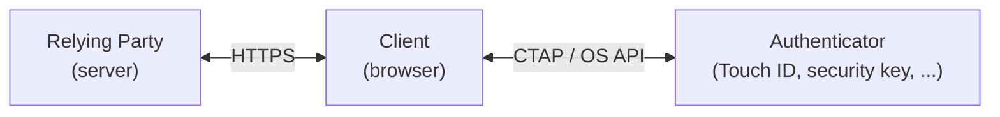
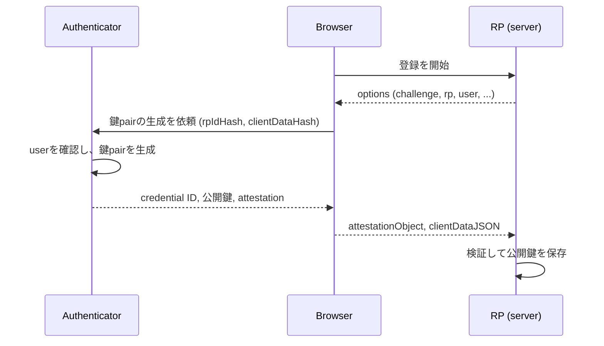
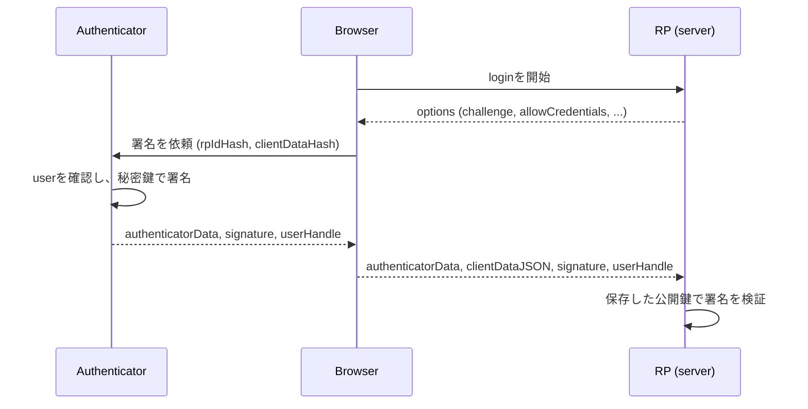

WebAuthn (Web Authentication) は、**公開鍵暗号でuserを認証するためのbrowser API**。W3Cが仕様を定めている。
serverは公開鍵だけを持ち、秘密鍵は端末 (authenticator) の外に出ない。
署名の対象にはoriginが含まれるので、偽siteで認証しても本物のsiteでは使えない。
passwordの漏洩とphishingの2つをまとめて潰せるのが最大の利点。

このノートで扱うのは次の5つ。

- 登場人物と、phishingに強い理由
- 登録 (registration) の流れとserverでの検証
- 認証 (authentication) の流れとserverでの検証
- passkeyとdiscoverable credential
- attestation、RP ID、運用上の注意

## 前提知識

- 公開鍵暗号と電子署名の基本 (秘密鍵で署名し、公開鍵で検証する)
- JavaScriptのPromiseと `ArrayBuffer`
- cookie sessionによるlogin状態の管理

## コンセプト

### FIDO2の中での位置

WebAuthnはFIDO Allianceの規格群FIDO2の一部で、2つの仕様に分かれている。

- WebAuthn: Web pageとbrowserの間のAPI (`navigator.credentials.create()` / `get()`)。W3C
- CTAP (Client to Authenticator Protocol): browserとsecurity keyやスマホの間のprotocol。FIDO Alliance

Web開発者が触るのはWebAuthnだけで、CTAPはbrowserとOSが面倒を見る。

### 登場人物



- Relying Party (RP): 認証を求めるWeb service。challengeを発行し、署名を検証する
- Client: browser。originを確かめ、RPとauthenticatorの間を取り持つ
- Authenticator: 鍵pairを生成し、秘密鍵で署名する装置

authenticatorは2種類ある。

- platform authenticator: 端末に組み込まれたもの。Touch ID / Face ID、Windows Hello、Androidの画面lock
- roaming authenticator: 端末の外にあるもの。USB、NFC、BLEでつなぐsecurity key (YubiKeyなど)。PCのbrowserからQR codeを読ませてスマホで認証するhybrid transportも、スマホがroaming authenticatorとして振る舞う形

### credentialはRPごとに作られる

authenticatorはRPごと、accountごとに別の鍵pairを作る。
これをpublic key credentialと呼び、IDとしてcredential IDが付く。

鍵pairはRP ID (通常はsiteのdomain、`example.com` など) に紐づく。
`example.com` 用のcredentialは、`examp1e.com` からは呼び出せない。
同じauthenticatorを複数のsiteで使っても、site同士で鍵を突き合わせてuserを追跡することはできない。

### phishingに強い理由

passwordやOTPは、userが偽siteに入力した値を攻撃者がそのまま本物のsiteへ中継できる。
WebAuthnでは中継が成り立たない仕組みが2重にある。

1. browserが、pageのoriginとRP IDの関係を確かめる。`evil.example` のpageは `example.com` のcredentialを要求できない
2. browserが作る `clientDataJSON` にoriginが入り、authenticatorの署名はこれを覆う。中継された署名にはserverが期待するのと違うoriginが入っている

userが見た目に騙されても、browserが騙されない限り認証は成立しない。
人間の注意力に頼らないのがOTPとの本質的な違い。

serverが持つのは公開鍵だけなので、DBが漏れても他のsiteで使い回される情報はない。

### user presenceとuser verification

authenticatorが確かめる「userがいること」には2段階ある。

- user presence (UP): 誰かがその場で操作した (security keyに触れた)。本人かどうかは問わない
- user verification (UV): 本人であることをauthenticatorが確かめた (指紋、顔、PIN)

UVを要求すると、WebAuthn 1回で「持っているもの」と「本人であること」の2要素を満たせる。
passkeyでpasswordを置き換える場合はUVが前提になる。

<Hint level="info">
  生体情報はauthenticatorの中で照合され、RPには届かない。RPが受け取るのは「UVが行われた」というflagだけ。
</Hint>

## 登録 (registration)

WebAuthnの仕様は、登録と認証のやり取りをceremonyと呼ぶ。



### browser側

```javascript
const credential = await navigator.credentials.create({
  publicKey: {
    challenge, // serverが生成したrandomなbyte列 (ArrayBuffer)
    rp: { id: "example.com", name: "Example" },
    user: {
      id: userHandle, // accountを表すrandomなbyte列。emailなど個人情報は入れない
      name: "alice@example.com",
      displayName: "Alice",
    },
    pubKeyCredParams: [
      { type: "public-key", alg: -7 }, // ES256
      { type: "public-key", alg: -8 }, // EdDSA
      { type: "public-key", alg: -257 }, // RS256
    ],
    authenticatorSelection: {
      residentKey: "required", // discoverable credential (passkey) を作る
      userVerification: "preferred",
    },
    excludeCredentials, // 登録済みのcredential ID。同じauthenticatorへの二重登録を防ぐ
    attestation: "none",
    timeout: 300_000,
  },
});
```

`alg` の数値はCOSE (CBOR Object Signing and Encryption) のalgorithm ID。
ES256は全authenticatorが対応しているので必ず入れる。RS256はWindows Helloの古い実装向け。

戻り値の `credential.response` (`AuthenticatorAttestationResponse`) をserverに送る。

- `clientDataJSON`: browserが作ったJSON。`type`、`challenge`、`origin` が入る
- `attestationObject`: authenticatorが作ったCBOR。認証器データ (`authData`) とattestation文 (`attStmt`) が入る

`getPublicKey()`、`getTransports()` などのhelperもあり、CBORを自前でparseしなくても公開鍵を取り出せる。

<Hint level="warn">
  optionsのbyte列 (`challenge`、`user.id`、credential ID) は `ArrayBuffer` で渡す必要があり、JSONのままでは送れない。
  base64urlで運び、両端で変換するのが定番。
  WebAuthn Level 3の `PublicKeyCredential.parseCreationOptionsFromJSON()` と `credential.toJSON()` を使えば、この変換をbrowserに任せられる。
</Hint>

### clientDataJSON

```javascript
{
  "type": "webauthn.create",
  "challenge": "dGhpcyBpcyBhIGNoYWxsZW5nZQ", // base64url
  "origin": "https://example.com",
  "crossOrigin": false
}
```

serverはこれを**文字列のまま**検証する。
authenticatorが署名するのはこのJSONのSHA-256なので、parseして組み直すとhashが合わなくなる。

### authenticator data

authenticator dataはbinaryのstructで、登録と認証の両方に出てくる。

| offset | 長さ | 内容 |
| --- | --- | --- |
| 0 | 32 | `rpIdHash`: RP IDのSHA-256 |
| 32 | 1 | `flags` |
| 33 | 4 | `signCount`: 署名counter (big endian) |
| 37 | 可変 | attested credential data (登録時のみ) |
| … | 可変 | extensionsの出力 (ある場合のみ) |

flagsの各bitの意味。

| bit | 名前 | 意味 |
| --- | --- | --- |
| 0 | UP | user presence |
| 2 | UV | user verification |
| 3 | BE | backup eligible: このcredentialは同期 (backup) されうる |
| 4 | BS | backup state: 現にbackupされている |
| 6 | AT | attested credential dataがある |
| 7 | ED | extensionsの出力がある |

```javascript
const view = new DataView(authData.buffer, authData.byteOffset);
const flags = view.getUint8(32);
const up = (flags & 0x01) !== 0;
const uv = (flags & 0x04) !== 0;
const signCount = view.getUint32(33); // big endian
```

attested credential dataは、AAGUID (authenticatorの機種を表す16 byte)、credential IDの長さ (2 byte)、credential ID、COSE形式の公開鍵が順に並ぶ。

### serverでの検証

1. `clientDataJSON.type` が `"webauthn.create"` である
2. `clientDataJSON.challenge` が、このsessionで発行したchallengeと一致する。照合したらchallengeは破棄する
3. `clientDataJSON.origin` が自siteのoriginと一致する
4. `attestationObject` をCBORとしてparseし、`authData` を取り出す
5. `rpIdHash` がRP IDのSHA-256と一致する
6. UPが立っている。UVを必須にしたならUVも立っている
7. 公開鍵のalgorithmが `pubKeyCredParams` で許したものである
8. (attestationを要求したなら) `attStmt` を検証する
9. credential IDが他のuserに登録済みでない

通ったら次の値を保存する。

- credential ID (検索に使うのでindexを張る)
- 公開鍵 (COSE形式のまま保存してよい)
- `signCount`
- transports (`getTransports()` の値。認証時に `allowCredentials` へ載せる)
- BE、BSのflag、AAGUID (UIで「iCloud Keychainのpasskey」のように表示するのに使える)
- user handle (`user.id`) とaccountの対応

<Hint level="warn">
  この手順を自前で書くのは避け、検証済みのlibraryを使うのがよい。
  SimpleWebAuthn (TypeScript)、webauthn-rs (Rust)、java-webauthn-server (Yubico) やWebAuthn4J (Java/Kotlin) など。
  CBORのparse、COSE鍵の変換、attestation形式ごとの検証は細かい落とし穴が多い。
</Hint>

## 認証 (authentication)



### browser側

```javascript
const assertion = await navigator.credentials.get({
  publicKey: {
    challenge,
    rpId: "example.com",
    allowCredentials: [], // 空ならdiscoverable credentialから選ばせる
    userVerification: "preferred",
    timeout: 300_000,
  },
});
```

username入力後に認証する流れなら、そのuserのcredential IDを `allowCredentials` に並べる。
passkeyでusernameなしにloginさせるなら空にする。

戻り値の `assertion.response` (`AuthenticatorAssertionResponse`) には次が入る。

- `clientDataJSON`: `type` が `"webauthn.get"` になる以外は登録時と同じ
- `authenticatorData`: attested credential dataを含まない (ATが立たない)
- `signature`: 署名
- `userHandle`: 登録時の `user.id`。discoverable credentialでは必ず返る

### 署名の対象

authenticatorが署名するのは次のbyte列。

```
authenticatorData || SHA-256(clientDataJSON)
```

`authenticatorData` にRP IDのhashが、`clientDataJSON` にchallengeとoriginが入っているので、1つの署名が「どのsiteの」「どのrequestへの」「どのoriginからの」応答かをすべて縛る。

ES256の署名はASN.1 DERで符号化されている。
Web Cryptoの `crypto.subtle.verify()` は生の `r || s` (64 byte) を期待するので、自前で検証するなら変換が要る。

### serverでの検証

1. `assertion.id` (credential ID) で保存済みのcredentialを引く。`allowCredentials` を指定したなら、その中の1つである
2. `userHandle` があれば、そのcredentialの持ち主と一致する
3. `clientDataJSON.type` が `"webauthn.get"`、`challenge`、`origin` が期待通り
4. `rpIdHash`、UP、(必要なら) UVを確かめる
5. 保存した公開鍵で `signature` を検証する
6. `signCount` を確かめ、保存値を更新する

### 署名counter

authenticatorは署名のたびに `signCount` を増やす。
保存値以下の値が来たら、authenticatorが複製された疑いがある。

ただし同期されるpasskeyは複数の端末で同じ鍵を使うので、counterは常に0を返すのが普通。
0のまま変わらない場合は検査を飛ばし、増えるauthenticatorでだけ巻き戻りを検出する。
巻き戻りを検出してもloginを拒否するかは方針次第で、警告やlogに留めることが多い。

## passkey

### discoverable credential

credentialには2種類ある。

- non-discoverable credential: authenticatorは鍵を保存しない。credential IDの中に暗号化した秘密鍵を詰めておき、RPから渡されたIDを復号して署名する。RPがcredential IDを `allowCredentials` で渡さないと使えない
- discoverable credential (旧称resident key): authenticatorが鍵とuser情報を保存する。RPが何も渡さなくても、authenticatorが候補を出せる

usernameを打たずにloginできるのはdiscoverable credentialだから。
security keyは保存領域が小さく、discoverable credentialを作れる数に上限がある。

### passkeyとは

passkeyはdiscoverable credentialの通称で、FIDO Allianceと大手OS vendorが広めた呼び名。
中でもiCloud Keychain、Google Password Manager、1Passwordなどが**端末間で同期するもの** (synced passkey) を指すことが多い。
1台の端末に閉じたもの (security keyの中など) はdevice-bound passkeyと呼ぶ。

flagsのBEとBSで区別できる。

| BE | BS | 意味 |
| --- | --- | --- |
| 0 | 0 | device-bound。その端末を失うと使えなくなる |
| 1 | 0 | 同期可能だが、まだbackupされていない |
| 1 | 1 | 同期済み |

BEは登録後に変わらない。BSは変わりうるので、認証のたびに保存値を更新する。

同期によって「端末をなくすとloginできない」というWebAuthn初期の最大の弱点が解消された。
代わりに、秘密鍵がcloud accountの安全性に依存するようになった。
「鍵が端末の外に出ない」は、synced passkeyでは「鍵がvendorの同期基盤の外に出ない (end-to-end暗号化)」に読み替える。

### conditional UI (autofill)

usernameの入力欄に、保存されているpasskeyを候補として出す仕組み。

```
<input type="text" name="username" autocomplete="username webauthn" />
```

```javascript
if (await PublicKeyCredential.isConditionalMediationAvailable?.()) {
  const assertion = await navigator.credentials.get({
    mediation: "conditional",
    publicKey: { challenge, rpId: "example.com" },
  });
  // userがautofillの候補からpasskeyを選んだときにresolveする
}
```

page表示時に `get()` を呼んでおくと、modal dialogを出さずに待機し、userが候補を選んだときだけ認証が走る。
passkeyを持たないuserにはふつうのusername欄として見えるので、passwordとpasskeyを1つのformで並存させられる。

## attestation

attestationは、**authenticatorの機種を製造元の鍵で証明する仕組み**。
「この公開鍵は、YubiKey 5の中で生成された」ことをRPが確かめられる。

`attestation` optionで要求の強さを選ぶ。

- `"none"`: 要らない (default)
- `"indirect"`: あれば欲しいが、clientが匿名化してもよい
- `"direct"`: authenticatorのattestationをそのまま欲しい
- `"enterprise"`: 個体を識別できるattestationが欲しい。管理された端末向け

形式 (`fmt`) は `packed`、`tpm`、`android-key`、`apple`、`fido-u2f`、`none` など。
検証には機種ごとのroot証明書が要り、FIDO Metadata Service (MDS) から取得できる。

一般向けのsiteでは `"none"` でよい。
機種を制限してもuserの選択肢が減るだけで、phishing耐性はattestationなしでも変わらない。
同期されるpasskeyはattestationを返さないことが多い。
社内systemで「会社が配ったsecurity keyだけを許す」といった要件があるときに使う。

## RP ID

RP IDはcredentialのscopeを決めるdomain。
originのhostそのものか、その**registrable domain suffix** (親domain) でなければならない。

- originが `https://login.example.com` なら、RP IDに `login.example.com` と `example.com` を使える
- `com` (public suffix) や `other.com` は使えない
- 省略するとoriginのhostになる

RP IDを親domainにしておくと、`login.example.com` で作ったpasskeyを `www.example.com` でも使える。
後から変えると既存のcredentialが使えなくなるので、最初に決めておくべき値。

<Hint level="info">
  `example.com` と `example.co.jp` のように親domainが違うsiteで同じpasskeyを使いたい場合は、WebAuthn Level 3のRelated Origin Requestsを使う。
  RP IDのdomainで `/.well-known/webauthn` にJSONを置き、許可するoriginを列挙する。
</Hint>

## 運用上の注意

### challenge

- CSPRNGで16 byte以上を生成する
- serverのsession (または有効期限付きの保存先) に置き、1回照合したら捨てる
- clientから送られたchallengeを信じない。必ずserverが発行したものと比べる

### account recovery

WebAuthnが強くても、recoveryがemailのlinkだけならaccountの強さはemailと同じになる。

- 1 accountに複数のcredentialを登録できるようにし、2つ目の登録を促す
- passkeyを登録した直後にpasswordを消させない
- credentialごとに名前、作成日時、最終使用日時を表示し、userが自分で削除できるようにする

### WebAuthnが守らないもの

- XSS: 自siteのoriginで任意のscriptが動けば、そのscriptから `navigator.credentials.get()` を呼べる (UVのpromptは出る)
- login後のsession: 守られるのは認証の瞬間だけ。session cookieを盗まれれば同じこと
- 端末の乗っ取り: OSが侵害されていればauthenticatorとのやり取りも信用できない

## 発展

- extensions: `credProps` (discoverable credentialになったかを返す)、`prf` (credentialから対称鍵を導出し、end-to-end暗号化の鍵に使う)、`largeBlob` (credentialに小さなdataを保存する)、`appid` (旧FIDO U2Fのcredentialを使い続ける)
- Signal API (Level 3): `PublicKeyCredential.signalUnknownCredential()` などで、server側で削除したcredentialやuser名の変更をpassword managerに伝える
- CTAP 2.x: browserとauthenticatorの間のprotocol。PIN/UVの扱い、hybrid transportのcaBLE (Cloud-assisted BLE)
- Digital Credentials API: 運転免許証などの身元証明をbrowserから提示するAPI。WebAuthnと同じ `navigator.credentials` に載る

## 参考

- W3C, _Web Authentication: An API for accessing Public Key Credentials Level 3_。仕様本体。登録と認証の検証手順 (§7) が番号付きで書かれている
- FIDO Alliance, _Client to Authenticator Protocol (CTAP)_。authenticator側のprotocol
- passkeys.dev。passkey実装のguideと、OS・browserごとの対応表
- webauthn.guide。登録と認証の流れを図とcodeで追える入門
- Adam Langley, "A Tour of WebAuthn" (2023)。仕様の背景、CTAP、attestationまで掘り下げた解説
- SimpleWebAuthn。TypeScriptのserver/browser library。検証手順の実装を読むのにも向く
